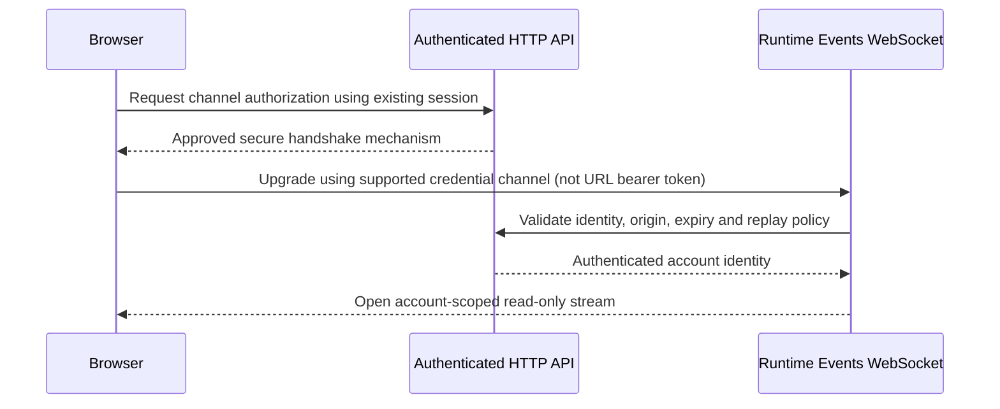

# Learning Curriculum — Cross-Layer Implementation Backlog

> Purpose: track shared design, infrastructure, service/backend, persistence and integration prerequisites discovered while applying learning tasks to the real TCE Dashboard. This is not a claim that every item below is already a confirmed defect; items marked **NEEDS AUDIT** must be verified against current source/configuration before implementation.

Use the shared contract in [Implementation Readiness Gate](../IMPLEMENTATION_READINESS.md). Prefer one item per shared system gap and link all lessons that depend on it.

## Status legend

- **NEEDS AUDIT** — inspect source/configuration and collect evidence before deciding.
- **READY** — prerequisites and acceptance criteria are confirmed.
- **BLOCKED** — evidence shows a missing dependency; include an explicit unblock condition.
- **IN PROGRESS / VERIFIED** — use only when implementation or verification evidence exists.

## Cross-layer items

### CURR-ARCH-01 — Map learning exercises to the real TCE architecture

- **Priority:** P0
- **Status:** VERIFIED — source mapping completed for the five Day 9–13 lesson files present in `docs/learning/`
- **Last source recheck:** 2026-10-30 against current master `53b70f907eb24462db207269ddc2092e9c6563c3` after PR #961 merged.
- **Evidence:** [TCE Dashboard learning-to-source architecture map](../architecture-map.md), refreshed against current master; Day 10 quote validation is in `apps/web/lib/market-price-validation.ts`, pool-read cancellation is in `apps/web/lib/stock-dividend-pool-store.ts`, and stock-event cancellation is in `apps/web/lib/stock-event-store.ts` plus `apps/web/lib/app-data-worker.ts`. Telegram notification read cancellation is in `apps/web/lib/telegram-notification-data.ts` and the notifications list/detail/config consumers.
- **Boundary:** This verifies source-path/ownership mapping only. It does not mark Day 10–13 runtime requirements complete, and explicitly leaves WebSocket auth (`CURR-AUTH-07`), live schema/RLS/migration provenance (`CURR-DATA-04`), infra deployment details, and Day 13 profiling as unresolved.
- **Affected lessons:** Day 9–13 currently present in `docs/learning/`; link other curriculum days when their files are added/found.
- **Verified result:** The architecture map traces each existing Day 9–13 lesson to actual routes/components, API/store owners, service/event boundaries, and explicit N/A or unresolved layers. Missing Day 1–8 files remain tracked separately under `CURR-CATALOG-06`.
- **Maintenance:** Update the map when a source owner, route, API contract, event cursor, or readiness decision changes; re-verify every referenced path against the current base branch.
- **Acceptance:** MET for the five existing Day 9–13 files only: each lesson has source-backed entry points and affected layers, irrelevant layers are marked N/A with a reason, and unresolved contracts are explicit. Day 1–8 are not claimed reviewed.
- **Verification:** Referenced paths/symbols, the Day 9 architecture-map link, Day 10 validator, pool-read lifecycle, stock-event lifecycle and Telegram notification read helper were checked against master `6b3beb5`. PR #957 exact head `052c301ad522d98802a13e88ed48c6a48c636de7` passed WF-01P #41024683065, WF-02 #41024683023 and WF-05 #41024682994 before merge. The available connector did not surface post-merge status for merge SHA `6b3beb5`; no separate master push check or production deployment is claimed.

### CURR-INFRA-02 — Verify infrastructure prerequisites for service-level exercises

- **Priority:** P1
- **Status:** NEEDS AUDIT
- **Affected lessons:** Day 9–13 where a lesson introduces SSR, API transport, streams, caching, or profiling.
- **Gap to verify:** Document which exercises require only browser-local work and which require backend, deployment, network, secrets/configuration, or observability changes.
- **Work:** Inspect the current workflow, container/deployment manifests and runtime configuration relevant to each exercise. Do not change live infrastructure as part of this audit.
- **Acceptance:** Every infrastructure-affecting task has an environment scope, configuration owner, health/rollback check, and an explicit statement about whether deployment was actually verified.
- **Unblock condition:** Current manifests/workflows and ownership have been inspected and evidence is attached to the task/PR.

### CURR-SVC-03 — Verify service/API/event contracts before frontend-only implementation

- **Priority:** P0
- **Status:** NEEDS AUDIT
- **Affected lessons:** Day 10 REST cancellation; Day 11 realtime/recovery; Day 12 snapshot/event merge; Day 13 performance diagnosis.
- **Gap to verify:** Confirm actual endpoint and event producers/consumers, auth scope, versioning, timeout/retry behavior, cancellation semantics, event identity/order/cursor, and recovery source before modifying clients.
- **Verified slices (2026-10-30; not full acceptance):** PR #953 merged dividend-pool cancellation, generation guards, safe errors and worker signal forwarding. PR #955 merged stock-event cancellation, stale-response protection, safe errors and worker signal forwarding at `d79404e`. PR #955 exact-head frontend build run 41013983958, Prettier run 41013984089 and backend/root tests run 41013983940 passed; master checks 41014092643, 41014092714 and 41014092678 also passed. Tests are in `stock-dividend-pool-store.spec.ts`, `stock-event-store.spec.ts` and `app-data-worker.spec.ts`. `CURR-SVC-03` remains open because every API/event caller and end-to-end contract has not been audited.
- **Merged bounded slice (PR #957; merge `6b3beb546409358cf9cc1a8f000a4527f02255ab`):** `apps/web/lib/telegram-notification-data.ts` forwards a shared `AbortSignal` to existing Telegram bot/assignment GETs; notifications list/detail/config consumers abort on cleanup and guard stale commits. `apps/web/lib/telegram-notification-data.spec.ts` covers signal forwarding and response normalization. Exact PR head `052c301ad522d98802a13e88ed48c6a48c636de7` passed WF-01P #41024683065, WF-02 #41024683023 and WF-05 #41024682994 before merge. Post-merge status was not surfaced by the available connector, so it remains unverified. This is one bounded client read-lifecycle slice, not proof that all API callers or end-to-end contracts are audited.
- **Merged bounded slice (PR #961; merge `53b70f907eb24462db207269ddc2092e9c6563c3`):** `EngineControlPanel.tsx` now owns an `AbortController` for engine status/configuration GETs, passes the same signal through `apps/web/lib/engine-control-data.ts`, aborts on effect cleanup/restart and blocks stale state/loading commits. `engine-control-data.spec.ts` covers signal sharing, aborting both pending reads and empty payload normalization. Exact PR head `ec240d8662597b3982263fe74b7071a76a26e735` passed WF-01P #41030892797, WF-02 #41030892857 and WF-05 #41030892904 (253 passed, 0 failed). Post-merge status for `53b70f9` was not surfaced; no production deployment is claimed. `CURR-SVC-03` remains open.
- **Work:** Trace existing service handlers and frontend consumers; write down contract gaps only where source evidence demonstrates them.
- **Acceptance:** No lesson claims end-to-end behavior based only on a client hook, mock, type, or unit test. Required service changes have an identified owner and integration test path.
- **Unblock condition:** Relevant producer and consumer contracts are located and the intended behavior is agreed/documented.

### CURR-DATA-04 — Verify persistence and versioning assumptions

- **Priority:** P1
- **Status:** NEEDS AUDIT
- **Affected lessons:** Day 11–12 and any exercise requiring durable replay, snapshot/event ordering, deduplication, or cache reconciliation.
- **Gap to verify:** Establish whether required IDs, versions, timestamps, cursors and persistence guarantees exist today; do not assume database changes are necessary or safe.
- **Work:** Inspect current data models, schema/migrations, RLS, and service contracts. Record whether the exercise can use existing contracts or needs a separately planned change.
- **Acceptance:** Stale-snapshot rejection and recovery behavior have a documented source-of-truth/version rule and deterministic tests. Any schema/RLS change has its own compatibility, security and rollback review.
- **Unblock condition:** Current persistence and ordering guarantees are verified; unresolved guarantees become a specific follow-up item.

### CURR-VERIFY-05 — Add end-to-end evidence to implementation completion

- **Priority:** P0
- **Status:** READY
- **Affected lessons:** All learning lessons.
- **Work:** Apply the readiness checklist; choose verification proportional to impact: unit/component, API/contract, integration, build/CI, deployment/runtime, and performance profiling as applicable.
- **Acceptance:** Completion reports separate implemented, integrated, CI-verified, environment-verified and production-verified states; no claim exceeds the evidence.
- **Safety:** Do not use a live order, production schema mutation, or production rollout as a test fixture.

### CURR-CATALOG-06 — Reconcile curriculum file inventory

- **Priority:** P1
- **Status:** BLOCKED
- **Affected lessons:** Day 1–13 curriculum inventory.
- **Evidence:** The repository's `docs/learning/` directory on the audited branch contains Day 9, Day 10, Day 11, Day 12 and Day 13 lesson files only. The first eight day-specific Markdown files are not present in that directory listing at the time of this audit.
- **Work:** Locate the canonical Day 1–8 lesson source or restore/create those files from the authoritative curriculum before claiming all 13 lesson files have been reviewed. Do not fabricate lesson content or mark missing files reviewed.
- **Acceptance:** A checked-in index lists the canonical path for each Day 1–13 lesson and links the readiness gate; all listed files exist.
- **Unblock condition:** The canonical source for Day 1–8 is located or the owner confirms they should be created anew.

### CURR-AUTH-07 — Establish a secure browser WebSocket authentication handshake

- **Priority:** P1
- **Status:** BLOCKED
- **Affected lessons:** Day 11 realtime/recovery and Day 12 cache/stream integration.
- **Evidence:** In master, `apps/web/lib/api.ts` attaches the in-memory access token only to Axios requests; the browser WebSocket constructor in the unmerged PR #936 did not carry an Authorization header. `apps/service/src/runtime-events/runtime-events.websocket.ts` accepts a Bearer header or a cookie that it introspects through `AUTH_SERVICE_URL`. The auth refresh cookie is configured with `Path=/api/auth`; the actual socket host/path cookie scope has not been verified. An authenticated HTTP preflight does not authenticate a later WebSocket upgrade.
- **Work:** Inspect the real production host, reverse-proxy route, cookie domain/path/SameSite settings, and browser session lifecycle. Choose and document a secure handshake compatible with browser WebSocket APIs before implementing the frontend quote stream. Consider a verified same-origin HttpOnly cookie contract or a short-lived, single-use channel credential transported outside the URL; do not put access/refresh bearer tokens in URLs.
- **Acceptance:** The design has a sequence diagram and identifies credential issuer, transport, expiry/replay protection, origin validation, account binding, logging/redaction, and rollback. An integration test proves the actual browser-to-socket identity path, rejects unauthenticated/expired/replayed credentials and disallowed origins, and proves the client cannot select another account. No stream is marked integrated based only on a successful HTTP preflight or mocked WebSocket.
- **Unblock condition:** Deployment routing and cookie scope are verified, the handshake design is reviewed, and the integration-test owner/environment are identified. Any persistence or schema needed for one-time credentials gets a separate readiness review.

**Proposed handshake sequence — design target only; not implemented:**

## Day-specific follow-up

- **Day 13 performance:** `PERF-13-01` actual consumer/source map is complete via PR #952 and recorded in [Day 13 performance implementation backlog](day13-performance-profiling-implementation-backlog.md). The next gates are a reproducible `PERF-13-02` baseline and `PERF-13-03` measurable correctness/performance acceptance before any optimization.
- **Day 9–12:** Add specific items only when source inspection demonstrates a concrete missing contract, service capability, infrastructure requirement, or test harness. Avoid speculative migrations and duplicate backlog entries.
