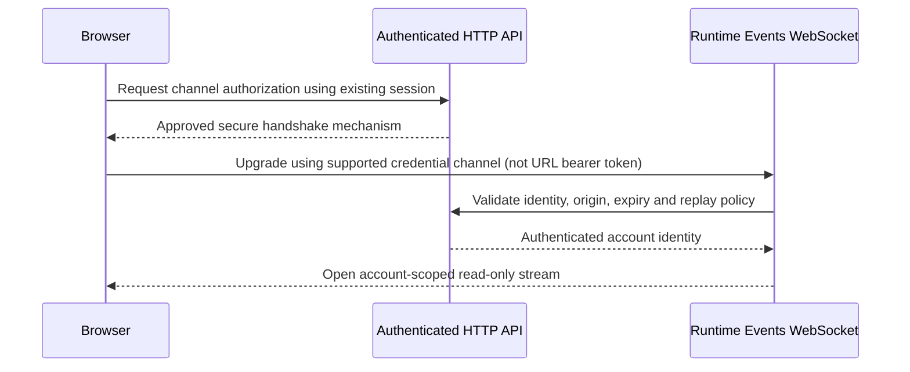

# Learning Curriculum — Cross-Layer Implementation Backlog

> Purpose: track shared design, infrastructure, service/backend, persistence and integration prerequisites discovered while applying learning tasks to the real TCE Dashboard. This is not a claim that every item below is already a confirmed defect; items marked **NEEDS AUDIT** must be verified against current source/configuration before implementation.

Use the shared contract in [Implementation Readiness Gate](../IMPLEMENTATION_READINESS.md). Prefer one item per shared system gap and link all lessons that depend on it.

## Status legend

- **NEEDS AUDIT** — inspect source/configuration and collect evidence before deciding.
- **READY** — prerequisites and acceptance criteria are confirmed.
- **BLOCKED** — evidence shows a missing dependency; include an explicit unblock condition.
- **IN PROGRESS / VERIFIED** — use only when implementation or verification evidence exists.

## Cross-layer items

### CURR-ARCH-01 — Map learning exercises to the real TCE architecture

- **Priority:** P0
- **Status:** VERIFIED — source mapping completed for the five Day 9–13 lesson files present in `docs/learning/`
- **Last source recheck:** 2026-10-31 against source baseline `171541ae67246c3aae264f05a2950bf9f56c7c54`, after PR #994 merged app-data worker safe-error logging. PR #985/#986 account-isolation evidence remains recorded below.
- **Evidence:** [TCE Dashboard learning-to-source architecture map](../architecture-map.md), refreshed from source baseline `171541ae67246c3aae264f05a2950bf9f56c7c54`; Day 10 quote validation is in `apps/web/lib/market-price-validation.ts`, pool-read cancellation is in `apps/web/lib/stock-dividend-pool-store.ts`, stock-event cancellation is in `apps/web/lib/stock-event-store.ts` plus `apps/web/lib/app-data-worker.ts`, and identified frontend stock-event readers use `STOCK_EVENTS_READ_LIMIT = 200`. Engine Workflow runtime-read cancellation is in `apps/web/app/settings/engine/EngineWorkflowScreen.tsx` via `apps/web/lib/engine-runtime-data.ts`. Dividend OHLCV chart-read cancellation is in `apps/web/components/dashboard/DividendOneYearCandleChart.tsx` and `apps/web/lib/dividend-ohlcv-store.ts`; it forwards an effect-owned signal, resets loading on cancellation, fences stale results after clear/reload, and normalizes errors. `StockEventsService` retains its existing 200-row cap as `MAX_LIMIT`; PRs #976/#978/#981 do not change endpoint/auth/account-scope contracts, engine writes, repository selection or scanner behavior. PR #975's watcher traffic guard is a separate service-file change already in master.
- **Latest bounded evidence:** PR #985 merges Engine Runtime cache abort/generation fencing and wires `useEngineRuntimeStore.clear()` into `clearAccountScopedStores()`. PR #986 keys `TelegramBotConfig` by `useAuthStore.user.id`, so account changes remount the local subtree and trigger its existing request cleanup. Both PRs passed exact-head build/Prettier/unit checks; post-merge status queries returned no records, so remain WARN.
- **Boundary:** This verifies source-path/ownership mapping and bounded account-isolation slices only. It does not mark Day 10–13 runtime requirements complete, and leaves WebSocket auth (`CURR-AUTH-07`), snapshot/event ordering and live schema/RLS/migration provenance (`CURR-DATA-04`), infra deployment details, and Day 13 profiling unresolved.
- **Affected lessons:** Day 9–13 currently present in `docs/learning/`; link other curriculum days when their files are added/found.
- **Verified result:** The architecture map traces each existing Day 9–13 lesson to actual routes/components, API/store owners, service/event boundaries, and explicit N/A or unresolved layers. Missing Day 1–8 files remain tracked separately under `CURR-CATALOG-06`.
- **Maintenance:** Update the map when a source owner, route, API contract, event cursor, or readiness decision changes; re-verify every referenced path against the current base branch.
- **Acceptance:** MET for the five existing Day 9–13 files only: each lesson has source-backed entry points and affected layers, irrelevant layers are marked N/A with a reason, and unresolved contracts are explicit. Day 1–8 are not claimed reviewed.
- **Verification:** The architecture map and current source paths were rechecked against master `66da3a008ba055ee3551dc520c12952ec58164b5`. PR #983 final head `5941d5aecaccb2aae4bc9928d4fb73aa709f369e` passed WF-01P `41077247885`, WF-02 `41077248228`, and WF-05 `41077247826`; four new Node tests passed and the suite reported 275 Node tests passed / 0 failed. Post-merge WF-02 `41077445106` and WF-05 `41077444913` passed; post-merge WF-01 `41077445107` completed successfully (image/config verification only; not deployment). No live rollout is claimed.

### CURR-INFRA-02 — Verify infrastructure prerequisites for service-level exercises

- **Priority:** P1
- **Status:** NEEDS AUDIT
- **Affected lessons:** Day 9–13 where a lesson introduces SSR, API transport, streams, caching, or profiling.
- **Gap to verify:** Document which exercises require only browser-local work and which require backend, deployment, network, secrets/configuration, or observability changes.
- **Work:** Inspect the current workflow, container/deployment manifests and runtime configuration relevant to each exercise. Do not change live infrastructure as part of this audit.
- **Acceptance:** Every infrastructure-affecting task has an environment scope, configuration owner, health/rollback check, and an explicit statement about whether deployment was actually verified.
- **Unblock condition:** Current manifests/workflows and ownership have been inspected and evidence is attached to the task/PR.

### CURR-SVC-03 — Verify service/API/event contracts before frontend-only implementation

- **Priority:** P0
- **Status:** NEEDS AUDIT
- **Affected lessons:** Day 10 REST cancellation; Day 11 realtime/recovery; Day 12 snapshot/event merge; Day 13 performance diagnosis.
- **Gap to verify:** Confirm actual endpoint and event producers/consumers, auth scope, versioning, timeout/retry behavior, cancellation semantics, event identity/order/cursor, and recovery source before modifying clients.
- **Verified slices (2026-10-30; not full acceptance):** PR #953 merged dividend-pool cancellation, generation guards, safe errors and worker signal forwarding. PR #955 merged stock-event cancellation, stale-response protection, safe errors and worker signal forwarding at `d79404e`. PR #955 exact-head frontend build run 41013983958, Prettier run 41013984089 and backend/root tests run 41013983940 passed; master checks 41014092643, 41014092714 and 41014092678 also passed. Tests are in `stock-dividend-pool-store.spec.ts`, `stock-event-store.spec.ts` and `app-data-worker.spec.ts`. `CURR-SVC-03` remains open because every API/event caller and end-to-end contract has not been audited.
- **Merged bounded slice (PR #957; merge `6b3beb546409358cf9cc1a8f000a4527f02255ab`):** `apps/web/lib/telegram-notification-data.ts` forwards a shared `AbortSignal` to existing Telegram bot/assignment GETs; notifications list/detail/config consumers abort on cleanup and guard stale commits. `apps/web/lib/telegram-notification-data.spec.ts` covers signal forwarding and response normalization. Exact PR head `052c301ad522d98802a13e88ed48c6a48c636de7` passed WF-01P #41024683065, WF-02 #41024683023 and WF-05 #41024682994 before merge. Post-merge status was not surfaced by the available connector, so it remains unverified. This is one bounded client read-lifecycle slice, not proof that all API callers or end-to-end contracts are audited.
- **Merged bounded slice (PR #961; merge `53b70f907eb24462db207269ddc2092e9c6563c3`):** `EngineControlPanel.tsx` now owns an `AbortController` for engine status/configuration GETs, passes the same signal through `apps/web/lib/engine-control-data.ts`, aborts on effect cleanup/restart and blocks stale state/loading commits. `engine-control-data.spec.ts` covers signal sharing, aborting both pending reads and empty payload normalization. Exact PR head `ec240d8662597b3982263fe74b7071a76a26e735` passed WF-01P #41030892797, WF-02 #41030892857 and WF-05 #41030892904 (253 passed, 0 failed). Post-merge status for `53b70f9` was not surfaced; no production deployment is claimed. `CURR-SVC-03` remains open.
- **Merged bounded slice (PR #963; merge `086d5370f80128e20683dc792f3f02c7608015e3`):** `apps/web/components/dashboard/BinanceRealtimeChart.tsx` now aborts its public Binance kline-history fetch when the effect is disposed or its inputs change. `apps/web/lib/binance-kline-history.ts` owns the request URL/query and forwards the signal; `binance-kline-history.spec.ts` covers query bounds, signal propagation/abort, and HTTP 429 handling. Exact PR head `d18f18464a4b8ed151fbc2a6b304f56e126821b2` passed WF-01P `41037561091`, WF-02 `41037561173`, and WF-05 `41037561127`; the three new Node tests passed and Vitest reported 23 files / 101 tests passed. Post-merge status for `086d537` remains unverified. `CURR-SVC-03` remains open.
- **Merged bounded slice (PR #965; merge `ff274e77bcd5d6c835654b96423342061a3d0df2`):** `BinanceXauTradingPanel.tsx` now aborts its existing config/Telegram-bot reads on effect cleanup and account identity changes, clears account-local view state before reloading, and aborts the position poll on account/environment cleanup. Polls are sequential, so slow reads do not stack. `api.ts` forwards optional signals to the existing config/position GETs while preserving the environment header; `binance-xau-position-data.ts` retains the existing open-position selection rule. Tests in `binance-xau-position-data.spec.ts` cover signal/environment forwarding, selection, empty/malformed responses and intentional cancellation; `dashboard-cancellation.spec.ts` verifies the Axios signals and testnet header. Exact PR head `8726c7f4d0287e50fab42a60dbb1826761314c53` passed WF-01P `41045939056`, WF-02 `41045938623`, WF-05 `41045938628`; post-merge master `ff274e77bcd5d6c835654b96423342061a3d0df2` passed WF-01 `41046146755`, WF-02 `41046146855` and WF-05 `41046146842`. WF-01 verifies images/config/YAML only; no deployment is claimed. `CURR-SVC-03` remains open.
- **Merged bounded slice (PR #969; merge `5c193ff4da29ba895bca36a54cc927500b1068b9`):** `apps/web/components/dashboard/DividendPositionsView.tsx` starts the read through `apps/web/lib/stock-event-read-lifecycle.ts` and aborts its effect-owned signal on cleanup. `stock-event-read-lifecycle.spec.ts` covers the refresh arguments and cleanup; existing `stock-event-store.spec.ts` covers transport cancellation, waiter behavior and stale-response protection. Exact PR head `9b67809a932cf46e7f9ac1e7d6263904616314a4` passed WF-01P `41048947556`, WF-02 `41048947517`, WF-05 `41048947521` and WF-11 `41048947442`. Post-merge status for `5c193ff` remains unverified. Source inspection found the caller requested 2000 while the service clamps to 200; this mismatch was resolved by the separate PR #976 contract-alignment slice.
- **Merged bounded contract-alignment slice (PR #976; merge `4431264eea50c8adba67a6ca6160ea17a4fddc26`):** `STOCK_EVENTS_READ_LIMIT = 200` is used by the stock-event store default, DividendPositionsView, DashboardViews, the app-data worker and stock-events page. `StockEventsService` names its existing cap `MAX_LIMIT = 200` without changing behavior. `stock-event-read-lifecycle.spec.ts` asserts the shared request limit; new `stock-events.service.spec.ts` verifies oversized requests clamp to 200 and a valid 120-row request passes through. Exact-head WF-01P `41054054969`, WF-02 `41054054925`, WF-05 `41054054987` (24 Vitest files / 103 Vitest tests plus 263 Node tests) and WF-11 `41054054923` passed. Post-merge status for `4431264` remains unverified; `CURR-SVC-03` stays open for broader caller/end-to-end audit.
- **Merged bounded slice (PR #978; merge `ef40e664662b9df9c55c2cb30b54b4dabc3e4077`):** `dashboardApi.engineRuntime(signal?)` forwards an optional AbortSignal; `apps/web/lib/engine-runtime-data.ts` normalizes the existing response collection; `EngineWorkflowScreen.tsx` aborts on effect cleanup/superseding reads, ignores stale/cancelled outcomes and displays normalized safe errors. `engine-runtime-data.spec.ts` covers signal forwarding, malformed response shape, in-flight cancellation and an already-aborted signal. Exact PR head `58694a8241862aa2c1cc2a75f36ccf40691c0104` passed WF-01P `41060920532`, WF-02 `41060920537`, and WF-05 `41060920340`; WF-05 logs include all four new Node tests and 24 Vitest files / 103 tests passed. Post-merge status for `ef40e664` remains unverified; no production deployment is claimed. `CURR-SVC-03` remains open for broader caller and end-to-end contract audit.
- **Merged bounded slice (PR #981; merge `dc11adc6aaa73436857512173d4f26a2a7b027a9`):** `DividendOneYearCandleChart.tsx` now aborts its existing one-year history GET on effect cleanup or symbol change. `dividend-ohlcv-store.ts` links the caller signal to the API request, resets loading on cancellation, fences stale results after clear/reload, and uses `normalizeApiError` for safe errors. `dividend-ohlcv-store.spec.ts` verifies signal forwarding/data normalization, cancellation state, stale-result rejection and safe error fallback. Exact PR head `27ab1b9ea98f55286869d3fe21931dd55c442f8b` passed WF-01P `41069139823`, WF-02 `41069139440`, and WF-05 `41069139458`; four new Node tests passed, 271 Node tests passed / 0 failed, and Vitest reported 24 files / 103 tests passed. Post-merge status for `dc11adc` remains unverified; `CURR-SVC-03` remains open for broader caller/end-to-end contract audit. No production deployment is claimed.
- **Merged bounded safe-error slice (PR #983; merge `66da3a008ba055ee3551dc520c12952ec58164b5`):** `apps/web/lib/stock-sync-store.ts` now routes refresh/save/trigger failures through the existing `normalizeApiError` helper instead of surfacing arbitrary `Error.message` text. `stock-sync-store.spec.ts` adds four Node regression tests: safe 403 refresh, safe 500 save, safe 403 trigger, and a non-Axios fallback. Exact PR head `5941d5aecaccb2aae4bc9928d4fb73aa709f369e` passed WF-01P `41077247885`, WF-02 `41077248228`, and WF-05 `41077247826`; 275 Node tests passed / 0 failed. Post-merge WF-02 `41077445106` and WF-05 `41077444913` passed; WF-01 `41077445107` completed successfully (image/config verification only; not deployment). This changes only user-facing error selection; request/auth/write/cron contracts remain unchanged. `CURR-SVC-03` remains open.
- **Merged bounded Telegram cache/error slice (PR #990; merge `2255b263fe0d5b7670ec51de21cc7dd70a41f1c4`):** `NotificationsPage` now requires both bot and debug-assignment cache arrays before using the cache, reloads both through the existing authenticated GETs when either is missing, ignores intentional cancellation, and shows a normalized safe error plus Retry rather than a false empty state. `TelegramBotConfig` shares the same cache-completeness predicate. `telegram-notification-data.spec.ts` verifies complete/partial cache values, safe HTTP 500 messaging and generic fallback without internal details. Exact PR head `65e9e99241110a6b8a567844f2efab2384fe86f1` passed WF-01P `41087370680`, WF-02 `41087370830`, and WF-05 `41087370764`. Post-merge status for `2255b26` remains WARN/unverified; `CURR-SVC-03` remains open for the broader caller/end-to-end contract audit.
- **Merged bounded safe-logging slice (PR #994; merge `171541ae67246c3aae264f05a2950bf9f56c7c54`):** `apps/web/lib/app-data-worker.ts` now passes worker task failures through the existing `normalizeApiError` contract and logs only allow-listed failure kind/message/retryability/optional HTTP status instead of the raw Axios error. This preserves task failure counting and scheduling while preventing request headers and arbitrary backend response bodies from being serialized into logs. `apps/web/lib/app-data-worker.spec.ts` uses a synthetic bearer token and private response body, verifies both remain absent, asserts the controlled safe message/retryability/status, and confirms failures are still counted. Exact PR head `7989c82675ef556d426fd2fa1f3d35db83c74118` passed WF-01P `41111968892`, WF-02 `41111968970`, and WF-05 `41111968847`; Vitest reported 24 files / 103 tests passed. Post-merge WF-02 `41112463811` and WF-05 `41112463921` passed; WF-01 `41112463838` remained in progress at the latest audit snapshot. This does not complete `CURR-SVC-03`: the broader API/event caller and end-to-end contract audit remains open, and no production deployment is claimed.
- **Review of previous test-only PRs (2026-10-30):** PR #938 and PR #939 each changed only `apps/web/lib/dashboard-cancellation.spec.ts`. Current `apps/web/lib/store.ts` supplies the actual cancellation/version guards and normalized market-price sync logging; the tests verify runtime behavior but are not substitutes for it.
- **Work:** Trace existing service handlers and frontend consumers; write down contract gaps only where source evidence demonstrates them.
- **Acceptance:** No lesson claims end-to-end behavior based only on a client hook, mock, type, or unit test. Required service changes have an identified owner and integration test path.
- **Unblock condition:** Relevant producer and consumer contracts are located and the intended behavior is agreed/documented.

### CURR-DATA-04 — Verify persistence and versioning assumptions

- **Priority:** P1
- **Status:** NEEDS AUDIT
- **Affected lessons:** Day 11–12 and any exercise requiring durable replay, snapshot/event ordering, deduplication, or cache reconciliation.
- **Gap to verify:** Establish whether required IDs, versions, timestamps, cursors and persistence guarantees exist today; do not assume database changes are necessary or safe.
- **Work:** Inspect current data models, schema/migrations, RLS, and service contracts. Record whether the exercise can use existing contracts or needs a separately planned change.
- **Merged bounded account-isolation slice (PR #985; merge `550580915819da4704c16d119e80d9ea9d2d99d4`):** `engine-runtime-store.ts` aborts the pending authenticated GET, increments a generation fence and ignores late responses; `clearAccountScopedStores()` now clears that store. `engine-runtime-store.spec.ts` and `account-cache-isolation.spec.ts` cover abort/stale response and logout/account-switch clearing. Exact-head WF-01P `41080028709`, WF-02 `41080028776`, and WF-05 `41080028739` passed; post-merge status remains unverified.
- **Merged bounded local-UI isolation slice (PR #986; merge `05fc77704b2af8c87a2ed89693e9da41b04126bb`):** `TelegramBotConfig.tsx` keys its local subtree to the authenticated user ID, discarding old-account form/bot/assignment state and running existing read cleanup on identity changes. `telegram-bot-config-account.spec.ts` verifies distinct account keys; exact-head WF-01P `41081363037`, WF-02 `41081363112`, and WF-05 `41081362999` passed. Post-merge status remains unverified. These slices do not establish a universal snapshot watermark or reconciliation rule; keep `CURR-DATA-04` NEEDS AUDIT.
- **Merged bounded notification-list local UI isolation slice (PR #992; merge `c44dbb58d33379fa53fefcad1958be0fc52c5636`):** `NotificationsPage` now keys `NotificationsPageContent` by authenticated user ID through `telegramNotificationAccountKey()`. A key change discards prior bot/assignment/loading/error state and runs the existing effect cleanup to abort the pending paired read. `telegram-notification-account.spec.ts` verifies account-key uniqueness and anonymous handling. Exact PR head `f9548b0db91e04677e715a9992f7d235e34a2e58` passed WF-01P `41095290873`, WF-02 `41095290861`, and WF-05 `41095290859`; the test log confirms the new test ran. Post-merge unit tests `41095470305` and image/config/YAML verification `41095470277` passed; auto-format-on-push `41095470165` remained in progress at the audit snapshot, so overall post-merge verification remains WARN. This is local UI lifecycle isolation only and does not establish server authorization, snapshot/event ordering, or replay/reconciliation; keep `CURR-DATA-04` NEEDS AUDIT.
- **Acceptance:** Stale-snapshot rejection and recovery behavior have a documented source-of-truth/version rule and deterministic tests. Any schema/RLS change has its own compatibility, security and rollback review.
- **Unblock condition:** Current persistence and ordering guarantees are verified; unresolved guarantees become a specific follow-up item.

### CURR-VERIFY-05 — Add end-to-end evidence to implementation completion

- **Priority:** P0
- **Status:** READY
- **Affected lessons:** All learning lessons.
- **Work:** Apply the readiness checklist; choose verification proportional to impact: unit/component, API/contract, integration, build/CI, deployment/runtime, and performance profiling as applicable.
- **Acceptance:** Completion reports separate implemented, integrated, CI-verified, environment-verified and production-verified states; no claim exceeds the evidence.
- **Safety:** Do not use a live order, production schema mutation, or production rollout as a test fixture.

### CURR-CATALOG-06 — Reconcile curriculum file inventory

- **Priority:** P1
- **Status:** BLOCKED
- **Affected lessons:** Day 1–13 curriculum inventory.
- **Evidence:** The repository's `docs/learning/` directory on the audited branch contains Day 9, Day 10, Day 11, Day 12 and Day 13 lesson files only. The first eight day-specific Markdown files are not present in that directory listing at the time of this audit.
- **Inventory recheck (2026-10-31):** GitHub repository-content queries confirmed that root `curriculum/` and `roadmap/` paths do not exist (404), and the current `docs/learning/` listing contains the five Day 9–13 lesson files plus audit/readiness and backlog documents. `CURR-CATALOG-06` remains BLOCKED until the authoritative Day 1–8 source is found or the owner explicitly authorizes creating those lessons.
- **Work:** Locate the canonical Day 1–8 lesson source or restore/create those files from the authoritative curriculum before claiming all 13 lesson files have been reviewed. Do not fabricate lesson content or mark missing files reviewed.
- **Acceptance:** A checked-in index lists the canonical path for each Day 1–13 lesson and links the readiness gate; all listed files exist.
- **Unblock condition:** The canonical source for Day 1–8 is located or the owner confirms they should be created anew.

### CURR-AUTH-07 — Establish a secure browser WebSocket authentication handshake

- **Priority:** P1
- **Status:** BLOCKED
- **Affected lessons:** Day 11 realtime/recovery and Day 12 cache/stream integration.
- **Evidence:** In master, `apps/web/lib/api.ts` attaches the in-memory access token only to Axios requests; the browser WebSocket constructor in the unmerged PR #936 did not carry an Authorization header. `apps/service/src/runtime-events/runtime-events.websocket.ts` accepts a Bearer header or a cookie that it introspects through `AUTH_SERVICE_URL`. The auth refresh cookie is configured with `Path=/api/auth`; the actual socket host/path cookie scope has not been verified. An authenticated HTTP preflight does not authenticate a later WebSocket upgrade.
- **Adjacent merged change (PR #966; merge `48e38425510d0703c731abc593b82215add0e599`):** `apps/web/lib/keycloak-sso.ts` now reads a non-empty string `message` from failed session-exchange responses and otherwise uses status-specific fallback text for 401/403/other errors. PR #966 passed exact-head WF-01P/WF-02/WF-05, but it changed only this file and added no dedicated frontend regression spec. This is user-facing SSO error reporting, not browser WebSocket upgrade authentication; `CURR-AUTH-07` remains BLOCKED.
- **Merged adjacent change (PR #970; merge `7bf367b6a21c7e2831880f94a7befebeff377f9a`):** `apps/web/lib/keycloak-sso.ts` now distinguishes a browser fetch/network/CORS failure at the Keycloak token endpoint from one at the central Auth session exchange and uses safe stage-specific messages. Exact master push workflows WF-02 `41073127601`, WF-05 `41073127613`, and WF-01 `41073127688` passed. This improves diagnostics only, changes no browser WebSocket handshake, and does not satisfy the `CURR-AUTH-07` unblock condition.
- **Work:** Inspect the real production host, reverse-proxy route, cookie domain/path/SameSite settings, and browser session lifecycle. Choose and document a secure handshake compatible with browser WebSocket APIs before implementing the frontend quote stream. Consider a verified same-origin HttpOnly cookie contract or a short-lived, single-use channel credential transported outside the URL; do not put access/refresh bearer tokens in URLs.
- **Acceptance:** The design has a sequence diagram and identifies credential issuer, transport, expiry/replay protection, origin validation, account binding, logging/redaction, and rollback. An integration test proves the actual browser-to-socket identity path, rejects unauthenticated/expired/replayed credentials and disallowed origins, and proves the client cannot select another account. No stream is marked integrated based only on a successful HTTP preflight or mocked WebSocket.
- **Unblock condition:** Deployment routing and cookie scope are verified, the handshake design is reviewed, and the integration-test owner/environment are identified. Any persistence or schema needed for one-time credentials gets a separate readiness review.

**Proposed handshake sequence — design target only; not implemented:**

## Day-specific follow-up

- **Day 13 performance:** `PERF-13-01` actual consumer/source map is complete via PR #952 and recorded in [Day 13 performance implementation backlog](day13-performance-profiling-implementation-backlog.md). The next gates are a reproducible `PERF-13-02` baseline and `PERF-13-03` measurable correctness/performance acceptance before any optimization.
- **Day 9–12:** Add specific items only when source inspection demonstrates a concrete missing contract, service capability, infrastructure requirement, or test harness. Avoid speculative migrations and duplicate backlog entries.
