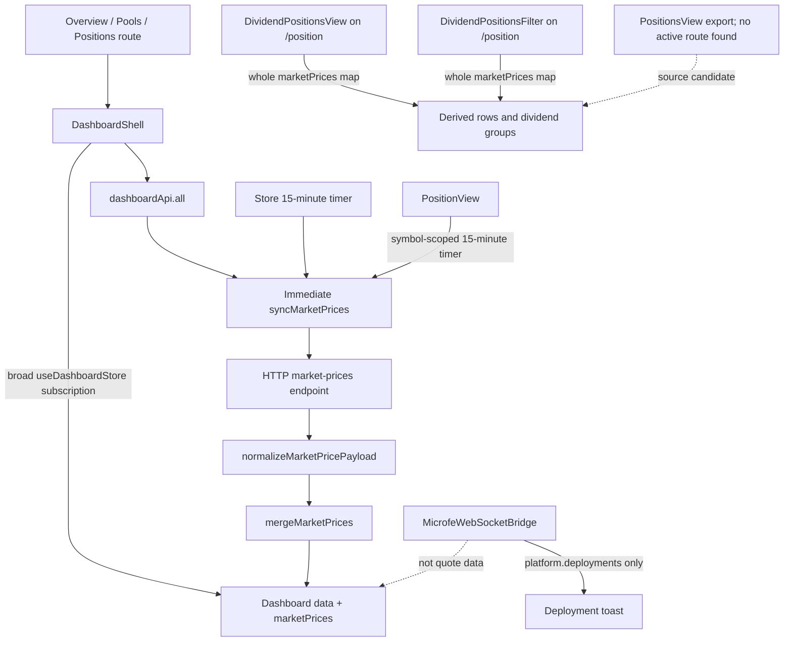

# Day 13 — Performance Profiling Implementation Backlog

Status: **PERF-13-01 source map complete; runtime optimization not started pending measured baseline**
Source lesson: [Day 13 — Performance Profiling](../senior-frontend-day-13-performance-profiling.md)
Scope: TCE Dashboard frontend performance, with correctness-preserving changes only.

## Audit summary

The lesson is useful as a learning guide, but it is **not yet a complete implementation-ready feature specification**. It contains illustrative React/Zustand snippets and a profiling workflow, but it does not identify the exact production route/component call sites, define measurable baselines and acceptance thresholds, or provide an executable test/performance harness.

The source-backed call-site map is now complete for the visible dashboard routes:

- `apps/web/components/dashboard/DashboardShell.tsx` subscribes to the whole `useDashboardStore()` state via `const { data, loading, error, load } = useDashboardStore()`; this broad subscription makes the shell sensitive to market-price updates.
- `apps/web/lib/store.ts` stores quotes in `marketPrices: Record<string, MarketPrice>` keyed by normalized symbol. `syncMarketPrices` merges accepted quotes into the map and calls `mergeMarketPrices`, which maps `positions`, `currentPositions`, and `pools`.
- `PositionsView`, `DividendPositionsView`, and `DividendPositionsFilter` subscribe to the entire `marketPrices` map, not to a single symbol. `DividendPositionsView` and `DividendPositionsFilter` include the whole map in expensive derived grouping dependencies.
- Dashboard quote refresh is HTTP polling. `DashboardShell.load` fetches the dashboard snapshot, triggers an immediate price sync, and starts a 15-minute store timer. Positions-related views also trigger symbol-scoped syncs and 15-minute timers. Because all call the same action, overlapping syncs can abort one another; this is a profiling candidate, not a confirmed defect.
- `MicrofeWebSocketBridge` subscribes to `platform.deployments` notifications; it is not the market-quote stream.
- Visible `useTCEDataStore` consumers select `engines`, `telegramBots`, or `telegramAssignments`. No direct UI selector of the cached `dashboard` field was found in the inspected consumers; confirm repository-wide usage before removing the prefetch because the cache may have indirect consumers.
- The source shows plausible repeated work: the shell's broad subscription, quote-driven array/row cloning in `mergeMarketPrices`, whole-map selectors, duplicated dashboard prefetch, and multiple pollers. **None is declared the dominant bottleneck until a real profile confirms it.**

References:

- `apps/web/lib/store.ts`
- `apps/web/lib/tce-data-store.ts`
- `docs/learning/senior-frontend-day-12-normalization-cache.md`
- `docs/learning/senior-frontend-day-13-performance-profiling.md`

## P0 — Required before changing runtime behavior

### PERF-13-01 — Map real dashboard rendering call sites

- [x] Trace the actual overview/watchlist/positions/pools components that consume `useDashboardStore` and `useTCEDataStore`.
- [x] Record each subscription selector and whether it reads `data`, `marketPrices`, or broad store slices.
- [x] Confirm whether updates to `marketPrices` cause components to subscribe to the whole map or to individual symbols.
- [x] Identify actual row components, list keys, derived calculations, and any duplicated quote-to-position/pool mapping.
- [x] Record the current refresh/event source for each screen; do not assume WebSocket behavior without tracing the code.
- **Acceptance:** source-backed map completed below with exact file paths/selectors. Runtime performance remains unmeasured; no optimization is authorized by this mapping alone.

### Verified source map — 2026-10-30

**Dashboard snapshot and quote update path**

- `apps/web/app/overview/page.tsx` renders `DashboardShell view="overview"` with `OverviewView`.
- `apps/web/app/pools/page.tsx` renders `DashboardShell view="pools"` with `PoolsView`; `apps/web/app/pool/page.tsx` renders `PoolEngineView`.
- `apps/web/app/position/page.tsx` renders `DividendPositionsView` with `DividendPositionsFilter`. `PositionsView` is exported from `DashboardViews.tsx` and subscribes to the whole quote map, but no active App Router page referencing that export was found; treat it as an unmounted candidate until a route consumer is verified.
- `DashboardShell.tsx:57` subscribes broadly to `useDashboardStore()` and passes derived `data` plus actions into the child render function.
- `store.ts:263-269` loads the dashboard snapshot and immediately syncs prices. `store.ts:272-278` starts a 15-minute store timer. `store.ts:292-324` validates requested-symbol quotes, updates `marketPrices`, and merges quote values into dashboard rows. `mergeMarketPrices` maps all three arrays; for rows with a quote it returns a new object even if the price is unchanged.
- `DashboardViews.tsx:238-239` (`PositionsView`, exported but no active route consumer found), `DividendPositionsView.tsx:25-26`, and `DividendPositionsFilter.tsx:32` subscribe to the whole `marketPrices` map. The active `/position` dividend views derive grouped events using that map; their symbol-scoped refresh timers are also 15 minutes.
- `DashboardViews.tsx`: `OverviewView` slices four positions/three pools and sums P&L; `PoolsView` builds capital-pool metrics and maps up to nine positions and twelve decision rows. Row keys use `row.id ?? row.symbol ?? index`; capital pools use `pool.pool`.
- `DividendPositionsView.tsx`: groups events by month/symbol, finds a matching pool for each card, and keys cards by `${group.monthKey}:${item.symbol}`. `DividendPositionsFilter.tsx` recomputes month groups/candidate counts from events, filters and the whole quote map.
- `PoolEngineView.tsx`: consumes `data` props rather than a quote selector; maps capital pools by `pool.pool`, positions and decision rows by `row.id ?? row.symbol ?? index`. It can still rerender through the broad `DashboardShell` subscription.
- `apps/web/app/providers.tsx`: `MicrofeWebSocketBridge` subscribes to `platform.deployments` and shows deployment notifications; this is not the quote-update source.
- `tce-data-store.ts` is a prefetch cache. Inspected UI consumers use narrow selectors for `engines`, `telegramBots`, and `telegramAssignments`; the visible dashboard quote flow is owned by `useDashboardStore`.

**Readiness decision:** GO for this source-map task; **NO-GO for PERF-13-04/05/06 runtime optimization until PERF-13-02 and PERF-13-03 are satisfied**. A UI mock, ERD, and deployment swimlane are N/A: this task changes no visual behavior, persistent entity, or deployment workflow.

### PERF-13-02 — Establish a reproducible baseline

- [ ] Define a deterministic scenario using mocked/replay data; do not submit live orders or alter trading settings.
- [ ] Record route, browser/device, build mode, number of symbols/positions/pools, and exact interaction.
- [ ] Capture React Profiler and browser Performance traces.
- [ ] Record commits, expensive components, scripting duration, long tasks, and layout/paint observations where applicable.
- [ ] Separate development profiling from production-like measurements.
- **Acceptance:** baseline results are reproducible and saved in the PR description or a non-sensitive engineering note; no fabricated metrics.

### PERF-13-03 — Define performance and correctness acceptance criteria

- [ ] Choose thresholds only after measuring the baseline and agreeing on the target device/use case.
- [ ] Require a measurable improvement in the identified bottleneck, not only a lower render count.
- [ ] Require unchanged final quote values, list ordering, selection/focus behavior, freshness display, and error/loading behavior.
- [ ] Confirm no changes to authentication/account scoping, API contracts, trading strategy, execution, schedules, or Supabase schema.
- **Acceptance:** PR lists before/after evidence and all relevant correctness checks.

## P1 — Implement the smallest evidence-backed improvement

### PERF-13-04 — Narrow market-data subscriptions where proven beneficial

- [ ] Based on PERF-13-01/02, replace broad subscriptions only at verified expensive call sites with selectors for the smallest required stable value.
- [ ] Use the existing `marketPrices` symbol-key contract unless code/API evidence proves a different canonical key.
- [ ] Preserve reference identity for unchanged quote entities where the store implementation permits it.
- [ ] Avoid introducing a new state library or duplicating canonical market data.
- [ ] Do not copy the lesson's `quotesBySymbol` example verbatim: it does not match the current `marketPrices` store shape.
- **Acceptance:** profiler evidence shows the targeted unrelated work is reduced; visible behavior and data values remain correct.

### PERF-13-05 — Isolate high-frequency rows only when profiling supports it

- [ ] Identify real quote/position/pool row components and their prop/state dependencies.
- [ ] Introduce or refine component boundaries only where the profile shows meaningful repeated work.
- [ ] Consider `React.memo` only when stable props and measured render cost justify it.
- [ ] Keep selectors and callbacks correct; do not introduce stale closures or stale derived values.
- **Acceptance:** a focused diff with a documented reason for each memoization/boundary change and before/after evidence.

### PERF-13-06 — Avoid broad object rebuilding when it is a measured bottleneck

- [ ] Inspect the cost of `mergeMarketPrices`, which maps over positions/currentPositions/pools when applying quote updates.
- [ ] Determine whether those arrays are large/frequently rebuilt and whether consumers render expensively as a result.
- [ ] If material, design a minimal immutable update that preserves unchanged row references while keeping all views consistent.
- [ ] Do not change domain models or normalized-state contracts without a separate migration/design note.
- **Acceptance:** equivalent quote propagation to all intended views; unchanged rows retain identity where designed; tests cover all affected collections.

## P1 — Verification

### PERF-13-07 — Add tests for the chosen optimization

- [ ] Add tests for selector/update behavior using the repository's existing test framework and conventions.
- [ ] Verify a quote update changes the intended row and does not change unrelated quote values.
- [ ] Verify dashboard positions/currentPositions/pools still receive the correct market price where applicable.
- [ ] Verify loading, empty, and error states are unchanged.
- [ ] Avoid tests that only assert an implementation detail such as an exact render count unless it is stable and necessary.
- **Acceptance:** relevant tests pass and cover the user-visible behavior and state invariants.

### PERF-13-08 — Add a deterministic profiling/replay recipe

- [ ] Document the exact route, dataset fixture, replay command or manual steps, and profiler capture steps.
- [ ] Ensure the recipe uses mocked/non-trading data and cannot trigger order execution.
- [ ] Store only non-sensitive profile artifacts; do not commit account data, credentials, or production payloads.
- **Acceptance:** another developer can reproduce the scenario and compare results without access to live trading state.

## P2 — Evaluate only if the evidence warrants it

### PERF-13-09 — Evaluate virtualization for genuinely large lists

- [ ] Measure DOM node count, scroll behavior, and row-render cost first.
- [ ] Check current dependencies and existing list patterns before choosing a library.
- [ ] Preserve stable keys, keyboard navigation, focus, selection, responsive layout, and accessibility.
- **Acceptance:** virtualization is adopted only if the measured gain outweighs interaction/accessibility complexity.

### PERF-13-10 — Evaluate presentation coalescing for high-frequency quote updates

- [ ] Trace the actual quote event/update path and define whether intermediate values are safely replaceable for display.
- [ ] Keep transport recovery, sequence/gap detection, domain reducers, positions, risk, execution, audit, and reconciliation processing independent from UI render cadence.
- [ ] Never silently drop domain events to reduce React commits.
- [ ] Verify freshness indicators and final canonical state using deterministic replay.
- **Acceptance:** presentation work is reduced without losing required domain transitions or showing stale data as fresh.

## Implementation sequence and guardrails

1. Complete PERF-13-01 and PERF-13-02 before selecting an optimization.
2. Complete PERF-13-03 before coding the runtime change.
3. Implement one focused P1 item per change and collect before/after evidence.
4. Add tests for the selected behavior; test coverage alone is not a substitute for implementing the runtime behavior.
5. Use a dedicated branch, run the relevant lint/typecheck/test/build commands, review the diff, and open a PR. Squash-merge only after the applicable checks and review are satisfactory.
6. Do not change Supabase schema, authentication/session behavior, market schedules, strategy, or live execution as part of this performance lesson.
7. If profiling shows no meaningful user-facing bottleneck, document the result and do not add complexity merely to reduce render counts.

## Definition of Done

- [x] Actual production component/store paths are documented.
- [ ] A reproducible baseline and a measured bottleneck exist.
- [ ] A focused runtime implementation addresses that bottleneck.
- [ ] Tests cover correctness and regressions.
- [ ] Before/after measurements are included.
- [ ] Relevant lint/typecheck/test/build checks pass, or any unrelated failure is explicitly documented.
- [ ] No trading, auth, API, schedule, or database behavior changed unintentionally.
