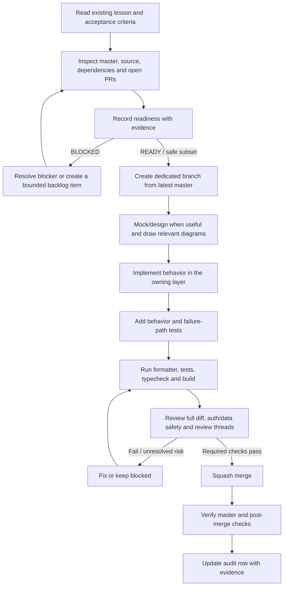
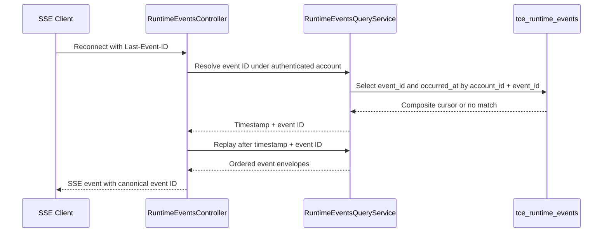

# Senior Frontend Learning — Implementation Audit & Readiness

**Audit date:** 2026-10-30  
**Repository:** `phanthienquoc/TCE-dashboard`  
**Audited master:** `41b0afa91ebaa201564620a9278a131306642329`  
**Standard:** [Implementation Readiness Gate](IMPLEMENTATION_READINESS.md)  
**Shared backlog:** [Cross-layer curriculum backlog](backlog/curriculum-implementation-backlog.md)

This is an evidence-backed snapshot. It does not claim that unmeasured runtime behavior is complete or that production was verified.

## 1. System Readiness Check

- **Scope and criteria — PASS:** reviewed all five Day 9–13 lesson files, the shared readiness gate, and both implementation backlogs.
- **Default branch/base — PASS:** repository default branch is `master`; audited SHA is `41b0afa91ebaa201564620a9278a131306642329`.
- **PR overlap — WARN:** [PR #936](https://github.com/phanthienquoc/TCE-dashboard/pull/936) was closed without merge. It was stale, had a failing Prettier check, and introduced a WebSocket quote client without a verified browser-to-socket auth handshake. Its branch is reference only. [PR #946](https://github.com/phanthienquoc/TCE-dashboard/pull/946) is a bounded SSE resume-cursor task awaiting CI.
- **Source/dependencies — PASS with gaps:** master contains the centralized API/auth client, cancellation-aware dashboard reads, runtime-event REST/SSE controller, persisted event query service, and read-only WebSocket adapter. The frontend quote-stream implementation from PR #936 is not on master.
- **Working-tree safety — WARN:** dedicated branches are used. A local working-tree snapshot is not observable through the GitHub connector.
- **Build/test baseline — WARN:** no check runs were exposed for the audited master SHA. Historical PR #936 frontend build, backend tests and mobile viewport contract passed, but Prettier failed. Those results do not validate unmerged code. PR #946 must pass CI before merge.
- **Infrastructure/deployment — N/A:** this audit made no deployment or live service mutation. Verify actual service health and routing before runtime rollout.
- **Secrets/permissions — N/A:** no secret values were read or changed. Verify the actual credential path before any socket-auth implementation.
- **Database/migrations — PASS for cursor design:** existing `tce_runtime_events` has `event_id` as primary key and includes `account_id` and `occurred_at`. The SSE cursor task requires no schema change. Live schema drift was not queried.
- **Production risk/rollback — WARN:** no production deployment is authorized. Auth, RLS, schema, live execution and schedule changes require their own readiness check and rollback plan.

### Readiness decisions

- **GO:** documentation/readiness maintenance and the bounded SSE `Last-Event-ID` change in PR #946, subject to CI and diff review.
- **NO-GO:** merging PR #936 as-is. It combines Days 9–12, diverges from master, has a failing Prettier check, and has no verified browser-to-WebSocket identity transfer. An HTTP preflight does not authenticate the later WebSocket handshake.
- **NO-GO:** Day 13 runtime optimization until a reproducible profile identifies a real bottleneck.
- **BLOCKED:** frontend quote streaming from PR #936 until a secure socket-auth handshake is designed and integration-tested. Never put bearer tokens in a URL.

## 2. Audit matrix — existing Day 9–13 lessons

| Lesson | Status | Master evidence | Remaining work | PR status |
|---|---|---|---|---|
| Day 9 — Next.js | PARTIAL | `layout.tsx`, `overview/page.tsx`, `providers.tsx`, `DashboardShell`, `api.ts` | Map ownership and auth/cache boundaries before any SSR migration. | Readiness docs merged in #944. |
| Day 10 — REST/errors | PARTIAL | `api-errors.ts`, `store.ts`, `tce-data-store.ts`, related specs | Audit every relevant read caller for cancellation, stale-response and safe error state. | Existing code is on master; #936 closed unmerged. |
| Day 11 — realtime | PARTIAL | `microfe-ws.ts`, `runtime-events.websocket.ts`, `runtime-events.controller.ts`, query service | Verify SSE resume fix in #946; keep frontend quote stream blocked until socket auth is proven. | #946 open; #936 closed unmerged. |
| Day 12 — cache | PARTIAL | `store.ts`, `tce-data-store.ts`, `tce-event.contract.ts` | Confirm entity identity and snapshot/event ordering from real contracts; do not invent a global watermark. | Readiness docs merged in #944. |
| Day 13 — profiling | BLOCKED | Lesson and dedicated profiling backlog | Trace actual selectors, capture repeatable baseline, then define measured acceptance criteria before optimizing. | Backlog merged in #944; no runtime optimization claimed. |

### Day 9 — Next.js architecture

- **Source:** `apps/web/app/layout.tsx`, `apps/web/app/overview/page.tsx`, `apps/web/app/providers.tsx`, `DashboardShell`, and `apps/web/lib/api.ts`.
- **Readiness:** PARTIALLY READY. Do not migrate authenticated fetching to Server Components without an explicit session, freshness, loading/error, and deployment design.
- **Verification:** relevant route/build coverage exists; this audit did not introduce a runtime change.

### Day 10 — REST, errors, cancellation

- **Source:** `apps/web/lib/api-errors.ts`, `apps/web/lib/api.ts`, `apps/web/lib/store.ts`, and `apps/web/lib/tce-data-store.ts`.
- **Tests:** `api-errors.spec.ts` covers safe error normalization; `tce-data-store.spec.ts` verifies clear/abort prevents late data from repopulating the store.
- **Readiness:** PARTIALLY IMPLEMENTED. Several read methods support `AbortSignal`, but this does not prove every relevant caller does. Check each checklist item against the owning store and caller.

### Day 11 — WebSocket, SSE, replay and backpressure

- **Source:** `apps/web/lib/microfe-ws.ts` has bounded reconnect backoff; `apps/service/src/runtime-events/runtime-events.websocket.ts` has account-scoped replay cursors and a bounded outbound buffer. REST replay is ordered by `occurred_at,event_id`.
- **Tests:** existing controller/query tests cover account scope, cursor validation and event envelopes. PR #946 adds focused SSE resume tests.
- **Readiness:** PARTIALLY IMPLEMENTED. PR #946 resolves `Last-Event-ID` within the authenticated account and resumes with the composite cursor; await CI and merge verification. The platform deployment socket is not the canonical runtime-event consumer. The frontend quote stream in PR #936 remains blocked on socket authentication.

### Day 12 — normalization and cache

- **Source:** `store.ts` contains dashboard state, market-price data, request guards and pool normalization. `tce-event.contract.ts` supports optional aggregate-scoped sequences, not a universal global sequence.
- **Tests:** existing runtime-event query and contract tests validate account-scoped replay and event envelopes.
- **Readiness:** PARTIALLY READY. Confirm canonical entity keys, cache ownership and snapshot/event ordering from actual producer contracts. Account-switch/logout cleanup and stale-event recovery need integration evidence. No schema/RLS change is justified by this audit.

### Day 13 — performance profiling

- **Source:** `store.ts`, `tce-data-store.ts`, and dashboard components are investigation entry points; the dominant bottleneck was not measured in this run.
- **Acceptance:** comparable before/after profiles and unchanged data/UI behavior are required.
- **Readiness:** BLOCKED for runtime optimization. Complete PERF-13-01/02/03 in the [Day 13 backlog](backlog/day13-performance-profiling-implementation-backlog.md) before selecting a change. Do not add memoization or virtualization speculatively.

### Curriculum inventory

The audited directory contains Day 9–13 lesson files plus the readiness standard and backlogs. Day 1–8 lesson files were not present in the inspected listing. This is tracked as `CURR-CATALOG-06`; do not fabricate content or claim the missing lessons were reviewed.

## 3. Mandatory task lifecycle

## 4. Design artifacts by task type

- Cross-module/service change: architecture/component diagram.
- API, auth, WebSocket, SSE or async lifecycle: sequence diagram.
- Persistence, relations or cache identity: ERD/data model.
- Multi-owner workflow or deployment: swimlane.
- State transitions, retry/recovery or UI behavior: flow/state machine.
- Complex validation or deterministic branching: pseudocode.
- User-visible UI behavior: mock/prototype or component-state table when it improves reviewability.

Diagrams must match real contracts and source. Label unknowns instead of inventing guarantees. A mock is a design artifact, not evidence that runtime behavior exists.

### SSE resume sequence — PR #946, pending CI

## 5. Completion evidence

A lesson is complete only when the audit row identifies:

1. Exact acceptance criteria from the existing MD.
2. Source paths and behavior on `master`.
3. Tests for success, failure, race and recovery paths as relevant.
4. Relevant diagrams/mock and why they match implementation.
5. Readiness results and warnings/blockers.
6. PR URL, squash-merge SHA, CI/post-merge evidence, and deployment evidence only if deployment occurred.

Tests-only changes do not count as runtime implementation. Documentation-only changes do not count as runtime implementation. A green build alone does not prove domain correctness or production deployment. The repository's Prettier pull-request workflow checks this Markdown.
