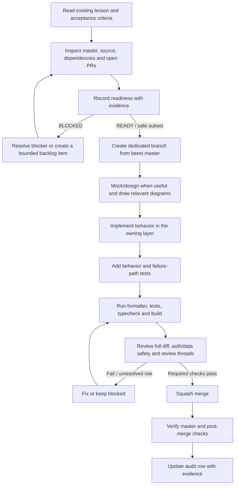
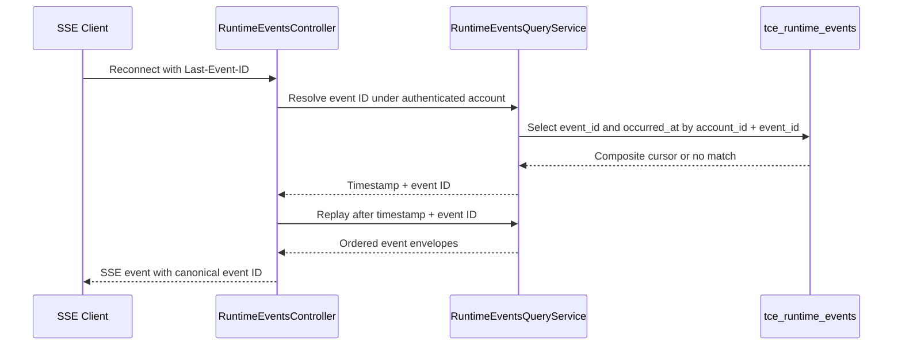

# Senior Frontend Learning — Implementation Audit & Readiness

**Audit date:** 2026-10-30 (current master baseline `ff274e`)  
**Repository:** `phanthienquoc/TCE-dashboard`  
**Audited master:** `ff274e77bcd5d6c835654b96423342061a3d0df2`  
**Standard:** [Implementation Readiness Gate](IMPLEMENTATION_READINESS.md)  
**Shared backlog:** [Cross-layer curriculum backlog](backlog/curriculum-implementation-backlog.md)

This evidence-backed snapshot includes PR #965's Binance XAU panel read-lifecycle slice merged at `ff274e`, on top of PR #963 and earlier Day 10 slices. PR #965 final-head build, Prettier and unit tests passed; current-master post-merge build/image/YAML verification, Prettier and unit tests also passed. These checks do not prove live production deployment or downstream cancellation.

## System Readiness Check — PR #963 post-merge audit refresh (2026-10-30)

**Task:** `DAY10-POSTMERGE-AUDIT-963` — refresh the existing Day 9–13 audit matrix and Day 10/source-map/backlog evidence after the bounded Binance chart-history cancellation merged. Documentation-only; no runtime changes.

- **Scope and acceptance — PASS:** Record PR #963 runtime/helper/spec paths, exact-head CI evidence, merge SHA and remaining broader `CURR-SVC-03` audit. Keep Day 10 partially ready and do not claim deployment or end-to-end completion.
- **Default/base/current commit — PASS:** Repository default branch is `master`; current master is merge commit `086d5370f80128e20683dc792f3f02c7608015e3`. Dedicated audit branch `docs/day10-binance-history-audit-20261030` was created from that exact SHA.
- **Open PR/branch overlap — PASS:** PR #963 is merged. The only open PR found is #928, which changes only `plan/agentic-task-queue.md`; no overlap with the audit artifacts. No existing audit branch with this name was found.
- **Source of truth and dependencies — PASS:** Verified PR #963's three changed files and the merged chart component/helper/spec. The public Binance REST request remains read-only; the effect-owned signal is aborted during cleanup. The WebSocket, API/auth contracts, trading/execution paths and data schema are unchanged.
- **Working-tree/change safety — WARN:** The GitHub connector does not expose a local working-tree snapshot. This branch changes only the existing audit matrix, architecture map, shared backlog and Day 10 lesson; review the complete documentation diff before merge.
- **Build/test/CI baseline — PASS / WARN:** Exact PR #963 head `d18f18464a4b8ed151fbc2a6b304f56e126821b2` passed WF-01P run `41037561091`, WF-02 run `41037561173`, and WF-05 run `41037561127`. The three new Node tests passed; Vitest reported 23 files and 101 tests passed. The combined-status query returned no entries for merge SHA `086d537`, and the available workflow-run connector only surfaced PR-triggered runs; post-merge checks remain unverified, not PASS.
- **Service/infrastructure/deployment — N/A:** Documentation-only audit refresh; no service, manifest, workflow, deployment, market-scan schedule or production configuration changes.
- **Secrets/permissions — PASS / N/A:** Repository write permission is available; no secret is required or accessed.
- **Database/schema/migrations — N/A:** No database or schema changes; live schema/RLS remains outside scope.
- **Production risk/rollback — PASS:** Audit metadata only. No production deployment is planned or claimed; rollback is reverting this documentation PR.

**Readiness decision:** GO for this documentation-only audit refresh. Keep post-merge execution status WARN until a trustworthy status/run source is available.

## System Readiness Check — PR #961 post-merge audit refresh (2026-10-30)

**Task:** `DAY10-POSTMERGE-AUDIT-961` — update the existing audit matrix and linked learning artifacts to reflect the merged Engine Control read-cancellation slice, while keeping post-merge verification uncertainty explicit. Documentation-only; no runtime changes.

- **Scope and acceptance — PASS:** Refresh the existing audit matrix, Day 10 lesson, architecture map and shared backlog with PR #961 merge/CI evidence. Keep `CURR-SVC-03` open; do not claim deployment or end-to-end completion.
- **Default/base/current commit — PASS:** Default branch is `master`; current master is merge commit `53b70f907eb24462db207269ddc2092e9c6563c3` from PR #961. Dedicated branch `docs/day10-postmerge-audit-pr961-20261030` was created from that exact SHA.
- **Open PR/branch overlap — PASS:** PR #961 is merged. The only open PR found is #928, limited to `plan/agentic-task-queue.md`; no overlap with the audit artifacts. No existing PR961 post-merge audit branch was found.
- **Source of truth and dependencies — PASS:** Verified PR #961 merge state, its six changed files, the Engine Control consumer/helper and three tests. Existing API methods accept `AbortSignal`; engine toggle writes and auth/API contracts are unchanged.
- **Working-tree/change safety — WARN:** The GitHub connector does not expose a local working-tree snapshot. The complete documentation-only diff must be reviewed before merge.
- **Build/test/CI baseline — PASS / WARN:** Exact PR #961 head `ec240d8662597b3982263fe74b7071a76a26e735` passed WF-01P #41030892797, WF-02 #41030892857 and WF-05 #41030892904 (253 tests passed, 0 failed, including all three Engine Control specs). Combined status and the available workflow-run query returned no post-merge records for `53b70f9`; post-merge checks remain unverified, not PASS.
- **Service/infrastructure/deployment — N/A:** Documentation-only refresh; no service, infra, deployment, market-scan schedule or production configuration change.
- **Secrets/permissions — PASS / N/A:** Repository write permission is available; no secret is required or accessed.
- **Database/schema/migrations — N/A:** No database or schema changes; live schema/RLS state is outside scope.
- **Production risk/rollback — PASS:** Audit metadata only. No production deployment is planned or claimed; rollback is reverting this documentation PR.

**Readiness decision:** GO for the documentation-only audit refresh. Preserve WARN for post-merge execution status until a trustworthy status/run source is available.

## System Readiness Check — PR #957 post-merge audit refresh (2026-10-30)

**Task:** `DAY10-POSTMERGE-AUDIT-01` — refresh existing audit artifacts to reflect the merged Telegram notification read-lifecycle slice and distinguish pre-merge CI evidence from post-merge verification. Documentation-only; no runtime changes.

| Area                              | Status | Evidence                                                                                                                                                                                                                                                                                      |
| --------------------------------- | ------ | --------------------------------------------------------------------------------------------------------------------------------------------------------------------------------------------------------------------------------------------------------------------------------------------- |
| Scope and acceptance              | PASS   | Update the existing audit matrix, architecture map, shared backlog and Day 10 lesson with PR #957's merge SHA, exact-head checks, and remaining post-merge uncertainty. Do not close `CURR-SVC-03` or claim production deployment.                                                            |
| Default/base/current commit       | PASS   | Repository default/base is `master`; `master` is identical to merge commit `6b3beb546409358cf9cc1a8f000a4527f02255ab`. Dedicated branch `docs/day10-postmerge-audit-20261030` was created from that exact SHA.                                                                                |
| Open PR/branch overlap            | PASS   | Only PR #928 is open; it changes `plan/agentic-task-queue.md`, not the audit artifacts in scope. PR #957 is merged.                                                                                                                                                                           |
| Source of truth and dependencies  | PASS   | Verified PR #957 merged state, changed-file list, runtime helper/components and user-scoped Telegram GET handlers. Exact PR head `052c301ad522d98802a13e88ed48c6a48c636de7` passed WF-01P #41024683065, WF-02 #41024683023 and WF-05 #41024682994 before merge.                               |
| Working tree/change safety        | WARN   | Connector exposes branch/file content and PR diffs, not a local working-tree snapshot. Review the complete documentation-only PR diff before merge.                                                                                                                                           |
| Build/test/CI baseline            | WARN   | Pre-merge exact-head CI passed. Querying combined status for merge SHA `6b3beb5` returned no status entries and the available workflow-run connector surfaced no post-merge runs; post-merge checks remain unverified, not PASS. Documentation PR will require its own Prettier/WF-05 checks. |
| Service/infrastructure/deployment | N/A    | Documentation-only refresh; no service, infra, deployment, market-scan schedule or production config change.                                                                                                                                                                                  |
| Secrets/permissions               | PASS   | Repository write permission is available; no secret is required or accessed.                                                                                                                                                                                                                  |
| Database/schema/migrations        | N/A    | No database or schema changes; live schema/RLS remains outside scope.                                                                                                                                                                                                                         |
| Production risk/rollback          | PASS   | Low-risk audit metadata only. Rollback is reverting this documentation PR; no production deployment is planned or claimed.                                                                                                                                                                    |

**Readiness decision:** GO for the documentation-only post-merge audit refresh. Keep post-merge execution status WARN until a trustworthy run/status source is available.

## Post-merge verification — PR #957 (2026-10-30)

| Check                 | Status | Evidence                                                                                                                                                                                              |
| --------------------- | ------ | ----------------------------------------------------------------------------------------------------------------------------------------------------------------------------------------------------- |
| Merge state           | PASS   | PR #957 is closed/merged at `6b3beb546409358cf9cc1a8f000a4527f02255ab`; comparing `master` to that SHA returns identical, with zero commits ahead/behind.                                             |
| Pre-merge CI          | PASS   | Exact PR head `052c301ad522d98802a13e88ed48c6a48c636de7` passed WF-01P #41024683065, WF-02 #41024683023 and WF-05 #41024682994.                                                                       |
| Post-merge checks     | WARN   | Combined-status query for merge SHA returned no status entries, and the available workflow-run connector surfaced no post-merge runs. This is unverified, not a pass; no post-merge CI claim is made. |
| Production/deployment | N/A    | No deployment, service change, database migration, auth change or trading/execution behavior was requested or performed.                                                                              |

## System Readiness Check — Telegram notification read lifecycle (2026-10-30)

**Task:** `DAY10-TELEGRAM-READ-01` — make Telegram bot/assignment reads abortable and prevent stale notification UI state after route unmount or account switch. Scope is limited to existing notifications list/detail/config read paths and a shared client-side loader; write/mutation calls are excluded.

| Area                              | Status | Evidence                                                                                                                                                                                                                                                                                                                                  |
| --------------------------------- | ------ | ----------------------------------------------------------------------------------------------------------------------------------------------------------------------------------------------------------------------------------------------------------------------------------------------------------------------------------------- |
| Scope and acceptance              | PASS   | Target: forward `AbortSignal` to existing authenticated GETs, abort superseded/unmounted reads, and commit result/loading state only for the current account/effect. No new API, auth, schema, or mutation semantics.                                                                                                                     |
| Default/base/current commit       | PASS   | Repository default branch is `master`; dedicated branch `fix/day10-telegram-read-lifecycle-20261030` was created from exact master SHA `e093b8521730eaef3b6d1b2e7ce5b6e6b0c095ee`, the squash merge of PR #956.                                                                                                                           |
| Open PR/branch overlap            | PASS   | Open PR #928 changes only `plan/agentic-task-queue.md`; it does not overlap this task. PR #956 is merged.                                                                                                                                                                                                                                 |
| Source of truth and dependencies  | PASS   | Inspected `apps/web/lib/api.ts` (`platformApi.telegramBots(signal?)`, `telegramDebugAssignments(signal?)`), `apps/web/app/notifications/page.tsx`, `app/notifications/[id]/page.tsx`, `app/notifications/TelegramBotConfig.tsx`, and `apps/web/lib/tce-data-store.ts`. Existing endpoint/auth contracts and cache ownership are retained. |
| Working tree/change safety        | WARN   | GitHub connector exposes branch/file content and PR diffs, not a local working-tree snapshot. Review the complete PR diff before merge.                                                                                                                                                                                                   |
| Build/test/CI baseline            | PASS   | Exact PR head `9baa4327d21089a6b2a02e7707f2a367caba706e` passed WF-01P run `41024441808`, WF-02 run `41024441810`, and WF-05 run `41024441832`. The earlier Prettier failure was on the prior head and formatting was corrected; cancelled duplicate runs are not counted.                                                                |
| Service/infrastructure/deployment | N/A    | These are client-side reads against existing authenticated GET endpoints. No service, workflow, manifest, deployment, or market-scan schedule change is needed.                                                                                                                                                                           |
| Secrets/permissions               | PASS   | Repository write permission is confirmed. No secret is required, read, or modified.                                                                                                                                                                                                                                                       |
| Database/schema/migrations        | N/A    | No schema/persistence contract changes. Live schema/RLS/ledger is not queried because this bounded task does not require it.                                                                                                                                                                                                              |
| Production risk and rollback      | PASS   | Low-risk client-side cancellation/state-commit guards; no trading/execution path or server side effects. Rollback is reverting this PR. No production deployment is planned or claimed.                                                                                                                                                   |

**Readiness decision: GO for this bounded client read-lifecycle slice only.** Any broader API-caller audit, auth protocol, persistence/versioning, or production change requires its own readiness check.

## System Readiness Check — post-merge learning audit refresh (2026-10-30)

**Task:** `DAY9-13-AUDIT-POSTMERGE-955` — refresh the existing Day 9–13 implementation matrix and linked evidence after PRs #951, #952, #953 and #955 merged. This task changes documentation only.

| Area                              | Status | Evidence                                                                                                                                                                                                                                                                                                                                                                                                                                                                                                                                                                                              |
| --------------------------------- | ------ | ----------------------------------------------------------------------------------------------------------------------------------------------------------------------------------------------------------------------------------------------------------------------------------------------------------------------------------------------------------------------------------------------------------------------------------------------------------------------------------------------------------------------------------------------------------------------------------------------------- |
| Scope and acceptance              | PASS   | Update the existing audit matrix, source map, shared backlog and Day 10/12/13 evidence; retain all blockers and do not create lesson files or runtime scope. Existing Mermaid component/data-flow and read-lifecycle diagrams remain the relevant design artifacts.                                                                                                                                                                                                                                                                                                                                   |
| Default/base/current commit       | PASS   | Default branch is `master`; current master at task start is `d79404ec62250ddf2762620f6819318daf029412`, the squash merge of PR #955. The dedicated branch was created from this exact SHA.                                                                                                                                                                                                                                                                                                                                                                                                            |
| Open PR/branch overlap            | PASS   | Only open PR is draft #928; its changed file is `plan/agentic-task-queue.md`, so there is no overlap with these learning files. PR #936 remains closed unmerged.                                                                                                                                                                                                                                                                                                                                                                                                                                      |
| Source of truth and dependencies  | PASS   | Rechecked `apps/web/lib/stock-event-store.ts`, `app-data-worker.ts`, the `clearAccountScopedStores()` path, account-cache-isolation tests and the existing Day 13 source map. Existing Axios/Zustand and route contracts remain unchanged.                                                                                                                                                                                                                                                                                                                                                            |
| Working-tree/change safety        | WARN   | The connector exposes GitHub branch/file state but not a local working-tree snapshot. The complete PR diff will be reviewed; this branch changes documentation only.                                                                                                                                                                                                                                                                                                                                                                                                                                  |
| Build/test/CI baseline            | WARN   | PR #955 exact head `ad1664f06ed48972dd3915ef105551b08f91cc14` passed frontend build run 41013983958, Prettier run 41013984089 and backend/root tests run 41013983940. On master `d79404e`, backend unit tests run 41014092643, Build + Verify TCE images and PROD config run 41014092714, and Auto-format on push run 41014092678 passed. Duplicate runs were cancelled/skipped; no separate local test run is available through this connector. The final PR head must pass its own Prettier/Markdown and test checks before merge; inherited master checks do not validate this documentation diff. |
| Service/infrastructure/deployment | N/A    | Documentation-only refresh; no service, manifest, workflow, runtime configuration, deployment or market-scan schedule changes.                                                                                                                                                                                                                                                                                                                                                                                                                                                                        |
| Secrets/permissions               | PASS   | Repository write permission is available for the branch/PR; this task requires no secrets. No secret values were read or changed.                                                                                                                                                                                                                                                                                                                                                                                                                                                                     |
| Database/schema/migrations        | WARN   | No database mutation. Live schema, RLS and migration-ledger state were not queried and remain unverified.                                                                                                                                                                                                                                                                                                                                                                                                                                                                                             |
| Production risk and rollback      | PASS   | Reverting this documentation-only change restores the previous audit snapshot; no production rollout or runtime rollback is involved.                                                                                                                                                                                                                                                                                                                                                                                                                                                                 |

**Readiness decision: GO for audit/documentation refresh only.** This does not authorize runtime optimization, browser WebSocket auth, database changes or production deployment.

This snapshot does not replace a task-specific readiness check before any future runtime, authentication, database, trading or deployment change.

## System Readiness Check — post-merge Day 10 audit refresh (2026-10-30)

**Task:** `DAY10-AUDIT-POSTMERGE-953` — reconcile the Day 9–13 audit matrix and architecture/backlog evidence after PR #953 merged.

| Area                                | Status                                           | Evidence                                                                                                                                                                                                                                                                                                            |
| ----------------------------------- | ------------------------------------------------ | ------------------------------------------------------------------------------------------------------------------------------------------------------------------------------------------------------------------------------------------------------------------------------------------------------------------- |
| Scope and acceptance                | PASS                                             | Refresh the existing Day 9–13 audit matrix, architecture source map, and shared backlog with the merged Day 10 pool-read lifecycle evidence. Keep broader API-caller audit and unrelated Day 11–13 blockers open.                                                                                                   |
| Default/base and commit             | PASS                                             | Default branch is `master`; this documentation branch was created from `2434a27510044e08ae1b0ba6ce5501bbc163b5cf`, the squash merge of PR #953.                                                                                                                                                                     |
| Open PR overlap                     | PASS                                             | The only other open PR is #928, which changes only `plan/agentic-task-queue.md`; it does not overlap the learning audit, architecture map, backlog, or Day 10 lesson.                                                                                                                                               |
| Source of truth and dependencies    | PASS                                             | Verified merged `apps/web/lib/stock-dividend-pool-store.ts`, `apps/web/lib/app-data-worker.ts`, both pool page consumers, the regression specs, Day 10 lesson, and the existing authenticated controller/service contract.                                                                                          |
| Working-tree/change safety          | WARN                                             | GitHub branch and file diffs are observable, but no local working-tree snapshot is available through this connector. This branch is based on the exact master merge SHA; planned changes are documentation-only.                                                                                                    |
| Build/test/CI baseline              | PASS for PR head; WARN for post-merge visibility | PR #953 exact head `39abde70b07fe35ef86f0f8f1d24f3324248c8a6` passed WF-01P run 41012494912, WF-02 run 41012494814, and WF-05 run 41012494856. Post-merge status/workflow endpoints returned no records for merge SHA `2434a27510044e08ae1b0ba6ce5501bbc163b5cf`; do not claim a separate master push check passed. |
| Service, infrastructure, deployment | N/A                                              | This refresh changes documentation only. No service, workflow, manifest, runtime configuration, deployment, or market-scan schedule changes.                                                                                                                                                                        |
| Secrets and permissions             | PASS                                             | No secret values read or changed; no new permission required.                                                                                                                                                                                                                                                       |
| Database/schema/migrations          | N/A for changes; WARN for live state             | No database/schema/migration change. Live schema/RLS/ledger state remains unverified and unchanged.                                                                                                                                                                                                                 |
| Production risk and rollback        | PASS for documentation                           | No runtime behavior changes. Reverting this documentation-only commit restores the previous audit snapshot; no deployment rollback applies.                                                                                                                                                                         |

**Readiness decision: GO for audit refresh only.** PR #953's runtime change and exact-head CI are evidenced; post-merge workflow status is not exposed by the available status endpoints. No production or environment verification is claimed.

---

## 1. System Readiness Check

| Area                          | Status                                                                                       | Evidence                                                                                                                                                                                                                                                                                                                                                            |
| ----------------------------- | -------------------------------------------------------------------------------------------- | ------------------------------------------------------------------------------------------------------------------------------------------------------------------------------------------------------------------------------------------------------------------------------------------------------------------------------------------------------------------- |
| Scope and criteria            | PASS                                                                                         | Reviewed all five existing Day 9–13 lesson files, shared readiness gate, cross-layer backlog, Day 13 backlog, source map, and related merged/open PRs through PR #953. No root `curriculum/` directory exists; the learning-specific backlog is under `docs/learning/backlog/`.                                                                                     |
| Default branch and base       | PASS                                                                                         | Default branch is `master`. This post-merge audit refresh is based on master `2434a27510044e08ae1b0ba6ce5501bbc163b5cf`, after PR #953 added the Day 10 pool-read lifecycle fix.                                                                                                                                                                                    |
| Open PR overlap               | PASS                                                                                         | PR #953 is merged at `2434a27`. The only other open PR found is #928, which changes only `plan/agentic-task-queue.md`; it does not overlap the learning audit, source map, backlog, or Day 10 lesson. PR #936 remains closed without merge.                                                                                                                         |
| Source and dependencies       | PASS for Day 10 quote validation and pool-read lifecycle; PARTIAL for the curriculum overall | Verified `apps/web/lib/store.ts`, `apps/web/lib/api.ts`, `apps/web/lib/market-price-validation.ts`, `apps/web/lib/stock-dividend-pool-store.ts`, `apps/web/lib/app-data-worker.ts`, the pool controller/service, and their regression specs. Day 11 WebSocket auth, Day 12 snapshot/event ordering, and Day 13 profiling remain unresolved as detailed below.       |
| Working-tree/change safety    | WARN                                                                                         | Branch heads and complete PR diffs are observable through GitHub; a local working-tree snapshot is not available through this connector.                                                                                                                                                                                                                            |
| Build/test baseline           | PASS for PR #953 exact-head CI; WARN for separate post-merge status visibility               | Final head `39abde70b07fe35ef86f0f8f1d24f3324248c8a6` passed WF-01P run 41012494912, WF-02 run 41012494814, and WF-05 run 41012494856. Status/workflow endpoints returned no separate post-merge records for `2434a27510044e08ae1b0ba6ce5501bbc163b5cf`; no production deployment occurred.                                                                         |
| Infrastructure and deployment | N/A for this audit refresh                                                                   | This branch changes learning documentation only. No deployment, workflow, manifest, service configuration, or live environment was changed.                                                                                                                                                                                                                         |
| Secrets and permissions       | N/A for this audit refresh                                                                   | No secret values were read or changed. The merged PR's master workflow checked required-secret presence without printing values; that is not a production verification claim.                                                                                                                                                                                       |
| Database/schema/migrations    | WARN / unresolved                                                                            | No live schema, RLS, or migration-ledger query was performed. Keep `CURR-DATA-04` and the open migration-provenance PR #928 as unresolved; no database mutation is authorized.                                                                                                                                                                                      |
| Production risk and rollback  | PASS for documentation; PASS for bounded Day 10 client reads                                 | PR #953 changes only the dividend-pool client read lifecycle, worker cancellation propagation, tests, and Day 10 evidence. It does not change auth protocol, database schema/RLS, trading strategy, execution, market-scan schedules, or deployment. Rollback is reverting squash commit `2434a275`; no deployment rollback applies because no deployment occurred. |

### Readiness decisions

- **GO / merged:** Day 10 market-price payload validation and dividend-pool read lifecycle are implemented in their actual client store paths. PR #953 exact-head WF-01P, WF-02, and WF-05 passed; separate post-merge workflow records for `2434a275` were not surfaced. No environment or production verification is claimed.
- **PARTIALLY READY:** Day 9 architecture/source mapping is verified, but an authenticated Server Component migration remains unjustified until session propagation, freshness, loading/error, and deployment contracts are designed.
- **PARTIALLY READY:** Day 10 quote validation and dividend-pool cancellation/stale-response protection are implemented and CI-verified. The broader audit of every API read caller is not yet complete.
- **BLOCKED:** Day 11 browser quote streaming remains blocked by `CURR-AUTH-07`. An HTTP preflight does not authenticate the later browser WebSocket upgrade; never put bearer tokens in a URL.
- **PARTIALLY READY / contract blocked:** Day 12 has existing stores and account-scoped replay, but no verified universal snapshot watermark or complete normalized entity cache. Keep `CURR-DATA-04` unresolved.
- **BLOCKED:** Day 13 runtime optimization remains blocked until `PERF-13-01` call-site tracing, `PERF-13-02` reproducible baseline, and `PERF-13-03` acceptance criteria are completed. Do not add speculative memoization or virtualization.
- **Inventory gap:** Day 1–8 lesson files are absent from the inspected `docs/learning/` listing. Keep `CURR-CATALOG-06` blocked; do not invent or claim those lessons were reviewed.

## 2. Audit matrix — existing Day 9–13 lessons

| Lesson                                        | Explicit requirement                                                                                                                                                                                                                                   | Source paths                                                                                                                                                                                                                                                                                                                                                                                                      | Actual implementation evidence on master                                                                                                                                                                                                                                                                                                                                                                                                                                                                                                                         | Tests and verification                                                                                                                                                                                                                                                                                      | Diagram/design artifact                                                                                                                                                            | Readiness                                                                                                                         | Remaining work                                                                                                                                                                              | PR/merge status                                                                                                                                                                                           |
| --------------------------------------------- | ------------------------------------------------------------------------------------------------------------------------------------------------------------------------------------------------------------------------------------------------------ | ----------------------------------------------------------------------------------------------------------------------------------------------------------------------------------------------------------------------------------------------------------------------------------------------------------------------------------------------------------------------------------------------------------------- | ---------------------------------------------------------------------------------------------------------------------------------------------------------------------------------------------------------------------------------------------------------------------------------------------------------------------------------------------------------------------------------------------------------------------------------------------------------------------------------------------------------------------------------------------------------------- | ----------------------------------------------------------------------------------------------------------------------------------------------------------------------------------------------------------------------------------------------------------------------------------------------------------- | ---------------------------------------------------------------------------------------------------------------------------------------------------------------------------------- | --------------------------------------------------------------------------------------------------------------------------------- | ------------------------------------------------------------------------------------------------------------------------------------------------------------------------------------------- | --------------------------------------------------------------------------------------------------------------------------------------------------------------------------------------------------------- |
| Day 9 — Next.js                               | Keep Server/Client boundaries, route ownership, auth/session and cache freshness correct; do not migrate SSR without a verified session design.                                                                                                        | `apps/web/app/layout.tsx`; `app/providers.tsx`; `app/dashboard/page.tsx`; `app/overview/page.tsx`; `components/dashboard/DashboardShell`; `lib/api.ts`.                                                                                                                                                                                                                                                           | `/dashboard` redirects to `/overview`; overview and providers are Client Components owning browser state/auth/realtime. No SSR migration was implemented or required by the lesson alone.                                                                                                                                                                                                                                                                                                                                                                        | Current frontend build verifies compilation only; no end-to-end SSR/session propagation test was evidenced in this audit.                                                                                                                                                                                   | Component architecture diagram in `architecture-map.md`; no mock needed because no UI change is proposed.                                                                          | PARTIALLY READY                                                                                                                   | Document session propagation, freshness, loading/error and runtime deployment before any SSR migration.                                                                                     | Lesson PR #909 merged docs-only at `9d7df52`; source map PR #948 merged at `e798834`.                                                                                                                     |
| Day 10 — REST/errors/cancellation             | Normalize safe errors; propagate `AbortSignal`; guard stale/loading commits; validate quotes; cancel pool, event, Telegram, Engine Control, public Binance chart-history, and Binance XAU panel config/bot/position reads at their lifecycle boundary. | `apps/web/lib/api.ts`; `api-errors.ts`; `store.ts`; `market-price-validation.ts`; `tce-data-store.ts`; pool/event stores; `telegram-notification-data.ts`; `engine-control-data.ts`; `apps/web/components/dashboard/BinanceRealtimeChart.tsx`; `apps/web/lib/binance-kline-history.ts` and its spec; `apps/web/app/engines/BinanceXauTradingPanel.tsx`; `apps/web/lib/binance-xau-position-data.ts` and its spec. | Quote validation, pool/event, Telegram, Engine Control, public Binance chart-history, and Binance XAU panel read-lifecycle slices are merged. PR #965 merged at `ff274e77bcd5d6c835654b96423342061a3d0df2`. Exact PR #965 head `8726c7f4` passed WF-01P #41045939056, WF-02 #41045938623 and WF-05 #41045938628; new XAU Node tests passed and Vitest reported 23 files / 101 tests passed. Current-master post-merge WF-01 #41046146755, WF-02 #41046146855 and WF-05 #41046146842 all passed. API/auth contracts are unchanged; no live deployment is claimed. | `api-errors.spec.ts`; `dashboard-cancellation.spec.ts`; `market-price-validation.spec.ts`; `tce-data-store.spec.ts`; pool/event/worker, Telegram and Engine Control specs; `binance-kline-history.spec.ts`; `binance-xau-position-data.spec.ts`. Exact-head CI and current-master post-merge checks passed. | Market-price, pool/event, Telegram, Engine Control, Binance chart-history, and Binance XAU read-lifecycle sequence diagrams; the XAU sequence is in the Day 10 lesson and PR #965. | PARTIALLY READY overall; the latest bounded slice and current-master post-merge checks PASS; broader contract audit remains open. | Broader API-read caller audit, endpoint/error/freshness contracts and end-to-end evidence remain open; no production verification claim.                                                    | PR #929 runtime; #938/#939 test-only; #949 quote validation; #953 pool; #955 stock-event; #957 Telegram; #961 Engine Control; #963 Binance chart history; #965 Binance XAU panel merged at `ff274e`.      |
| Day 11 — WebSocket/SSE/reconnect/backpressure | Preserve bounded reconnect, durable replay, cursor ordering, event identity, auth-expiry handling, and backpressure safety.                                                                                                                            | `apps/web/lib/microfe-ws.ts`; `microfe-ws.spec.ts`; `apps/service/src/runtime-events/runtime-events.controller.ts`; `runtime-events.query.service.ts`; `runtime-events.websocket.ts`; `libs/contracts/src/tce-event.contract.ts`.                                                                                                                                                                                 | Platform deployment WebSocket has bounded reconnect behavior; runtime event API supports account-scoped replay and `Last-Event-ID` resume. The frontend quote-stream proposal from PR #936 is not on master.                                                                                                                                                                                                                                                                                                                                                     | `microfe-ws.spec.ts`; runtime-events controller/query/cursor specs cover relevant server-side paths. No verified browser-to-runtime-WebSocket auth integration test exists.                                                                                                                                 | SSE resume sequence in this document; secure socket handshake remains a design target in the backlog, not an implementation.                                                       | PARTIALLY READY; quote stream BLOCKED.                                                                                            | Verify deployed routing/cookie scope and approve a secure handshake; add integration tests for identity, expiry/replay, origin and account binding before a frontend stream is implemented. | Lesson PR #931 docs-only merged at `a76e9aa`; reconnect fix PR #943 merged at `55ca862`; SSE resume PR #946 merged at `c324e3b`; auth blocker PR #947 merged at `746d2c5`; broad PR #936 closed unmerged. |
| Day 12 — Normalization/cache                  | Establish stable scope-correct entity identity, cache ownership, freshness, and snapshot/event ordering before merging streams into state.                                                                                                             | `apps/web/lib/store.ts`; `tce-data-store.ts`; `account-cache-isolation.spec.ts`; `libs/contracts/src/tce-event.contract.ts`; `apps/service/src/runtime-events/runtime-events.query.service.ts`.                                                                                                                                                                                                                   | PR #951 clears dashboard, TCE, worker, stock-event and stock-sync state before logout settles and when authenticated identity changes; tests cover the transition. A fully normalized entity cache and end-to-end snapshot/event merge are not established; no universal server watermark is verified.                                                                                                                                                                                                                                                           | Account-cache isolation and store/event tests cover their individual assertions; a complete snapshot/event race/version integration test is not evidenced.                                                                                                                                                  | Day 12 state/merge examples plus current component/data-flow map; examples remain illustrative where source contracts are absent.                                                  | PARTIALLY READY; account-cache invalidation is merged/CI-verified, snapshot/event ordering remains unresolved.                    | Continue `CURR-DATA-04`: verify producer watermark/version, replay/reconciliation and account binding before changing cache shape or schema.                                                | PR #942 prefetch isolation and #951 account-cache isolation merged; lesson PR #933 is docs-only.                                                                                                          |
| Day 13 — Performance profiling                | Trace selectors/components, establish a reproducible profile and define correctness/performance acceptance before optimizing.                                                                                                                          | `apps/web/lib/store.ts`; `tce-data-store.ts`; actual components under `apps/web/components/dashboard/`; Day 13 implementation backlog.                                                                                                                                                                                                                                                                            | PERF-13-01 source map is complete via PR #952 and records real subscriptions, row keys, refresh paths and candidate costs. No measured bottleneck or runtime optimization is evidenced; quote sync remains HTTP polling.                                                                                                                                                                                                                                                                                                                                         | No performance baseline/replay artifact exists; correctness tests do not prove performance gain.                                                                                                                                                                                                            | Profiling workflow in Day 13 lesson and Mermaid source-flow diagram in the backlog; no before/after profile exists.                                                                | BLOCKED for runtime optimization.                                                                                                 | Complete PERF-13-02 reproducible baseline and PERF-13-03 acceptance criteria before implementing a measured, correctness-preserving change.                                                 | Lesson PR #937 merged docs-only; source map PR #952 merged at `a6bf2a0`; runtime optimization not started.                                                                                                |

## 2.1 Supporting learning artifacts

| Artifact                                                        | Requirement / acceptance                                                                                                                | Actual implementation evidence                                                                                                                                                                                                                      | Tests and diagrams                                                                                                                                  | Readiness                                                                          | Remaining work                                                                                                     | PR/merge status                                                                                                                                         |
| --------------------------------------------------------------- | --------------------------------------------------------------------------------------------------------------------------------------- | --------------------------------------------------------------------------------------------------------------------------------------------------------------------------------------------------------------------------------------------------- | --------------------------------------------------------------------------------------------------------------------------------------------------- | ---------------------------------------------------------------------------------- | ------------------------------------------------------------------------------------------------------------------ | ------------------------------------------------------------------------------------------------------------------------------------------------------- |
| `IMPLEMENTATION_READINESS.md`                                   | Shared readiness gate for source ownership, cross-layer impacts, runtime implementation, verification, operations, backlog and safety.  | Process contract only; it does not implement product behavior or prove any task is complete.                                                                                                                                                        | Prettier/Markdown validation; checklist is the reusable evidence standard. No runtime test applies.                                                 | PASS as a shared standard. Each task must record its own evidence and N/A reasons. | Keep the gate aligned with repository workflows; never mark a task complete from docs/tests alone.                 | PR #944 merged at `41b0afa`.                                                                                                                            |
| `architecture-map.md`                                           | Map existing lessons to actual routes, components, stores, services, contracts and unresolved dependencies.                             | Current map includes App Router boundaries, centralized API/auth, dashboard stores, quote validator, pool/event/Telegram/Engine Control and Binance chart-history read lifecycles, runtime-event API, and unresolved WS auth/persistence contracts. | Mermaid component architecture/data-flow diagrams and Day 10 read-lifecycle sequences. Documentation checks validate the map, not runtime behavior. | PASS for source mapping only; DB/RLS and WS auth remain unverified/blocked.        | Recheck source paths after relevant code merges and preserve unknowns rather than infer contracts.                 | PR #948 source map; PR #952 Day 13 map; refreshed after PR #963 merge `086d537`; post-merge status remains unverified.                                  |
| `implementation-audit-readiness.md`                             | Maintain the per-artifact audit matrix, readiness evidence, lifecycle and completion boundary.                                          | Audit metadata/status rows reference current master code, tests, diagrams, merge SHAs and unresolved work; this is governance evidence, not runtime implementation.                                                                                 | Mermaid task lifecycle and SSE resume sequence; prior audit standards remain historical evidence.                                                   | PASS as the audit standard; this refresh is not a runtime-completion claim.        | Refresh after future merges and keep CI/environment/production states distinct.                                    | PR #945 established the standard; PR #950/#954 refreshed snapshots; PR #963 audit refresh records merge `086d537`; post-merge checks remain unverified. |
| `backlog/curriculum-implementation-backlog.md`                  | Track cross-layer gaps with stable IDs, evidence, acceptance criteria, dependencies and unblock conditions.                             | `CURR-ARCH-01` source mapping is verified; `CURR-SVC-03` has merged read-lifecycle slices but needs broader audit; `CURR-VERIFY-05` is ready; `CURR-INFRA-02`/`CURR-DATA-04` need audit; `CURR-CATALOG-06`/`CURR-AUTH-07` remain blocked.           | Secure WebSocket handshake remains design-only; formatting checks validate docs, not runtime.                                                       | PARTIAL; unresolved items are not treated as completed behavior.                   | Verify infra/service/data prerequisites and locate canonical Day 1–8 curriculum source.                            | PR #944 backlog; #947 auth blocker; source evidence refreshed through PR #963 merge `086d537`; broader `CURR-SVC-03` audit remains open.                |
| `backlog/day13-performance-profiling-implementation-backlog.md` | Track PERF-13-01 through PERF-13-10 with source map, reproducible baseline, acceptance thresholds, tests and before/after measurements. | PERF-13-01 source mapping is complete; no measured bottleneck/profile artifact or runtime optimization exists.                                                                                                                                      | Mermaid source-flow diagram is aligned to the inspected routes/store selectors; no performance baseline is represented as evidence.                 | BLOCKED for runtime optimization until PERF-13-02/03 are complete.                 | Capture a non-sensitive deterministic profile, then define acceptance and choose one evidence-backed optimization. | Backlog introduced with PR #944; PERF-13-01 source map added/merged via PR #952.                                                                        |

The five lesson rows above plus this support-artifact matrix cover all ten Markdown files currently present under `docs/learning/` and `docs/learning/backlog/`.

### Review of previous test-only PRs

- PR #938 added deterministic cancellation/race tests only; dashboard runtime cancellation came from PR #929. The later pool-read and stock-event cancellation paths are actual runtime changes in PRs #953 and #955, each with regression tests.
- PR #939 added sanitized-error logging tests only; verify the real logger/error path in `store.ts`/`api-errors.ts`, not from the test PR alone.
- PR #949 added the actual market-price validator/store integration and regression tests. Invalid or unrequested rows cannot overwrite accepted quote state.
- PR #951 added actual account-scoped cache invalidation with logout/account-switch tests; PR #952 completed PERF-13-01 source mapping but did not establish a performance baseline.
- PR #955 adds stock-event cancellation, stale-response guards, worker signal propagation and normalized read errors; it is merged at `d79404e` and exact-head CI passed.
- PR #936 remains closed without merge. Its proposed browser quote stream is not on master and remains blocked by `CURR-AUTH-07`.

### Curriculum inventory and roadmap boundary

`docs/learning/` contains five lesson files (Days 9–13) plus five readiness/source-map/audit/backlog support files: ten Markdown files total across `docs/learning/` and `docs/learning/backlog/`. Day 1–8 lesson files are absent from the inspected tree. No root `curriculum/` or `roadmap/` directory exists; `docs/agentic/copilot-agentic-roadmap.md` and `plan/` roadmap artifacts cover separate agentic/runtime work and are not substitutes for missing curriculum lessons. Keep `CURR-CATALOG-06` blocked until the canonical Day 1–8 source is found or the owner authorizes creating it.

## 3. Mandatory task lifecycle

## 4. Design artifacts by task type

- Cross-module/service change: architecture/component diagram.
- API, auth, WebSocket, SSE or async lifecycle: sequence diagram.
- Persistence, relations or cache identity: ERD/data model.
- Multi-owner workflow or deployment: swimlane.
- State transitions, retry/recovery or UI behavior: flow/state machine.
- Complex validation or deterministic branching: pseudocode.
- User-visible UI behavior: mock/prototype or component-state table when it improves reviewability.

Diagrams must match real contracts and source. Label unknowns instead of inventing guarantees. A mock is a design artifact, not evidence that runtime behavior exists.

### SSE resume sequence — PR #946 merged; master CI verified

## 5. Completion evidence

A lesson is complete only when the audit row identifies:

1. Exact acceptance criteria from the existing MD.
2. Source paths and behavior on `master`.
3. Tests for success, failure, race and recovery paths as relevant.
4. Relevant diagrams/mock and why they match implementation.
5. Readiness results and warnings/blockers.
6. PR URL, squash-merge SHA, CI/post-merge evidence, and deployment evidence only if deployment occurred.

Tests-only changes do not count as runtime implementation. Documentation-only changes do not count as runtime implementation. A green build alone does not prove domain correctness or production deployment. The repository's Prettier pull-request workflow checks this Markdown.

## System Readiness Check — PR #965 post-merge audit refresh (2026-10-30)

**Task:** `DAY10-POSTMERGE-AUDIT-965` — reconcile the existing Day 9–13 audit matrix, architecture map, shared backlog and Day 10 lesson with the merged Binance XAU panel read-lifecycle slice.

| Area                              | Status                             | Evidence                                                                                                                                                                                                                                                                                                                                           |
| --------------------------------- | ---------------------------------- | -------------------------------------------------------------------------------------------------------------------------------------------------------------------------------------------------------------------------------------------------------------------------------------------------------------------------------------------------- |
| Scope and acceptance              | PASS                               | Documentation-only audit of an already-merged bounded runtime change. Update existing records with source paths, tests, diagram, PR/merge SHA, final-head CI and post-merge CI; keep Day 10 and `CURR-SVC-03` partially ready. No new runtime scope.                                                                                               |
| Default/base/current commit       | PASS                               | Repository default branch is `master`; current master is `ff274e77bcd5d6c835654b96423342061a3d0df2`, the squash merge of PR #965. Audit branch `docs/day10-xau-read-lifecycle-audit-20261030` was created from that exact SHA.                                                                                                                     |
| Open PR/branch overlap            | PASS                               | PR #966 changes only `apps/web/lib/keycloak-sso.ts`; PR #928 changes only `plan/agentic-task-queue.md`. Neither overlaps the four learning/audit Markdown files in this task. PR #965 is merged.                                                                                                                                                   |
| Source of truth and dependencies  | PASS                               | Re-read merged `apps/web/app/engines/BinanceXauTradingPanel.tsx`, `apps/web/lib/api.ts`, `apps/web/lib/binance-xau-position-data.ts`, both related specs, the XAU route, `useAuthStore`, and the existing Day 10 lesson. Verified the merged master paths and per-user/environment read contract.                                                  |
| Working-tree/change safety        | WARN                               | The GitHub connector exposes repository files/PR diffs but no local working-tree snapshot or local command execution. Review the complete documentation diff and run PR CI before merge.                                                                                                                                                           |
| Build/test/CI baseline            | PASS / WARN                        | PR #965 exact head `8726c7f4d0287e50fab42a60dbb1826761314c53` passed WF-01P `41045939056`, WF-02 `41045938623` and WF-05 `41045938628`. Post-merge WF-02 `41046146855` and WF-05 `41046146842` passed; post-merge WF-01 build/verify run `41046146755` completed successfully; post-merge WF-02 `41046146855` and WF-05 `41046146842` also passed. |
| Service/infrastructure/deployment | N/A for audit                      | No runtime, service, manifest, workflow, deployment or market-scan schedule change is proposed. Post-merge WF-01 builds/verifies images and Kubernetes YAML; it does not deploy. No production environment verification is claimed.                                                                                                                |
| Secrets and permissions           | PASS / N/A                         | Repository write permission is available. No secrets are read or changed by the documentation task; no secret values are recorded.                                                                                                                                                                                                                 |
| Database/schema/migrations        | N/A for audit; WARN for live state | No persistence/schema/RLS changes. Live schema and migration ledger remain unverified and outside this task.                                                                                                                                                                                                                                       |
| Production risk and rollback      | PASS for docs-only change          | Audit documents evidence only; rollback is reverting the audit PR. No production deployment, live Binance call, order, strategy, auth, or database action is performed.                                                                                                                                                                            |
| Branch-protection visibility      | WARN                               | The connector returned HTTP 403 for the branch-protection endpoint. Final-head PR checks are directly verified; the inaccessible policy endpoint is not represented as PASS.                                                                                                                                                                       |

**Readiness decision: READY for the bounded documentation audit.** Reconcile source and evidence only. Keep any runtime or environment verification claim bounded to the actual checks returned by GitHub.

**Formatting follow-up:** The first Prettier check on the audit PR failed only on the newly added Day 10 cross-reference. Push formatter commit `c7c577a6` normalized that file; the failed run is stale and is not final-head evidence.