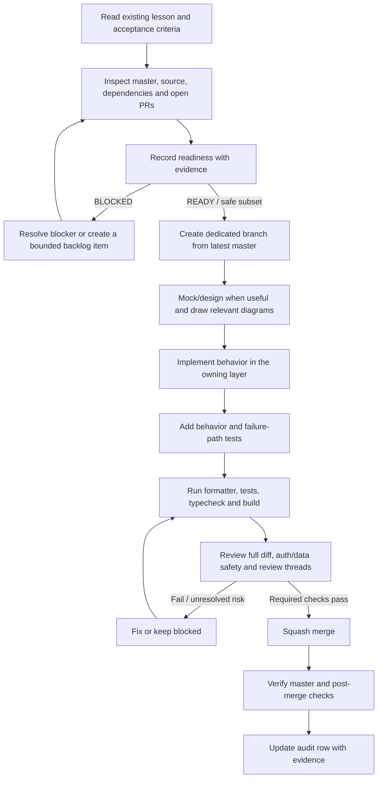
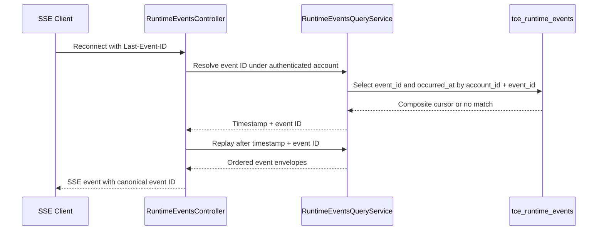

# Senior Frontend Learning — Implementation Audit & Readiness

**Audit date:** 2026-10-30 (master baseline `2434a27`)  
**Repository:** `phanthienquoc/TCE-dashboard`  
**Audited master:** `2434a27510044e08ae1b0ba6ce5501bbc163b5cf`  
**Standard:** [Implementation Readiness Gate](IMPLEMENTATION_READINESS.md)  
**Shared backlog:** [Cross-layer curriculum backlog](backlog/curriculum-implementation-backlog.md)

This is an evidence-backed snapshot. It does not claim that unmeasured runtime behavior is complete or that production was verified.

## System Readiness Check — post-merge Day 10 audit refresh (2026-10-30)

**Task:** `DAY10-AUDIT-POSTMERGE-953` — reconcile the Day 9–13 audit matrix and architecture/backlog evidence after PR #953 merged.

| Area                                | Status                                           | Evidence                                                                                                                                                                                                                                                                                                            |
| ----------------------------------- | ------------------------------------------------ | ------------------------------------------------------------------------------------------------------------------------------------------------------------------------------------------------------------------------------------------------------------------------------------------------------------------- |
| Scope and acceptance                | PASS                                             | Refresh the existing Day 9–13 audit matrix, architecture source map, and shared backlog with the merged Day 10 pool-read lifecycle evidence. Keep broader API-caller audit and unrelated Day 11–13 blockers open.                                                                                                   |
| Default/base and commit             | PASS                                             | Default branch is `master`; this documentation branch was created from `2434a27510044e08ae1b0ba6ce5501bbc163b5cf`, the squash merge of PR #953.                                                                                                                                                                     |
| Open PR overlap                     | PASS                                             | The only other open PR is #928, which changes only `plan/agentic-task-queue.md`; it does not overlap the learning audit, architecture map, backlog, or Day 10 lesson.                                                                                                                                               |
| Source of truth and dependencies    | PASS                                             | Verified merged `apps/web/lib/stock-dividend-pool-store.ts`, `apps/web/lib/app-data-worker.ts`, both pool page consumers, the regression specs, Day 10 lesson, and the existing authenticated controller/service contract.                                                                                          |
| Working-tree/change safety          | WARN                                             | GitHub branch and file diffs are observable, but no local working-tree snapshot is available through this connector. This branch is based on the exact master merge SHA; planned changes are documentation-only.                                                                                                    |
| Build/test/CI baseline              | PASS for PR head; WARN for post-merge visibility | PR #953 exact head `39abde70b07fe35ef86f0f8f1d24f3324248c8a6` passed WF-01P run 41012494912, WF-02 run 41012494814, and WF-05 run 41012494856. Post-merge status/workflow endpoints returned no records for merge SHA `2434a27510044e08ae1b0ba6ce5501bbc163b5cf`; do not claim a separate master push check passed. |
| Service, infrastructure, deployment | N/A                                              | This refresh changes documentation only. No service, workflow, manifest, runtime configuration, deployment, or market-scan schedule changes.                                                                                                                                                                        |
| Secrets and permissions             | PASS                                             | No secret values read or changed; no new permission required.                                                                                                                                                                                                                                                       |
| Database/schema/migrations          | N/A for changes; WARN for live state             | No database/schema/migration change. Live schema/RLS/ledger state remains unverified and unchanged.                                                                                                                                                                                                                 |
| Production risk and rollback        | PASS for documentation                           | No runtime behavior changes. Reverting this documentation-only commit restores the previous audit snapshot; no deployment rollback applies.                                                                                                                                                                         |

**Readiness decision: GO for audit refresh only.** PR #953's runtime change and exact-head CI are evidenced; post-merge workflow status is not exposed by the available status endpoints. No production or environment verification is claimed.

---

## 1. System Readiness Check

| Area                          | Status                                                               | Evidence                                                                                                                                                                                                                                                                                                                                                      |
| ----------------------------- | -------------------------------------------------------------------- | ------------------------------------------------------------------------------------------------------------------------------------------------------------------------------------------------------------------------------------------------------------------------------------------------------------------------------------------------------------- |
| Scope and criteria            | PASS                                                                 | Reviewed all five existing Day 9–13 lesson files, shared readiness gate, cross-layer backlog, Day 13 backlog, source map, and related merged/open PRs through PR #953. No root `curriculum/` directory exists; the learning-specific backlog is under `docs/learning/backlog/`.                                                                                               |
| Default branch and base       | PASS                                                                 | Default branch is `master`. This post-merge audit refresh is based on master `2434a27510044e08ae1b0ba6ce5501bbc163b5cf`, after PR #953 added the Day 10 pool-read lifecycle fix.                                                                                                                                                                                                        |
| Open PR overlap               | PASS                                                                 | PR #953 is merged at `2434a27`. The only other open PR found is #928, which changes only `plan/agentic-task-queue.md`; it does not overlap the learning audit, source map, backlog, or Day 10 lesson. PR #936 remains closed without merge.                                                                                                               |
| Source and dependencies       | PASS for Day 10 quote validation and pool-read lifecycle; PARTIAL for the curriculum overall | Verified `apps/web/lib/store.ts`, `apps/web/lib/api.ts`, `apps/web/lib/market-price-validation.ts`, `apps/web/lib/stock-dividend-pool-store.ts`, `apps/web/lib/app-data-worker.ts`, the pool controller/service, and their regression specs. Day 11 WebSocket auth, Day 12 snapshot/event ordering, and Day 13 profiling remain unresolved as detailed below.                                          |
| Working-tree/change safety    | WARN                                                                 | Branch heads and complete PR diffs are observable through GitHub; a local working-tree snapshot is not available through this connector.                                                                                                                                                                                                                      |
| Build/test baseline           | PASS for PR #953 exact-head CI; WARN for separate post-merge status visibility                                           | Final head `39abde70b07fe35ef86f0f8f1d24f3324248c8a6` passed WF-01P run 41012494912, WF-02 run 41012494814, and WF-05 run 41012494856. Status/workflow endpoints returned no separate post-merge records for `2434a27510044e08ae1b0ba6ce5501bbc163b5cf`; no production deployment occurred.                               |
| Infrastructure and deployment | N/A for this audit refresh                                           | This branch changes learning documentation only. No deployment, workflow, manifest, service configuration, or live environment was changed.                                                                                                                                                                                                                   |
| Secrets and permissions       | N/A for this audit refresh                                           | No secret values were read or changed. The merged PR's master workflow checked required-secret presence without printing values; that is not a production verification claim.                                                                                                                                                                                 |
| Database/schema/migrations    | WARN / unresolved                                                    | No live schema, RLS, or migration-ledger query was performed. Keep `CURR-DATA-04` and the open migration-provenance PR #928 as unresolved; no database mutation is authorized.                                                                                                                                                                                |
| Production risk and rollback  | PASS for documentation; PASS for bounded Day 10 client reads        | PR #953 changes only the dividend-pool client read lifecycle, worker cancellation propagation, tests, and Day 10 evidence. It does not change auth protocol, database schema/RLS, trading strategy, execution, market-scan schedules, or deployment. Rollback is reverting squash commit `2434a275`; no deployment rollback applies because no deployment occurred. |

### Readiness decisions

- **GO / merged:** Day 10 market-price payload validation and dividend-pool read lifecycle are implemented in their actual client store paths. PR #953 exact-head WF-01P, WF-02, and WF-05 passed; separate post-merge workflow records for `2434a275` were not surfaced. No environment or production verification is claimed.
- **PARTIALLY READY:** Day 9 architecture/source mapping is verified, but an authenticated Server Component migration remains unjustified until session propagation, freshness, loading/error, and deployment contracts are designed.
- **PARTIALLY READY:** Day 10 quote validation and dividend-pool cancellation/stale-response protection are implemented and CI-verified. The broader audit of every API read caller is not yet complete.
- **BLOCKED:** Day 11 browser quote streaming remains blocked by `CURR-AUTH-07`. An HTTP preflight does not authenticate the later browser WebSocket upgrade; never put bearer tokens in a URL.
- **PARTIALLY READY / contract blocked:** Day 12 has existing stores and account-scoped replay, but no verified universal snapshot watermark or complete normalized entity cache. Keep `CURR-DATA-04` unresolved.
- **BLOCKED:** Day 13 runtime optimization remains blocked until `PERF-13-01` call-site tracing, `PERF-13-02` reproducible baseline, and `PERF-13-03` acceptance criteria are completed. Do not add speculative memoization or virtualization.
- **Inventory gap:** Day 1–8 lesson files are absent from the inspected `docs/learning/` listing. Keep `CURR-CATALOG-06` blocked; do not invent or claim those lessons were reviewed.

## 2. Audit matrix — existing Day 9–13 lessons

| Lesson                                        | Explicit requirement                                                                                                                            | Source paths                                                                                                                                                                                                                      | Actual implementation evidence on master                                                                                                                                                                                                                                            | Tests and verification                                                                                                                                                                                                                                              | Diagram/design artifact                                                                                                           | Readiness                                                                       | Remaining work                                                                                                                                                                              | PR/merge status                                                                                                                                                                                              |
| --------------------------------------------- | ----------------------------------------------------------------------------------------------------------------------------------------------- | --------------------------------------------------------------------------------------------------------------------------------------------------------------------------------------------------------------------------------- | ----------------------------------------------------------------------------------------------------------------------------------------------------------------------------------------------------------------------------------------------------------------------------------- | ------------------------------------------------------------------------------------------------------------------------------------------------------------------------------------------------------------------------------------------------------------------- | --------------------------------------------------------------------------------------------------------------------------------- | ------------------------------------------------------------------------------- | ------------------------------------------------------------------------------------------------------------------------------------------------------------------------------------------- | ------------------------------------------------------------------------------------------------------------------------------------------------------------------------------------------------------------ |
| Day 9 — Next.js                               | Keep Server/Client boundaries, route ownership, auth/session and cache freshness correct; do not migrate SSR without a verified session design. | `apps/web/app/layout.tsx`; `app/providers.tsx`; `app/dashboard/page.tsx`; `app/overview/page.tsx`; `components/dashboard/DashboardShell`; `lib/api.ts`.                                                                           | `/dashboard` redirects to `/overview`; overview and providers are Client Components owning browser state/auth/realtime. No SSR migration was implemented or required by the lesson alone.                                                                                           | Current frontend build verifies compilation only; no end-to-end SSR/session propagation test was evidenced in this audit.                                                                                                                                           | Component architecture diagram in `architecture-map.md`; no mock needed because no UI change is proposed.                         | PARTIALLY READY                                                                 | Document session propagation, freshness, loading/error and runtime deployment before any SSR migration.                                                                                     | Lesson PR #909 merged docs-only at `9d7df52`; source map PR #948 merged at `e798834`.                                                                                                                        |
| Day 10 — REST/errors/cancellation             | Normalize safe errors; propagate `AbortSignal`; guard stale responses/loading; reject malformed market-price data before state/P&L display.     | `apps/web/lib/api.ts`; `api-errors.ts`; `store.ts`; `market-price-validation.ts`; `tce-data-store.ts`; `stock-dividend-pool-store.ts`; `app-data-worker.ts`.                                                                                                                            | `useDashboardStore.syncMarketPrices` validates untrusted rows against requested symbols and finite positive numeric prices. The pool store aborts superseded reads, guards state updates by request generation, and normalizes safe errors; the app-data worker forwards its cancellation signal.               | `api-errors.spec.ts`; `dashboard-cancellation.spec.ts`; `market-price-validation.spec.ts`; `tce-data-store.spec.ts`; `stock-dividend-pool-store.spec.ts`; `app-data-worker.spec.ts`. PR #953 exact-head WF-01P, WF-02, and WF-05 passed on `39abde7`; separate post-merge checks were not surfaced. | Market-price validation and pool-read lifecycle sequence diagrams in Day 10 lesson.                             | PARTIALLY READY overall; quote validation and pool-read lifecycle slices are implemented and CI-verified. | Audit remaining API read callers and their loading/error/freshness behavior; do not claim production verification.                                                                          | Runtime PR #929 merged at `a06d89d`; test-only PRs #938/#939 did not implement behavior; quote validation PR #949 merged at `4808382`; pool-read lifecycle PR #953 merged at `2434a27`. |
| Day 11 — WebSocket/SSE/reconnect/backpressure | Preserve bounded reconnect, durable replay, cursor ordering, event identity, auth-expiry handling, and backpressure safety.                     | `apps/web/lib/microfe-ws.ts`; `microfe-ws.spec.ts`; `apps/service/src/runtime-events/runtime-events.controller.ts`; `runtime-events.query.service.ts`; `runtime-events.websocket.ts`; `libs/contracts/src/tce-event.contract.ts`. | Platform deployment WebSocket has bounded reconnect behavior; runtime event API supports account-scoped replay and `Last-Event-ID` resume. The frontend quote-stream proposal from PR #936 is not on master.                                                                        | `microfe-ws.spec.ts`; runtime-events controller/query/cursor specs cover relevant server-side paths. No verified browser-to-runtime-WebSocket auth integration test exists.                                                                                         | SSE resume sequence in this document; secure socket handshake remains a design target in the backlog, not an implementation.      | PARTIALLY READY; quote stream BLOCKED.                                          | Verify deployed routing/cookie scope and approve a secure handshake; add integration tests for identity, expiry/replay, origin and account binding before a frontend stream is implemented. | Lesson PR #931 docs-only merged at `a76e9aa`; reconnect fix PR #943 merged at `55ca862`; SSE resume PR #946 merged at `c324e3b`; auth blocker PR #947 merged at `746d2c5`; broad PR #936 closed unmerged.    |
| Day 12 — Normalization/cache                  | Establish stable scope-correct entity identity, cache ownership, freshness, and snapshot/event ordering before merging streams into state.      | `apps/web/lib/store.ts`; `tce-data-store.ts`; `libs/contracts/src/tce-event.contract.ts`; `apps/service/src/runtime-events/runtime-events.query.service.ts`.                                                                      | Dashboard state uses `marketPrices` keyed by normalized symbol and pool normalization; event envelopes support optional aggregate-scoped sequence rather than a universal global sequence. A fully normalized entity cache and end-to-end snapshot/event merge are not established. | Existing store, event contract, and runtime-event query tests cover their own assertions; a complete snapshot/event race and account-switch integration test was not evidenced here.                                                                                | Day 12 state/merge examples plus current component/data-flow map; examples remain illustrative where source contracts are absent. | PARTIALLY READY; merge ordering contract unresolved.                            | Verify entity keys, account-switch/logout cleanup, producer watermark/version semantics, and replay/reconciliation before changing cache shape or adding schema.                            | Lesson PR #933 merged docs-only at `fa7a4bf`; no runtime completion claim. Shared persistence/versioning work remains `CURR-DATA-04`.                                                                        |
| Day 13 — Performance profiling                | Trace actual selectors/components, establish a reproducible profile, and define correctness/performance acceptance before optimizing.           | `apps/web/lib/store.ts`; `tce-data-store.ts`; actual components under `apps/web/components/dashboard/`; Day 13 implementation backlog.                                                                                            | No measured bottleneck or runtime optimization is evidenced. Store and components are investigation entry points only; current quote sync is API polling, not a verified quote WebSocket.                                                                                           | No performance-specific baseline or replay harness has been recorded. Existing correctness tests do not prove a performance gain.                                                                                                                                   | Profiling workflow in Day 13 lesson; no before/after profile artifact exists.                                                     | BLOCKED for runtime optimization.                                               | Complete `PERF-13-01`, `PERF-13-02`, and `PERF-13-03`; then implement only a measured, correctness-preserving change.                                                                       | Lesson PR #937 merged docs-only at `6dfd83d`; runtime implementation not started.                                                                                                                            |

## 2.1 Supporting learning artifacts

| Artifact                                                        | Requirement / acceptance                                                                                                                                                 | Actual implementation evidence                                                                                                                                                                | Tests and diagrams                                                                                                                                          | Readiness                                                                                                                        | Remaining work                                                                                                                                  | PR/merge status                                                                                        |
| --------------------------------------------------------------- | ------------------------------------------------------------------------------------------------------------------------------------------------------------------------ | --------------------------------------------------------------------------------------------------------------------------------------------------------------------------------------------- | ----------------------------------------------------------------------------------------------------------------------------------------------------------- | -------------------------------------------------------------------------------------------------------------------------------- | ----------------------------------------------------------------------------------------------------------------------------------------------- | ------------------------------------------------------------------------------------------------------ |
| `IMPLEMENTATION_READINESS.md`                                   | Shared readiness gate for source ownership, cross-layer impacts, runtime implementation, verification, operations, backlog and safety.                                   | Process contract only; it does not implement product behavior or prove any task is complete.                                                                                                  | Prettier/Markdown validation; checklist is the reusable evidence standard. No runtime test applies.                                                         | PASS as a shared standard. Each task must record its own evidence and N/A reasons.                                               | Keep the gate aligned with repository workflows; never mark a task complete from docs/tests alone.                                              | PR #944 merged at `41b0afa`.                                                                           |
| `architecture-map.md`                                           | Map each existing lesson to real routes, components, stores, services, contracts and unresolved dependencies.                                                            | Current source map includes App Router boundaries, centralized API/auth, dashboard stores, market-price validator, dividend-pool read lifecycle, runtime-event API and unresolved WS auth/persistence contracts.            | Mermaid component architecture and data/event sequence diagrams; the Day 10 pool-read lifecycle sequence is in the lesson. PR #953 runtime checks passed on its exact head; this map's own Markdown check validates documentation, not runtime behavior. | PASS for source mapping only; DB/RLS and WS auth remain unverified/blocked.                                                      | Recheck source baseline after relevant code merges and preserve unknowns rather than infer contracts.                                           | PR #948 merged at `e798834`; source baseline refreshed after PR #953 merged at `2434a27`.                                                     |
| `implementation-audit-readiness.md`                             | Maintain the per-artifact audit matrix, readiness evidence, lifecycle and completion boundary.                                                                           | Audit metadata and status rows reference actual master code, tests, diagrams, merge SHAs and unresolved work; this file is governance evidence, not runtime implementation.                   | Mermaid task lifecycle and SSE resume sequence; PR #945 established the audit standard and PR #950 refreshes it.                                            | PASS as the audit standard; per-task evidence is refreshed against master and is not a claim of runtime completion.              | Update the matrix after future merges; keep CI/environment/production states distinct.                                                          | PR #945 merged at `386be658`; this snapshot incorporates PR #953 merge `2434a27`, and PR #954 records the post-merge audit refresh.                                        |
| `backlog/curriculum-implementation-backlog.md`                  | Track shared cross-layer gaps with stable IDs, evidence, objective acceptance criteria, dependencies and unblock conditions.                                             | `CURR-ARCH-01` is verified for source mapping; `CURR-VERIFY-05` is ready; `CURR-INFRA-02`, `CURR-SVC-03`, and `CURR-DATA-04` need audit; `CURR-CATALOG-06` and `CURR-AUTH-07` remain blocked. | Proposed secure WebSocket handshake sequence is explicitly design-only and not implemented; Prettier/Markdown checks validate formatting only.              | PARTIAL: backlog quality is present; unresolved items must not be treated as runtime defects or completed work without evidence. | Verify infra/service/data prerequisites and find the canonical Day 1–8 curriculum source.                                                       | Created with PR #944; auth blocker added by PR #947; source evidence refreshed by PR #948 and PR #950. |
| `backlog/day13-performance-profiling-implementation-backlog.md` | Define PERF-13-01 through PERF-13-10, requiring real component mapping, repeatable baseline, acceptance thresholds, runtime change, tests and before/after measurements. | Backlog explicitly states runtime implementation has not started; no measured bottleneck or profile artifact is present.                                                                      | No performance baseline/test harness yet; diagrams and examples in the lesson are not performance evidence.                                                 | BLOCKED for runtime optimization until PERF-13-01/02/03 are complete.                                                            | Trace exact component selectors and refresh sources, capture non-sensitive reproducible profiles, then choose one evidence-backed optimization. | Backlog introduced with PR #944; no performance implementation PR is recorded.                         |

The five lesson rows above plus this support-artifact matrix cover all ten Markdown files currently present under `docs/learning/` and `docs/learning/backlog/`.

### Review of previous test-only PRs

- PR #938 added deterministic cancellation/race tests only; the runtime behavior it exercises originated in PR #929 and is present in current source.
- PR #939 added sanitized-error logging tests only; the logger implementation is in the real `store.ts` path and is not made complete by the test PR alone.
- PR #949 adds the actual market-price validator and store integration plus regression tests. All-invalid payloads preserve existing quote state; invalid/unrequested rows cannot overwrite it.
- PR #936 remains closed without merge. Do not treat its tests or code as present on master; its proposed browser quote stream is blocked by `CURR-AUTH-07`.

### Curriculum inventory and roadmap boundary

`docs/learning/` contains five lesson files (Days 9–13) plus shared readiness, source-map, and backlog documents. Day 1–8 lesson files were not present in the inspected listing. No root `curriculum/` directory exists; the project `plan/` roadmap contains separate runtime/infrastructure work and is not a substitute for missing lesson files. Keep `CURR-CATALOG-06` blocked until the canonical Day 1–8 source is found or the owner authorizes creating it.

## 3. Mandatory task lifecycle

## 4. Design artifacts by task type

- Cross-module/service change: architecture/component diagram.
- API, auth, WebSocket, SSE or async lifecycle: sequence diagram.
- Persistence, relations or cache identity: ERD/data model.
- Multi-owner workflow or deployment: swimlane.
- State transitions, retry/recovery or UI behavior: flow/state machine.
- Complex validation or deterministic branching: pseudocode.
- User-visible UI behavior: mock/prototype or component-state table when it improves reviewability.

Diagrams must match real contracts and source. Label unknowns instead of inventing guarantees. A mock is a design artifact, not evidence that runtime behavior exists.

### SSE resume sequence — PR #946 merged; master CI verified

## 5. Completion evidence

A lesson is complete only when the audit row identifies:

1. Exact acceptance criteria from the existing MD.
2. Source paths and behavior on `master`.
3. Tests for success, failure, race and recovery paths as relevant.
4. Relevant diagrams/mock and why they match implementation.
5. Readiness results and warnings/blockers.
6. PR URL, squash-merge SHA, CI/post-merge evidence, and deployment evidence only if deployment occurred.

Tests-only changes do not count as runtime implementation. Documentation-only changes do not count as runtime implementation. A green build alone does not prove domain correctness or production deployment. The repository's Prettier pull-request workflow checks this Markdown.
