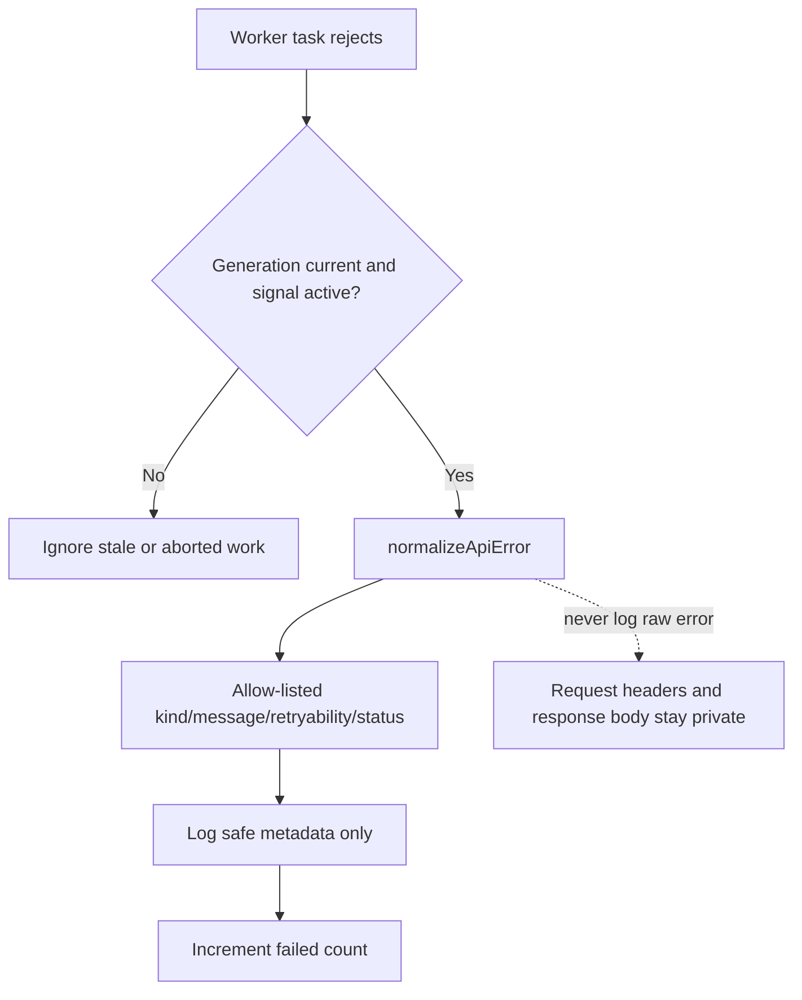
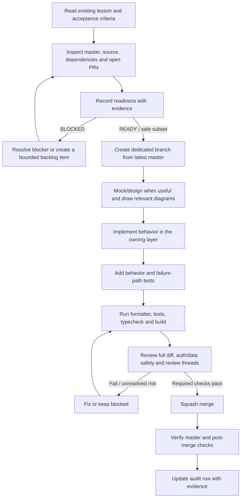
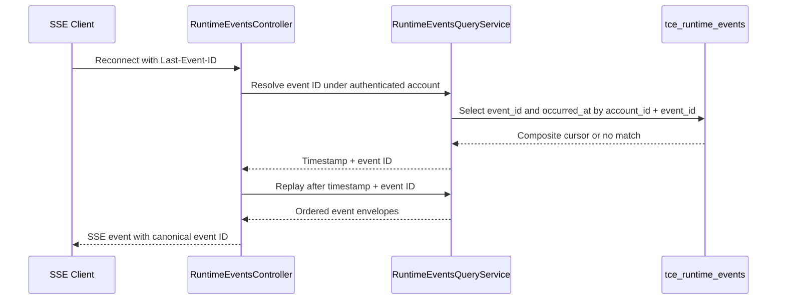

# Senior Frontend Learning — Implementation Audit & Readiness

**Audit date:** 2026-10-31 (current source baseline `171541a`)  
**Repository:** `phanthienquoc/TCE-dashboard`  
**Audited master:** `171541ae67246c3aae264f05a2950bf9f56c7c54`  
**Standard:** [Implementation Readiness Gate](IMPLEMENTATION_READINESS.md)  
**Shared backlog:** [Cross-layer curriculum backlog](backlog/curriculum-implementation-backlog.md)

This evidence-backed snapshot is current through master `171541ae67246c3aae264f05a2950bf9f56c7c54`, the squash merge of PR #994. PR #994's exact code head `7989c82675ef556d426fd2fa1f3d35db83c74118` passed WF-01P `41111968892`, WF-02 `41111968970`, and WF-05 `41111968847`; the unit-test log confirms the safe worker-logging regression ran, and Vitest reported 24 files / 103 tests passed. Post-merge master equals `171541ae67246c3aae264f05a2950bf9f56c7c54`. WF-02 `41112463811`, WF-05 `41112463921`, and WF-01 image/config verification `41112463838` all passed on master. Post-merge verification for these checks is **PASS**; WF-01 verifies images/config/YAML only and does not deploy production. WF-01 verifies images and Kubernetes YAML; it does not deploy production. The latest documented healthcheck still reports TCE web HTTP 200 but central Auth liveness/readiness HTTP 503; PR #994 does not address that independent service condition. Live database verification and production rollout are not claimed.

## System Readiness Check — App-data worker safe error logging (PR #994; 2026-10-31)

**Task:** `DAY10-APP-WORKER-SAFE-LOGGING` — normalize worker task failures before logging and prevent Axios request headers or arbitrary response bodies from reaching console output.

| Area | Status | Evidence |
|---|---|---|
| Scope / acceptance | PASS | `runWithConcurrency` now logs the task key plus allow-listed normalized kind/message/retryability/status, then increments the existing failure count. Scheduling, concurrency, and task completion semantics are unchanged. |
| Default/base/current commit | PASS | Default branch is `master`; branch `fix/day10-app-worker-safe-error-logging-20261031` started at `81bed230141907c92fd0b6e44bad7938c7e83c36`; PR #994 squash-merged at `171541ae67246c3aae264f05a2950bf9f56c7c54`, verified identical to master. |
| Open PR / overlap | PASS | No other open PR matched the two changed paths; the final diff changes only `apps/web/lib/app-data-worker.ts` and `apps/web/lib/app-data-worker.spec.ts`. |
| Source / dependencies | PASS | Inspected the worker, regression spec, and existing `normalizeApiError` implementation. The normalizer uses controlled messages for HTTP/network/timeout outcomes and does not forward arbitrary response bodies. |
| Working-tree / change safety | WARN | Remote GitHub diff and files were reviewed; no local working-tree snapshot or local command execution is available through the connector. |
| Build / tests / CI | PASS | Exact PR head `7989c82675ef556d426fd2fa1f3d35db83c74118` passed WF-01P `41111968892`, WF-02 `41111968970`, and WF-05 `41111968847`. The test log confirms the new regression test passed; Vitest reported 24 files / 103 tests passed. Post-merge WF-02 `41112463811`, WF-05 `41112463921`, and WF-01 `41112463838` all passed on master. |
| Service / infra / deployment | N/A | Client-side logging only; no service, workflow, manifest or deployment behavior changed. |
| Secrets / permissions | PASS / N/A | No new secret was needed. Tests use a synthetic bearer token and synthetic response body; no real secret values are read or exposed. |
| Database / schema / migrations | N/A | No persistence changes. |
| Production risk / rollback | PASS for bounded change | Revert merge `171541a` to restore the previous logger. No production deployment, auth/API contract, account isolation, trading/execution, production configuration, or market-scan schedule change occurred. |

**Readiness decision:** GO for this bounded observability fix. Keep `CURR-SVC-03` open for the broader API/event caller and end-to-end contract audit.

## System Readiness Check — Notifications page account-local state isolation (PR #992; 2026-10-31)

**Task:** `DAY12-NOTIFICATIONS-ACCOUNT-STATE-ISOLATION` — prevent Telegram bot/assignment/loading/error state from a prior authenticated identity remaining renderable after an account transition.

| Area                           | Status                              | Evidence                                                                                                                                                                                                                                                                                                                                                                                                                 |
| ------------------------------ | ----------------------------------- | ------------------------------------------------------------------------------------------------------------------------------------------------------------------------------------------------------------------------------------------------------------------------------------------------------------------------------------------------------------------------------------------------------------------------ |
| Scope / acceptance             | PASS                                | Bounded to the local notification route subtree. The parent keys `NotificationsPageContent` by authenticated user ID; a changed key remounts the subtree, discards old local state, and invokes existing effect cleanup to abort pending paired reads. Existing paired-cache checks, safe errors, and Retry remain unchanged.                                                                                            |
| Default/base/current commit    | PASS                                | Default branch is `master`; branch `fix/day12-notifications-account-state-remount-20261031` started at `47d4779a19bda027385b4172405c3972cbf4cb79`; PR #992 squash-merged at `c44dbb58d33379fa53fefcad1958be0fc52c5636`, verified identical to `master`.                                                                                                                                                                  |
| Open PR / overlap              | PASS                                | Only open PR found was #928, whose changed-file list is only `plan/agentic-task-queue.md`; no overlap with this code or learning audit.                                                                                                                                                                                                                                                                                  |
| Source / dependencies          | PASS                                | Inspected `NotificationsPage`, `telegram-notification-data.ts/spec`, `TelegramBotConfig`, `telegram-bot-config-account.ts/spec`, and `clearAccountScopedStores()`/identity transitions in `apps/web/lib/store.ts`. The config subtree already used an identity key; the notifications list did not.                                                                                                                      |
| Working-tree / change safety   | WARN                                | The GitHub connector exposes remote file/diff evidence but not a local working-tree snapshot or local command execution. The complete PR patch was reviewed remotely.                                                                                                                                                                                                                                                    |
| Build / tests / CI             | PASS before merge; WARN after merge | Exact PR head `f9548b0db91e04677e715a9992f7d235e34a2e58` passed WF-01P `41095290873`, WF-02 `41095290861`, and WF-05 `41095290859`; the test log confirms the new regression test ran. Post-merge backend tests `41095470305` and build/image/Kubernetes-YAML verification `41095470277` passed. Auto-format-on-push `41095470165` was still in progress at this snapshot, so post-merge verification is not fully PASS. |
| Service / infra / deployment   | WARN — independent                  | Latest documented healthcheck reports TCE web HTTP 200 but central Auth liveness/readiness HTTP 503. This UI-only change does not claim to restore Auth. The post-merge build workflow builds/verifies images and YAML; no production deploy was triggered.                                                                                                                                                              |
| Secrets / permissions          | PASS / N/A                          | No new secret was required or accessed. Repository write access was used for the dedicated branch and PR. No secret values were exposed.                                                                                                                                                                                                                                                                                 |
| Database / schema / migrations | N/A for code; WARN for live state   | No persistence change. Live schema/RLS/migration ledger remain unverified and are not required for this UI-only slice.                                                                                                                                                                                                                                                                                                   |
| Production risk / rollback     | PASS for bounded UI change          | No endpoint/auth protocol, server authorization, database, trading/execution, production configuration, or market-scan scheduling change. Rollback is reverting merge `c44dbb5`; no production rollout.                                                                                                                                                                                                                  |

**Readiness decision:** GO for this bounded client-local state isolation only. `CURR-DATA-04` remains NEEDS AUDIT for server snapshot watermark/version, event ordering, and replay/reconciliation guarantees; this change does not solve those contracts.

## System Readiness Check — Telegram notification read-error state (PR #990; 2026-10-30)

**Task:** `DAY10-TELEGRAM-NOTIFICATION-READ-ERROR-01` — require both cached Telegram collections before treating the view as ready, and surface safe read failures rather than a false empty state.

| Area                           | Status                              | Evidence                                                                                                                                                                                                                    |
| ------------------------------ | ----------------------------------- | --------------------------------------------------------------------------------------------------------------------------------------------------------------------------------------------------------------------------- |
| Scope / acceptance             | PASS                                | Both bot and debug-assignment cache values must be arrays. A partial cache triggers a paired authenticated read. Genuine read failures show a normalized safe error and Retry; cancellation remains silent.                 |
| Default/base/current commit    | PASS with base-advance note         | Branch began at master `fd02a6d`. Master advanced to `7af67b1` with only an unrelated production-release-ref guard in `.github/workflows/wf-03-tce-production-deploy.yml`. PR merge-ref CI passed against the updated base. |
| Open PR / overlap              | PASS                                | PR #928 remains open only on `plan/agentic-task-queue.md`; no overlap with these runtime or learning files.                                                                                                                 |
| Source / dependencies          | PASS                                | Inspected `NotificationsPage`, `TelegramBotConfig`, `telegram-notification-data.ts/spec`, `normalizeApiError`, existing authenticated GET methods, account-scoped cache invalidation and effect-owned cancellation.         |
| Working-tree / change safety   | WARN                                | Remote file/diff evidence was reviewed; the connector does not provide a local working-tree snapshot or local command execution.                                                                                            |
| Build / tests / CI             | PASS before merge; WARN after merge | PR head `65e9e99241110a6b8a567844f2efab2384fe86f1` passed WF-01P `41087370680`, WF-02 `41087370830`, WF-05 `41087370764`. Post-merge status/workflow queries returned no records for `2255b26`.                             |
| Service / infra / deployment   | WARN — independent                  | Latest documented healthcheck reports TCE web HTTP 200 but central Auth liveness/readiness HTTP 503. This client-only fix does not claim to restore service health.                                                         |
| Secrets / permissions          | PASS / N/A                          | No new secret was needed or accessed.                                                                                                                                                                                       |
| Database / schema / migrations | N/A for code; WARN for live state   | No persistence change; live schema/RLS/migration ledger remains unverified.                                                                                                                                                 |
| Production risk / rollback     | PASS for bounded UI change          | No endpoint/auth/write/trading/execution/config/schedule changes; no deployment. Rollback is reverting merge `2255b26`.                                                                                                     |

**Readiness decision:** GO for this bounded UI read/cache slice. Keep `CURR-SVC-03` open for the broader API/event caller and end-to-end contract audit; Day 12 remains partially ready because snapshot/event watermark and ordering guarantees are not established.

## System Readiness Check — Day 12 Telegram config local UI state isolation (pre-merge; base `5505809`)

**Task:** `DAY12-TELEGRAM-CONFIG-LOCAL-STATE-ISOLATION` — prevent account-local bot, assignment and form state from surviving a user identity change while an existing Telegram read is still in flight.

| Area                           | Status                                      | Evidence                                                                                                                                                                                                                                                                                      |
| ------------------------------ | ------------------------------------------- | --------------------------------------------------------------------------------------------------------------------------------------------------------------------------------------------------------------------------------------------------------------------------------------------- |
| Scope / acceptance             | PASS                                        | `TelegramBotConfig` is wrapped in a subtree keyed by authenticated `user.id`; identity changes remount the subtree, discard old local state and run the existing effect cleanup that aborts the read.                                                                                         |
| Default/base/current commit    | PASS                                        | Default branch is `master`; base `550580915819da4704c16d119e80d9ea9d2d99d4` was verified identical to master before the task. Dedicated branch `fix/day12-telegram-config-account-remount-20261030` was created from that SHA.                                                                |
| Open PR / branch overlap       | PASS                                        | Only open PR at task start was #928, limited to `plan/agentic-task-queue.md`; it does not overlap this component/helper/spec.                                                                                                                                                                 |
| Source of truth / dependencies | PASS                                        | Inspected `TelegramBotConfig.tsx`, `useAuthStore.user.id`, `useTCEDataStore`, `clearAccountScopedStores()` and the effect-owned `AbortController`. Global stores were cleared on identity change, but component-local bot/assignment/form state previously remained until async data arrived. |
| Working tree / change safety   | WARN                                        | The GitHub connector provides remote file/diff evidence but no local working-tree snapshot or local command execution. Complete PR diff and exact-head CI were reviewed remotely.                                                                                                             |
| Build / test / CI baseline     | PASS / WARN                                 | PR #985 exact-head WF-01P/WF-02/WF-05 passed. Combined status for base master was not surfaced, so that baseline remains unverified.                                                                                                                                                          |
| Service / infra / deployment   | WARN — independent                          | Latest documented healthcheck reported TCE web HTTP 200 but central Auth liveness/readiness HTTP 503. This UI-only change does not alter or claim to recover Auth/service health.                                                                                                             |
| Secrets / permissions          | PASS / N/A                                  | Repository write permission was available; no new secret was required or accessed.                                                                                                                                                                                                            |
| Database / schema / migrations | N/A for implementation; WARN for live state | No database/schema/RLS/migration change. Live schema and migration ledger remain unverified.                                                                                                                                                                                                  |
| Production risk / rollback     | PASS for bounded UI change                  | No endpoint, auth protocol, server-side authorization, Telegram mutation, engine write, trading/execution or scheduling behavior changed. Rollback is reverting PR #986; no deployment is planned.                                                                                            |

**Readiness decision:** GO for this bounded account-local UI state fix only. Day 12 remains partially ready because snapshot/event watermark, ordering and reconciliation guarantees are not established.

## Post-merge verification — PR #985 and PR #986

- **PR #985 — PASS for merge and exact-head CI:** merged at `550580915819da4704c16d119e80d9ea9d2d99d4`; exact head `f445f5475c66dbd57b08263a272710e31b5200ba` passed WF-01P `41080028709`, WF-02 `41080028776`, WF-05 `41080028739`. It adds abort/generation fencing to `engine-runtime-store.ts` and includes that store in `clearAccountScopedStores()`.
- **PR #986 — PASS for merge and exact-head CI:** merged at `05fc77704b2af8c87a2ed89693e9da41b04126bb`; exact head `61ad9d327275fd618e0c91ae4a836abfbe8da455` passed WF-01P `41081363037`, WF-02 `41081363112`, and WF-05 `41081362999`. The Node test log confirms the new account-key regression test ran.
- **Post-merge status — WARN:** combined-status and workflow-run queries returned no records for merge commits `5505809` and `05fc777`. This is unverified, not a claim of failure or success.
- **Safety boundary:** no production deployment, database mutation, auth-protocol change, trading/execution change or market-scan schedule change occurred.

## System Readiness Check — Engine Workflow runtime read cancellation (pre-merge; base e75e338)

**Task:** DAY10-ENGINE-RUNTIME-READ-01 — cancel the existing authenticated engine-runtime GET when its UI lifecycle ends or a newer read supersedes it; prevent stale state/loading commits and show a safe normalized read error. No engine writes or auth contracts are changed.

| Area                           | Status                                       | Evidence                                                                                                                                                                                                                                                                                                                                      |
| ------------------------------ | -------------------------------------------- | --------------------------------------------------------------------------------------------------------------------------------------------------------------------------------------------------------------------------------------------------------------------------------------------------------------------------------------------- |
| Scope / acceptance             | PASS                                         | Bounded Day 10 CURR-SVC-03 slice. Signal reaches Axios; cleanup aborts the read; stale/cancelled outcomes do not update UI state; non-cancellation errors are normalized.                                                                                                                                                                     |
| Default/base/current commit    | PASS                                         | Default branch is master. Dedicated branch fix/day10-engine-runtime-read-cancellation-20261030 was created from e75e338794537a66801c46fcb2a077ddbaf44c19.                                                                                                                                                                                     |
| Open PR / branch overlap       | PASS                                         | PR #928 changes only plan/agentic-task-queue.md; PR #970 merged at 7bf367b and changes only apps/web/lib/keycloak-sso.ts. Neither overlaps this four-file diff. PR #970 had no unresolved inline review threads.                                                                                                                              |
| Source of truth / dependencies | PASS                                         | Inspected EngineWorkflowScreen.tsx, lib/api.ts, engine-runtime-data.ts, DashboardController.getEngineRuntime and EngineRuntimeService.getRuntime. The controller requires the existing Bearer JWT and resolves the account ID; the service reads config/state rows filtered by account_id.                                                    |
| Working tree / change safety   | WARN                                         | The GitHub connector provides file contents and complete PR patches but no local working-tree snapshot or local command execution. The complete four-file diff was reviewed remotely.                                                                                                                                                         |
| Build / test / CI baseline     | PASS / WARN                                  | Base master returned no combined-status or workflow-run records in the available queries (unverified, not PASS). Final PR head 58694a8241862aa2c1cc2a75f36ccf40691c0104 passed WF-01P 41060920532, WF-02 41060920537 and WF-05 41060920340. WF-05 logs include all four new engine-runtime tests; Vitest reports 24 files / 103 tests passed. |
| Service / infra / deployment   | N/A for deployment; PASS for route ownership | Existing authenticated GET only. No service/controller/manifest/workflow/deployment change. No production rollout was triggered.                                                                                                                                                                                                              |
| Secrets / permissions          | PASS / N/A                                   | Repository write access was available. No new secret was required and no secret value was accessed or recorded.                                                                                                                                                                                                                               |
| Database / schema / migrations | N/A for change; WARN for live state          | No schema or persistence change. Live schema/RLS/migration ledger was not queried and remains unverified.                                                                                                                                                                                                                                     |
| Production risk / rollback     | PASS for bounded change                      | Read-only UI lifecycle and safe error display only. Existing engine status writes and dependency gating are unchanged. Rollback is reverting PR #978; no deployment is planned.                                                                                                                                                               |

**Readiness decision:** GO for the bounded read-lifecycle slice only. Keep CURR-SVC-03 open for the broader API/event contract audit.

## Post-merge verification — PR #978 (2026-10-30)

- **Merge state — PASS:** PR #978 was squash-merged at ef40e664662b9df9c55c2cb30b54b4dabc3e4077; master was verified identical to that commit.
- **Exact-head CI — PASS:** PR head 58694a8241862aa2c1cc2a75f36ccf40691c0104 passed WF-01P run 41060920532, WF-02 run 41060920537 and WF-05 run 41060920340. Logs confirm the frontend build, formatter, the four new engine-runtime Node tests, and 24 Vitest files / 103 Vitest tests all passed.
- **Review / diff — PASS:** Four files changed; no unresolved inline review threads. No endpoint, JWT/account-scope contract, engine write path or dependency gating changed.
- **Post-merge checks — WARN:** Combined-status and workflow-run queries returned no records for merge commit ef40e664. This is unverified, not PASS; it does not prove failure or success.
- **Production / data — N/A:** No deployment was requested or performed. Live schema/RLS/migration state remains unverified; no database, auth protocol, trading/execution or market-scan scheduling behavior changed.

## System Readiness Check — stock-event read-limit contract alignment (pre-merge; base `216f2d1`)

**Task:** `DAY10-STOCK-EVENT-LIMIT-01` — align all frontend stock-event readers with the service's existing maximum of 200 without changing the API response contract or expanding the backend limit.

| Area                             | Status                                             | Evidence                                                                                                                                                                                                                                                                                                                                                                       |
| -------------------------------- | -------------------------------------------------- | ------------------------------------------------------------------------------------------------------------------------------------------------------------------------------------------------------------------------------------------------------------------------------------------------------------------------------------------------------------------------------ |
| Scope and acceptance             | PASS                                               | Source shows `DividendPositionsView` requested 2000 while `StockEventsService.getUpcoming` clamps to 200. Acceptance: centralize the frontend read limit at 200, verify the service clamp with tests, preserve auth/endpoint/response shape, and keep `CURR-SVC-03` open.                                                                                                      |
| Default/base/current commit      | PASS                                               | Repository default branch is `master`; replacement branch `fix/day10-stock-event-limit-contract-20261030-216f2d1` was created from latest verified master `216f2d11863a0936edd74529d1405221a3e2eb08` after PR #975 advanced the base.                                                                                                                                          |
| Open PR / branch overlap         | PASS                                               | Open PR #928 changes only `plan/agentic-task-queue.md`; PR #970 merged at `7bf367b` and changes only `apps/web/lib/keycloak-sso.ts`. PR #975 is merged and changed only `apps/service/src/monitor/binance-position-watcher.service.ts`; it does not overlap. Superseded PR #974 was closed unmerged.                                                                           |
| Source of truth and dependencies | PASS                                               | Inspected `DividendPositionsView.tsx`, `DashboardViews.tsx`, `app-data-worker.ts`, `app/stock-events/page.tsx`, `stock-event-store.ts`, lifecycle helper/spec, authenticated `StockEventsController`, `StockEventsService`, Supabase repository and stock-events README. The service cap is shared by the read-only UI and dividend scanner; the task keeps the cap unchanged. |
| Working tree / change safety     | WARN                                               | GitHub connector exposes repository file content and commit diffs but not a local working-tree snapshot or local command execution. Review the full PR diff and use exact-head CI as validation.                                                                                                                                                                               |
| Build/test/CI baseline           | WARN                                               | At task start, combined-status and workflow-run queries returned no records for base `216f2d1`; this was unverified, not PASS. Final PR #976 exact-head CI later passed (see post-merge section), but post-merge status/workflow records remain unavailable.                                                                                                                   |
| Service / infra / deployment     | N/A for deployment; PASS for contract preservation | Only the existing service cap is named as `MAX_LIMIT = 200`; service routing, repository selection, deployment manifests, workflows and runtime configuration are not changed.                                                                                                                                                                                                 |
| Secrets / permissions            | PASS / N/A                                         | Repository write permission is available. No new secret is needed, and no secret values were accessed or recorded.                                                                                                                                                                                                                                                             |
| Database / schema / migrations   | N/A for this change; WARN for live state           | No schema, RLS, migration or database mutation is part of the task. Live schema/ledger state remains unverified and is not needed to align this request limit.                                                                                                                                                                                                                 |
| Production risk and rollback     | PASS for bounded change                            | The frontend stops requesting 2000 and requests 200, which matches the service's existing clamp; no endpoint, auth, response-shape, scanner limit, trading/execution or market-scan schedule behavior is expanded. Rollback is reverting the task PR; no deployment is planned.                                                                                                |

**Readiness decision:** GO for the bounded limit-alignment change. Keep the broader `CURR-SVC-03` audit open; do not raise the service cap or change persistence/auth behavior without a separate task-specific readiness review.

## Post-merge verification — PR #976 (2026-10-30)

- **Merge state — PASS:** PR #976 was squash-merged at `4431264eea50c8adba67a6ca6160ea17a4fddc26`; `master` was verified identical to that commit. The final PR head was `6e3452df2e1f9ff1b0df63a4d4d3117ed7a38777`.
- **Exact-head CI — PASS:** WF-01P run `41054054969`; WF-02 run `41054054925`; WF-05 run `41054054987` (24 Vitest files / 103 Vitest tests plus 263 Node tests); WF-11 run `41054054923`. All four completed successfully on the final PR head.
- **Review / diff — PASS:** No unresolved review threads. The final diff was limited to the stock-event read-limit contract, its tests, the service README and existing Day 10/audit documents.
- **Post-merge checks — WARN:** Combined-status and workflow-run queries returned no records for merge commit `4431264`. Treat that as unverified, not PASS; it does not prove a failure or success.
- **Production / data — N/A:** No deployment was requested or performed. No live schema/RLS/migration query was run; no database, auth, trading/execution or market-scan scheduling behavior changed.

## System Readiness Check — PR #969 post-merge audit refresh (2026-10-30)

**Task:** `DAY10-POSTMERGE-AUDIT-969` — record the merged DividendPositionsView event-read cleanup in the existing Day 9–13 audit artifacts. Documentation-only; no runtime changes.

| Area                             | Status                                  | Evidence                                                                                                                                                                                                                                                                                                                                                   |
| -------------------------------- | --------------------------------------- | ---------------------------------------------------------------------------------------------------------------------------------------------------------------------------------------------------------------------------------------------------------------------------------------------------------------------------------------------------------- |
| Scope and acceptance             | PASS                                    | Record the existing component/helper/spec paths, exact-head CI, merge SHA, and remaining `CURR-SVC-03` work. Keep Day 10 partially ready; do not claim end-to-end completion or production deployment.                                                                                                                                                     |
| Default/base/current commit      | PASS                                    | Current master is `5c193ff4da29ba895bca36a54cc927500b1068b9`, the squash merge of PR #969. This audit branch was created from that latest master SHA.                                                                                                                                                                                                      |
| Open PR / branch overlap         | PASS                                    | PR #928 is limited to `plan/agentic-task-queue.md`; PR #970 merged at `7bf367b` for SSO network-stage diagnostics in `apps/web/lib/keycloak-sso.ts` and does not overlap these audit files. PR #968 was superseded by this current-master audit branch. PR #970 is merged at `7bf367b` and is master evidence for stage-specific SSO error messaging only. |
| Source of truth and dependencies | PASS                                    | Inspected DividendPositionsView, the new lifecycle helper/spec, stock-event store/spec, app-data worker, shared Axios client, and authenticated stock-events controller/service. The helper forwards an effect-owned AbortSignal and leaves store deduplication/generation guards intact.                                                                  |
| Working tree / change safety     | WARN                                    | GitHub connector provides file contents and PR diffs but no local working-tree snapshot or local command execution. The complete source PR diff was reviewed; this audit changes only existing documentation files.                                                                                                                                        |
| Build/test/CI baseline           | PASS / WARN                             | Exact PR #969 head `9b67809a932cf46e7f9ac1e7d6263904616314a4` passed WF-01P `41048947556`, WF-02 `41048947517`, WF-05 `41048947521`, and WF-11 `41048947442`. Combined-status and workflow-run queries returned no post-merge records for `5c193`; post-merge checks remain unverified, not PASS.                                                          |
| Service / infra / deployment     | N/A for this audit                      | No service, manifest, workflow, or deployment change. Independent WF-03 run `41047668004` completed its image-publish/platform-infra-promotion jobs on base SHA `48e384`; this audit did not trigger it and does not claim live rollout verification.                                                                                                      |
| Secrets / permissions            | PASS / N/A                              | Repository write permission is available. No new secret is required; no secret values were read or recorded.                                                                                                                                                                                                                                               |
| Database / schema / migrations   | N/A for this audit; WARN for live state | No persistence/schema/RLS change. Live schema and migration ledger remain unverified and outside this bounded audit.                                                                                                                                                                                                                                       |
| Production risk / rollback       | PASS                                    | Documentation-only evidence update; rollback is reverting the audit PR. No production, auth, database, trading/execution, or market-scan behavior is changed.                                                                                                                                                                                              |
| Branch-protection visibility     | WARN                                    | The connector has returned 403 for branch-protection visibility; direct exact-head workflow evidence is used and hidden rules are not inferred.                                                                                                                                                                                                            |

**Readiness decision:** READY for this documentation-only audit refresh. Preserve WARN for post-merge execution status until a trustworthy status/run source is available. Keep `CURR-SVC-03` open.

## System Readiness Check — PR #963 post-merge audit refresh (2026-10-30)

**Task:** `DAY10-POSTMERGE-AUDIT-963` — refresh the existing Day 9–13 audit matrix and Day 10/source-map/backlog evidence after the bounded Binance chart-history cancellation merged. Documentation-only; no runtime changes.

- **Scope and acceptance — PASS:** Record PR #963 runtime/helper/spec paths, exact-head CI evidence, merge SHA and remaining broader `CURR-SVC-03` audit. Keep Day 10 partially ready and do not claim deployment or end-to-end completion.
- **Default/base/current commit — PASS:** Repository default branch is `master`; current master is merge commit `086d5370f80128e20683dc792f3f02c7608015e3`. Dedicated audit branch `docs/day10-binance-history-audit-20261030` was created from that exact SHA.
- **Open PR/branch overlap — PASS:** PR #963 is merged. The only open PR found is #928, which changes only `plan/agentic-task-queue.md`; no overlap with the audit artifacts. No existing audit branch with this name was found.
- **Source of truth and dependencies — PASS:** Verified PR #963's three changed files and the merged chart component/helper/spec. The public Binance REST request remains read-only; the effect-owned signal is aborted during cleanup. The WebSocket, API/auth contracts, trading/execution paths and data schema are unchanged.
- **Working-tree/change safety — WARN:** The GitHub connector does not expose a local working-tree snapshot. This branch changes only the existing audit matrix, architecture map, shared backlog and Day 10 lesson; review the complete documentation diff before merge.
- **Build/test/CI baseline — PASS / WARN:** Exact PR #963 head `d18f18464a4b8ed151fbc2a6b304f56e126821b2` passed WF-01P run `41037561091`, WF-02 run `41037561173`, and WF-05 run `41037561127`. The three new Node tests passed; Vitest reported 23 files and 101 tests passed. The combined-status query returned no entries for merge SHA `086d537`, and the available workflow-run connector only surfaced PR-triggered runs; post-merge checks remain unverified, not PASS.
- **Service/infrastructure/deployment — N/A:** Documentation-only audit refresh; no service, manifest, workflow, deployment, market-scan schedule or production configuration changes.
- **Secrets/permissions — PASS / N/A:** Repository write permission is available; no secret is required or accessed.
- **Database/schema/migrations — N/A:** No database or schema changes; live schema/RLS remains outside scope.
- **Production risk/rollback — PASS:** Audit metadata only. No production deployment is planned or claimed; rollback is reverting this documentation PR.

**Readiness decision:** GO for this documentation-only audit refresh. Keep post-merge execution status WARN until a trustworthy status/run source is available.

## System Readiness Check — PR #961 post-merge audit refresh (2026-10-30)

**Task:** `DAY10-POSTMERGE-AUDIT-961` — update the existing audit matrix and linked learning artifacts to reflect the merged Engine Control read-cancellation slice, while keeping post-merge verification uncertainty explicit. Documentation-only; no runtime changes.

- **Scope and acceptance — PASS:** Refresh the existing audit matrix, Day 10 lesson, architecture map and shared backlog with PR #961 merge/CI evidence. Keep `CURR-SVC-03` open; do not claim deployment or end-to-end completion.
- **Default/base/current commit — PASS:** Default branch is `master`; current master is merge commit `53b70f907eb24462db207269ddc2092e9c6563c3` from PR #961. Dedicated branch `docs/day10-postmerge-audit-pr961-20261030` was created from that exact SHA.
- **Open PR/branch overlap — PASS:** PR #961 is merged. The only open PR found is #928, limited to `plan/agentic-task-queue.md`; no overlap with the audit artifacts. No existing PR961 post-merge audit branch was found.
- **Source of truth and dependencies — PASS:** Verified PR #961 merge state, its six changed files, the Engine Control consumer/helper and three tests. Existing API methods accept `AbortSignal`; engine toggle writes and auth/API contracts are unchanged.
- **Working-tree/change safety — WARN:** The GitHub connector does not expose a local working-tree snapshot. The complete documentation-only diff must be reviewed before merge.
- **Build/test/CI baseline — PASS / WARN:** Exact PR #961 head `ec240d8662597b3982263fe74b7071a76a26e735` passed WF-01P #41030892797, WF-02 #41030892857 and WF-05 #41030892904 (253 tests passed, 0 failed, including all three Engine Control specs). Combined status and the available workflow-run query returned no post-merge records for `53b70f9`; post-merge checks remain unverified, not PASS.
- **Service/infrastructure/deployment — N/A:** Documentation-only refresh; no service, infra, deployment, market-scan schedule or production configuration change.
- **Secrets/permissions — PASS / N/A:** Repository write permission is available; no secret is required or accessed.
- **Database/schema/migrations — N/A:** No database or schema changes; live schema/RLS state is outside scope.
- **Production risk/rollback — PASS:** Audit metadata only. No production deployment is planned or claimed; rollback is reverting this documentation PR.

**Readiness decision:** GO for the documentation-only audit refresh. Preserve WARN for post-merge execution status until a trustworthy status/run source is available.

## System Readiness Check — PR #957 post-merge audit refresh (2026-10-30)

**Task:** `DAY10-POSTMERGE-AUDIT-01` — refresh existing audit artifacts to reflect the merged Telegram notification read-lifecycle slice and distinguish pre-merge CI evidence from post-merge verification. Documentation-only; no runtime changes.

| Area                              | Status | Evidence                                                                                                                                                                                                                                                                                      |
| --------------------------------- | ------ | --------------------------------------------------------------------------------------------------------------------------------------------------------------------------------------------------------------------------------------------------------------------------------------------- |
| Scope and acceptance              | PASS   | Update the existing audit matrix, architecture map, shared backlog and Day 10 lesson with PR #957's merge SHA, exact-head checks, and remaining post-merge uncertainty. Do not close `CURR-SVC-03` or claim production deployment.                                                            |
| Default/base/current commit       | PASS   | Repository default/base is `master`; `master` is identical to merge commit `6b3beb546409358cf9cc1a8f000a4527f02255ab`. Dedicated branch `docs/day10-postmerge-audit-20261030` was created from that exact SHA.                                                                                |
| Open PR/branch overlap            | PASS   | Only PR #928 is open; it changes `plan/agentic-task-queue.md`, not the audit artifacts in scope. PR #957 is merged.                                                                                                                                                                           |
| Source of truth and dependencies  | PASS   | Verified PR #957 merged state, changed-file list, runtime helper/components and user-scoped Telegram GET handlers. Exact PR head `052c301ad522d98802a13e88ed48c6a48c636de7` passed WF-01P #41024683065, WF-02 #41024683023 and WF-05 #41024682994 before merge.                               |
| Working tree/change safety        | WARN   | Connector exposes branch/file content and PR diffs, not a local working-tree snapshot. Review the complete documentation-only PR diff before merge.                                                                                                                                           |
| Build/test/CI baseline            | WARN   | Pre-merge exact-head CI passed. Querying combined status for merge SHA `6b3beb5` returned no status entries and the available workflow-run connector surfaced no post-merge runs; post-merge checks remain unverified, not PASS. Documentation PR will require its own Prettier/WF-05 checks. |
| Service/infrastructure/deployment | N/A    | Documentation-only refresh; no service, infra, deployment, market-scan schedule or production config change.                                                                                                                                                                                  |
| Secrets/permissions               | PASS   | Repository write permission is available; no secret is required or accessed.                                                                                                                                                                                                                  |
| Database/schema/migrations        | N/A    | No database or schema changes; live schema/RLS remains outside scope.                                                                                                                                                                                                                         |
| Production risk/rollback          | PASS   | Low-risk audit metadata only. Rollback is reverting this documentation PR; no production deployment is planned or claimed.                                                                                                                                                                    |

**Readiness decision:** GO for the documentation-only post-merge audit refresh. Keep post-merge execution status WARN until a trustworthy run/status source is available.

## Post-merge verification — PR #957 (2026-10-30)

| Check                 | Status | Evidence                                                                                                                                                                                              |
| --------------------- | ------ | ----------------------------------------------------------------------------------------------------------------------------------------------------------------------------------------------------- |
| Merge state           | PASS   | PR #957 is closed/merged at `6b3beb546409358cf9cc1a8f000a4527f02255ab`; comparing `master` to that SHA returns identical, with zero commits ahead/behind.                                             |
| Pre-merge CI          | PASS   | Exact PR head `052c301ad522d98802a13e88ed48c6a48c636de7` passed WF-01P #41024683065, WF-02 #41024683023 and WF-05 #41024682994.                                                                       |
| Post-merge checks     | WARN   | Combined-status query for merge SHA returned no status entries, and the available workflow-run connector surfaced no post-merge runs. This is unverified, not a pass; no post-merge CI claim is made. |
| Production/deployment | N/A    | No deployment, service change, database migration, auth change or trading/execution behavior was requested or performed.                                                                              |

## System Readiness Check — Telegram notification read lifecycle (2026-10-30)

**Task:** `DAY10-TELEGRAM-READ-01` — make Telegram bot/assignment reads abortable and prevent stale notification UI state after route unmount or account switch. Scope is limited to existing notifications list/detail/config read paths and a shared client-side loader; write/mutation calls are excluded.

| Area                              | Status | Evidence                                                                                                                                                                                                                                                                                                                                  |
| --------------------------------- | ------ | ----------------------------------------------------------------------------------------------------------------------------------------------------------------------------------------------------------------------------------------------------------------------------------------------------------------------------------------- |
| Scope and acceptance              | PASS   | Target: forward `AbortSignal` to existing authenticated GETs, abort superseded/unmounted reads, and commit result/loading state only for the current account/effect. No new API, auth, schema, or mutation semantics.                                                                                                                     |
| Default/base/current commit       | PASS   | Repository default branch is `master`; dedicated branch `fix/day10-telegram-read-lifecycle-20261030` was created from exact master SHA `e093b8521730eaef3b6d1b2e7ce5b6e6b0c095ee`, the squash merge of PR #956.                                                                                                                           |
| Open PR/branch overlap            | PASS   | Open PR #928 changes only `plan/agentic-task-queue.md`; it does not overlap this task. PR #956 is merged.                                                                                                                                                                                                                                 |
| Source of truth and dependencies  | PASS   | Inspected `apps/web/lib/api.ts` (`platformApi.telegramBots(signal?)`, `telegramDebugAssignments(signal?)`), `apps/web/app/notifications/page.tsx`, `app/notifications/[id]/page.tsx`, `app/notifications/TelegramBotConfig.tsx`, and `apps/web/lib/tce-data-store.ts`. Existing endpoint/auth contracts and cache ownership are retained. |
| Working tree/change safety        | WARN   | GitHub connector exposes branch/file content and PR diffs, not a local working-tree snapshot. Review the complete PR diff before merge.                                                                                                                                                                                                   |
| Build/test/CI baseline            | PASS   | Exact PR head `9baa4327d21089a6b2a02e7707f2a367caba706e` passed WF-01P run `41024441808`, WF-02 run `41024441810`, and WF-05 run `41024441832`. The earlier Prettier failure was on the prior head and formatting was corrected; cancelled duplicate runs are not counted.                                                                |
| Service/infrastructure/deployment | N/A    | These are client-side reads against existing authenticated GET endpoints. No service, workflow, manifest, deployment, or market-scan schedule change is needed.                                                                                                                                                                           |
| Secrets/permissions               | PASS   | Repository write permission is confirmed. No secret is required, read, or modified.                                                                                                                                                                                                                                                       |
| Database/schema/migrations        | N/A    | No schema/persistence contract changes. Live schema/RLS/ledger is not queried because this bounded task does not require it.                                                                                                                                                                                                              |
| Production risk and rollback      | PASS   | Low-risk client-side cancellation/state-commit guards; no trading/execution path or server side effects. Rollback is reverting this PR. No production deployment is planned or claimed.                                                                                                                                                   |

**Readiness decision: GO for this bounded client read-lifecycle slice only.** Any broader API-caller audit, auth protocol, persistence/versioning, or production change requires its own readiness check.

## System Readiness Check — post-merge learning audit refresh (2026-10-30)

**Task:** `DAY9-13-AUDIT-POSTMERGE-955` — refresh the existing Day 9–13 implementation matrix and linked evidence after PRs #951, #952, #953 and #955 merged. This task changes documentation only.

| Area                              | Status | Evidence                                                                                                                                                                                                                                                                                                                                                                                                                                                                                                                                                                                              |
| --------------------------------- | ------ | ----------------------------------------------------------------------------------------------------------------------------------------------------------------------------------------------------------------------------------------------------------------------------------------------------------------------------------------------------------------------------------------------------------------------------------------------------------------------------------------------------------------------------------------------------------------------------------------------------- |
| Scope and acceptance              | PASS   | Update the existing audit matrix, source map, shared backlog and Day 10/12/13 evidence; retain all blockers and do not create lesson files or runtime scope. Existing Mermaid component/data-flow and read-lifecycle diagrams remain the relevant design artifacts.                                                                                                                                                                                                                                                                                                                                   |
| Default/base/current commit       | PASS   | Default branch is `master`; current master at task start is `d79404ec62250ddf2762620f6819318daf029412`, the squash merge of PR #955. The dedicated branch was created from this exact SHA.                                                                                                                                                                                                                                                                                                                                                                                                            |
| Open PR/branch overlap            | PASS   | Only open PR is draft #928; its changed file is `plan/agentic-task-queue.md`, so there is no overlap with these learning files. PR #936 remains closed unmerged.                                                                                                                                                                                                                                                                                                                                                                                                                                      |
| Source of truth and dependencies  | PASS   | Rechecked `apps/web/lib/stock-event-store.ts`, `app-data-worker.ts`, the `clearAccountScopedStores()` path, account-cache-isolation tests and the existing Day 13 source map. Existing Axios/Zustand and route contracts remain unchanged.                                                                                                                                                                                                                                                                                                                                                            |
| Working-tree/change safety        | WARN   | The connector exposes GitHub branch/file state but not a local working-tree snapshot. The complete PR diff will be reviewed; this branch changes documentation only.                                                                                                                                                                                                                                                                                                                                                                                                                                  |
| Build/test/CI baseline            | WARN   | PR #955 exact head `ad1664f06ed48972dd3915ef105551b08f91cc14` passed frontend build run 41013983958, Prettier run 41013984089 and backend/root tests run 41013983940. On master `d79404e`, backend unit tests run 41014092643, Build + Verify TCE images and PROD config run 41014092714, and Auto-format on push run 41014092678 passed. Duplicate runs were cancelled/skipped; no separate local test run is available through this connector. The final PR head must pass its own Prettier/Markdown and test checks before merge; inherited master checks do not validate this documentation diff. |
| Service/infrastructure/deployment | N/A    | Documentation-only refresh; no service, manifest, workflow, runtime configuration, deployment or market-scan schedule changes.                                                                                                                                                                                                                                                                                                                                                                                                                                                                        |
| Secrets/permissions               | PASS   | Repository write permission is available for the branch/PR; this task requires no secrets. No secret values were read or changed.                                                                                                                                                                                                                                                                                                                                                                                                                                                                     |
| Database/schema/migrations        | WARN   | No database mutation. Live schema, RLS and migration-ledger state were not queried and remain unverified.                                                                                                                                                                                                                                                                                                                                                                                                                                                                                             |
| Production risk and rollback      | PASS   | Reverting this documentation-only change restores the previous audit snapshot; no production rollout or runtime rollback is involved.                                                                                                                                                                                                                                                                                                                                                                                                                                                                 |

**Readiness decision: GO for audit/documentation refresh only.** This does not authorize runtime optimization, browser WebSocket auth, database changes or production deployment.

This snapshot does not replace a task-specific readiness check before any future runtime, authentication, database, trading or deployment change.

## System Readiness Check — post-merge Day 10 audit refresh (2026-10-30)

**Task:** `DAY10-AUDIT-POSTMERGE-953` — reconcile the Day 9–13 audit matrix and architecture/backlog evidence after PR #953 merged.

| Area                                | Status                                           | Evidence                                                                                                                                                                                                                                                                                                            |
| ----------------------------------- | ------------------------------------------------ | ------------------------------------------------------------------------------------------------------------------------------------------------------------------------------------------------------------------------------------------------------------------------------------------------------------------- |
| Scope and acceptance                | PASS                                             | Refresh the existing Day 9–13 audit matrix, architecture source map, and shared backlog with the merged Day 10 pool-read lifecycle evidence. Keep broader API-caller audit and unrelated Day 11–13 blockers open.                                                                                                   |
| Default/base and commit             | PASS                                             | Default branch is `master`; this documentation branch was created from `2434a27510044e08ae1b0ba6ce5501bbc163b5cf`, the squash merge of PR #953.                                                                                                                                                                     |
| Open PR overlap                     | PASS                                             | The only other open PR is #928, which changes only `plan/agentic-task-queue.md`; it does not overlap the learning audit, architecture map, backlog, or Day 10 lesson.                                                                                                                                               |
| Source of truth and dependencies    | PASS                                             | Verified merged `apps/web/lib/stock-dividend-pool-store.ts`, `apps/web/lib/app-data-worker.ts`, both pool page consumers, the regression specs, Day 10 lesson, and the existing authenticated controller/service contract.                                                                                          |
| Working-tree/change safety          | WARN                                             | GitHub branch and file diffs are observable, but no local working-tree snapshot is available through this connector. This branch is based on the exact master merge SHA; planned changes are documentation-only.                                                                                                    |
| Build/test/CI baseline              | PASS for PR head; WARN for post-merge visibility | PR #953 exact head `39abde70b07fe35ef86f0f8f1d24f3324248c8a6` passed WF-01P run 41012494912, WF-02 run 41012494814, and WF-05 run 41012494856. Post-merge status/workflow endpoints returned no records for merge SHA `2434a27510044e08ae1b0ba6ce5501bbc163b5cf`; do not claim a separate master push check passed. |
| Service, infrastructure, deployment | N/A                                              | This refresh changes documentation only. No service, workflow, manifest, runtime configuration, deployment, or market-scan schedule changes.                                                                                                                                                                        |
| Secrets and permissions             | PASS                                             | No secret values read or changed; no new permission required.                                                                                                                                                                                                                                                       |
| Database/schema/migrations          | N/A for changes; WARN for live state             | No database/schema/migration change. Live schema/RLS/ledger state remains unverified and unchanged.                                                                                                                                                                                                                 |
| Production risk and rollback        | PASS for documentation                           | No runtime behavior changes. Reverting this documentation-only commit restores the previous audit snapshot; no deployment rollback applies.                                                                                                                                                                         |

**Readiness decision: GO for audit refresh only.** PR #953's runtime change and exact-head CI are evidenced; post-merge workflow status is not exposed by the available status endpoints. No production or environment verification is claimed.

---

## 1. System Readiness Check

| Area                          | Status                                                                                       | Evidence                                                                                                                                                                                                                                                                                                                                                            |
| ----------------------------- | -------------------------------------------------------------------------------------------- | ------------------------------------------------------------------------------------------------------------------------------------------------------------------------------------------------------------------------------------------------------------------------------------------------------------------------------------------------------------------- |
| Scope and criteria            | PASS                                                                                         | Reviewed all five existing Day 9–13 lesson files, shared readiness gate, cross-layer backlog, Day 13 backlog, source map, and related merged/open PRs through PR #953. No root `curriculum/` directory exists; the learning-specific backlog is under `docs/learning/backlog/`.                                                                                     |
| Default branch and base       | PASS                                                                                         | Default branch is `master`. This post-merge audit refresh is based on master `2434a27510044e08ae1b0ba6ce5501bbc163b5cf`, after PR #953 added the Day 10 pool-read lifecycle fix.                                                                                                                                                                                    |
| Open PR overlap               | PASS                                                                                         | PR #953 is merged at `2434a27`. The only other open PR found is #928, which changes only `plan/agentic-task-queue.md`; it does not overlap the learning audit, source map, backlog, or Day 10 lesson. PR #936 remains closed without merge.                                                                                                                         |
| Source and dependencies       | PASS for Day 10 quote validation and pool-read lifecycle; PARTIAL for the curriculum overall | Verified `apps/web/lib/store.ts`, `apps/web/lib/api.ts`, `apps/web/lib/market-price-validation.ts`, `apps/web/lib/stock-dividend-pool-store.ts`, `apps/web/lib/app-data-worker.ts`, the pool controller/service, and their regression specs. Day 11 WebSocket auth, Day 12 snapshot/event ordering, and Day 13 profiling remain unresolved as detailed below.       |
| Working-tree/change safety    | WARN                                                                                         | Branch heads and complete PR diffs are observable through GitHub; a local working-tree snapshot is not available through this connector.                                                                                                                                                                                                                            |
| Build/test baseline           | PASS for PR #953 exact-head CI; WARN for separate post-merge status visibility               | Final head `39abde70b07fe35ef86f0f8f1d24f3324248c8a6` passed WF-01P run 41012494912, WF-02 run 41012494814, and WF-05 run 41012494856. Status/workflow endpoints returned no separate post-merge records for `2434a27510044e08ae1b0ba6ce5501bbc163b5cf`; no production deployment occurred.                                                                         |
| Infrastructure and deployment | N/A for this audit refresh                                                                   | This branch changes learning documentation only. No deployment, workflow, manifest, service configuration, or live environment was changed.                                                                                                                                                                                                                         |
| Secrets and permissions       | N/A for this audit refresh                                                                   | No secret values were read or changed. The merged PR's master workflow checked required-secret presence without printing values; that is not a production verification claim.                                                                                                                                                                                       |
| Database/schema/migrations    | WARN / unresolved                                                                            | No live schema, RLS, or migration-ledger query was performed. Keep `CURR-DATA-04` and the open migration-provenance PR #928 as unresolved; no database mutation is authorized.                                                                                                                                                                                      |
| Production risk and rollback  | PASS for documentation; PASS for bounded Day 10 client reads                                 | PR #953 changes only the dividend-pool client read lifecycle, worker cancellation propagation, tests, and Day 10 evidence. It does not change auth protocol, database schema/RLS, trading strategy, execution, market-scan schedules, or deployment. Rollback is reverting squash commit `2434a275`; no deployment rollback applies because no deployment occurred. |

### Readiness decisions

- **GO / merged:** Day 10 market-price payload validation and dividend-pool read lifecycle are implemented in their actual client store paths. PR #953 exact-head WF-01P, WF-02, and WF-05 passed; separate post-merge workflow records for `2434a275` were not surfaced. No environment or production verification is claimed.
- **PARTIALLY READY:** Day 9 architecture/source mapping is verified, but an authenticated Server Component migration remains unjustified until session propagation, freshness, loading/error, and deployment contracts are designed.
- **PARTIALLY READY:** Day 10 quote validation and dividend-pool cancellation/stale-response protection are implemented and CI-verified. The broader audit of every API read caller is not yet complete.
- **BLOCKED:** Day 11 browser quote streaming remains blocked by `CURR-AUTH-07`. An HTTP preflight does not authenticate the later browser WebSocket upgrade; never put bearer tokens in a URL.
- **PARTIALLY READY / contract blocked:** Day 12 has existing stores and account-scoped replay, but no verified universal snapshot watermark or complete normalized entity cache. Keep `CURR-DATA-04` unresolved.
- **BLOCKED:** Day 13 runtime optimization remains blocked until `PERF-13-01` call-site tracing, `PERF-13-02` reproducible baseline, and `PERF-13-03` acceptance criteria are completed. Do not add speculative memoization or virtualization.
- **Inventory gap:** Day 1–8 lesson files are absent from the inspected `docs/learning/` listing. Keep `CURR-CATALOG-06` blocked; do not invent or claim those lessons were reviewed.

## 2. Audit matrix — existing Day 9–13 lessons

| Lesson                                        | Explicit requirement                                                                                                                                                                          | Source paths                                                                                                                                                                                                                                                                                                                                                                                                                                                                                                                                                                                                                                                                                                                                                             | Actual implementation evidence on master                                                                                                                                                                                                                                                                                                                                                                                            | Tests and verification                                                                                                                                                                                                                                                                                                                                                   | Diagram/design artifact                                                                                                                                                   | Readiness                                                                                                                                                                                  | Remaining work                                                                                                                                                                            | PR/merge status                                                                                                                                                                                                       |
| --------------------------------------------- | --------------------------------------------------------------------------------------------------------------------------------------------------------------------------------------------- | ------------------------------------------------------------------------------------------------------------------------------------------------------------------------------------------------------------------------------------------------------------------------------------------------------------------------------------------------------------------------------------------------------------------------------------------------------------------------------------------------------------------------------------------------------------------------------------------------------------------------------------------------------------------------------------------------------------------------------------------------------------------------ | ----------------------------------------------------------------------------------------------------------------------------------------------------------------------------------------------------------------------------------------------------------------------------------------------------------------------------------------------------------------------------------------------------------------------------------- | ------------------------------------------------------------------------------------------------------------------------------------------------------------------------------------------------------------------------------------------------------------------------------------------------------------------------------------------------------------------------ | ------------------------------------------------------------------------------------------------------------------------------------------------------------------------- | ------------------------------------------------------------------------------------------------------------------------------------------------------------------------------------------ | ----------------------------------------------------------------------------------------------------------------------------------------------------------------------------------------- | --------------------------------------------------------------------------------------------------------------------------------------------------------------------------------------------------------------------- |
| Day 9 — Next.js                               | Keep Server/Client boundaries, route ownership, auth/session and cache freshness correct; do not migrate SSR without a verified session design.                                               | `apps/web/app/layout.tsx`; `app/providers.tsx`; `app/dashboard/page.tsx`; `app/overview/page.tsx`; `components/dashboard/DashboardShell`; `lib/api.ts`.                                                                                                                                                                                                                                                                                                                                                                                                                                                                                                                                                                                                                  | `/dashboard` redirects to `/overview`; overview and providers are Client Components owning browser state/auth/realtime. No SSR migration was implemented or required by the lesson alone.                                                                                                                                                                                                                                           | Current frontend build verifies compilation only; no end-to-end SSR/session propagation test was evidenced in this audit.                                                                                                                                                                                                                                                | Component architecture diagram in `architecture-map.md`; no mock needed because no UI change is proposed.                                                                 | PARTIALLY READY                                                                                                                                                                            | Document session propagation, freshness, loading/error and runtime deployment before any SSR migration.                                                                                   | Lesson PR #909 merged docs-only at `9d7df52`; source map PR #948 merged at `e798834`.                                                                                                                                 |
| Day 10 — REST/errors/cancellation             | Normalize safe errors; propagate AbortSignal; guard stale/loading commits; validate quotes; cancel existing read consumers and align stock-event reads to the service-supported limit of 200. | `apps/web/lib/api.ts`; `api-errors.ts`; `store.ts`; `market-price-validation.ts`; `tce-data-store.ts`; pool/event stores; Telegram/Engine Control helpers; Binance chart-history/XAU helpers; `DividendPositionsView.tsx`; `DashboardViews.tsx`; `app-data-worker.ts`; `apps/web/lib/app-data-worker.spec.ts`; `app/stock-events/page.tsx`; `stock-event-read-lifecycle.ts`; `stock-events.service.ts`; `apps/web/app/settings/engine/EngineWorkflowScreen.tsx`; `apps/web/lib/engine-runtime-data.ts`; `apps/web/components/dashboard/DividendOneYearCandleChart.tsx`; `apps/web/lib/dividend-ohlcv-store.ts`; `apps/web/lib/stock-sync-store.ts` and specs; `apps/web/app/notifications/page.tsx`; `apps/web/app/notifications/TelegramBotConfig.tsx`; `apps/web/lib/telegram-notification-data.ts` and spec. | PR #983 merged Stock Events Sync safe-error normalization. PR #990 merged at `2255b26`: both Telegram consumers now require both cached collections to be arrays; partial cache triggers the paired authenticated read, and NotificationsPage shows a normalized safe error plus Retry rather than a false empty state. PR #994 merged at `171541a`: `app-data-worker.ts` now logs only allow-listed `normalizeApiError` metadata instead of raw Axios errors; task failure counting is preserved. Existing endpoints, authentication, payloads, write semantics and account scope remain unchanged.           | `telegram-notification-data.spec.ts` covers complete/partial cache values, HTTP 500 safe messaging and generic fallback without internal details; `app-data-worker.spec.ts` covers synthetic bearer/response-body redaction, normalized safe message/retryability/status, and preserved failure counting. PR #990 head `65e9e99241110a6b8a567844f2efab2384fe86f1` passed WF-01P `41087370680`, WF-02 `41087370830`, WF-05 `41087370764`; PR #994 head `7989c82675ef556d426fd2fa1f3d35db83c74118` passed WF-01P `41111968892`, WF-02 `41111968970`, WF-05 `41111968847`. Post-merge WF-02 `41112463811` and WF-05 `41112463921` passed; WF-01 `41112463838` remained in progress. | Existing Day 10 read-lifecycle sequences plus the paired-cache/read-error sequence in PR #990 and the Day 10 lesson.                                                      | PARTIALLY READY; PR #994 safe worker logging merged; exact-head CI and post-merge WF-02/WF-05/WF-01 all passed; broader caller/end-to-end audit remains open.                                                            | Continue the broader API-read caller and end-to-end contract audit; do not change write behavior, caps or service contracts without separate readiness evidence.                          | PRs #976 `4431264`; #978 `ef40e66`; #981 `dc11adc`; #983 `66da3a0`; #990 `2255b26`; #994 `171541a`. Exact-head CI passed; PR #994 post-merge WF-02/WF-05/WF-01 all passed; no production deployment claimed.                                           |
| Day 11 — WebSocket/SSE/reconnect/backpressure | Preserve bounded reconnect, durable replay, cursor ordering, event identity, auth-expiry handling, and backpressure safety.                                                                   | `apps/web/lib/microfe-ws.ts`; `microfe-ws.spec.ts`; `apps/web/lib/keycloak-sso.ts`; `apps/service/src/runtime-events/runtime-events.controller.ts`; `runtime-events.query.service.ts`; `runtime-events.websocket.ts`; `libs/contracts/src/tce-event.contract.ts`.                                                                                                                                                                                                                                                                                                                                                                                                                                                                                                        | Platform deployment WebSocket has bounded reconnect behavior; runtime event API supports account-scoped replay and `Last-Event-ID` resume. PR #966 improves SSO session-exchange error reporting; PR #970 merged at `7bf367b` and adds stage-specific Keycloak token endpoint versus central Auth network-failure diagnostics. Neither change implements browser WebSocket authentication/upgrade.                                  | `microfe-ws.spec.ts`; runtime-events controller/query/cursor specs cover relevant server-side paths. PR #970 changed only `keycloak-sso.ts`; no dedicated frontend regression spec or verified browser-to-runtime-WebSocket auth integration test exists.                                                                                                                | SSE resume sequence and SSO-error-vs-WebSocket-auth flow in the Day 11 lesson; secure socket handshake remains design-only in the backlog.                                | PARTIALLY READY; quote stream BLOCKED.                                                                                                                                                     | Verify deployed routing/cookie scope and approve a secure handshake; add integration tests for identity, expiry/replay, origin and account binding before implementing a frontend stream. | Lesson PR #931, reconnect PR #943, SSE resume PR #946, auth blocker PR #947, SSO diagnostics PR #966 and #970 merged; broad PR #936 closed unmerged.                                                                  |
| Day 12 — Normalization/cache                  | Establish stable scope-correct entity identity, cache ownership, freshness, and snapshot/event ordering before merging streams into state.                                                    | `apps/web/lib/store.ts`; `apps/web/lib/tce-data-store.ts`; `apps/web/lib/engine-runtime-store.ts` and spec; `apps/web/lib/account-cache-isolation.spec.ts`; `apps/web/app/notifications/TelegramBotConfig.tsx`; `apps/web/lib/telegram-bot-config-account.ts` and spec; `apps/web/app/notifications/page.tsx`; `apps/web/lib/telegram-notification-account.ts` and spec; `apps/web/lib/telegram-notification-data.ts/spec`; runtime-event query service/contracts.                                                                                                                                                                                                                                                                                                       | PR #951 clears account-scoped stores; PR #985 adds Engine Runtime abort/generation fencing; PR #986 keys Telegram config local state; PR #990 enforces paired-cache completeness; PR #992 keys `NotificationsPageContent` by authenticated user ID, discarding prior local bot/assignment/loading/error state and invoking existing read cleanup on identity change. No universal server snapshot watermark/version is established. | `account-cache-isolation.spec.ts`, `engine-runtime-store.spec.ts`, `telegram-bot-config-account.spec.ts`, `telegram-notification-account.spec.ts`, and `telegram-notification-data.spec.ts`. PR #992 code head `f9548b0db91e04677e715a9992f7d235e34a2e58` passed WF-01P `41095290873`, WF-02 `41095290861`, and WF-05 `41095290859`; logs confirm the new test ran.      | Day 12 account-clear and keyed Telegram UI lifecycle sequences; paired-cache/read-error sequence; notification subtree remount sequence in PR #992 and the Day 12 lesson. | PARTIALLY READY; account-local UI isolation improved and exact-head CI-verified; snapshot/event ordering remains unresolved. Current-master WF-02 `41112463811`, WF-05 `41112463921`, and WF-01 `41112463838` all passed after PR #994. | Continue `CURR-DATA-04`: verify producer watermark/version, replay/reconciliation, and account binding before changing cache shape or schema.                                             | PR #951 `5f03443`; #985 `5505809`; #986 `05fc777`; #990 `2255b26`; #992 merged at `c44dbb5`. Exact-head CI PASS; historical post-merge unit/image-config checks passed; current-master WF-02, WF-05 and WF-01 all passed after PR #994; no production deployment. |
| Day 13 — Performance profiling                | Trace selectors/components, establish a reproducible profile and define correctness/performance acceptance before optimizing.                                                                 | `apps/web/lib/store.ts`; `tce-data-store.ts`; actual components under `apps/web/components/dashboard/`; Day 13 implementation backlog.                                                                                                                                                                                                                                                                                                                                                                                                                                                                                                                                                                                                                                   | PERF-13-01 source map is complete via PR #952 and records real subscriptions, row keys, refresh paths and candidate costs. No measured bottleneck or runtime optimization is evidenced; quote sync remains HTTP polling.                                                                                                                                                                                                            | No performance baseline/replay artifact exists; correctness tests do not prove performance gain.                                                                                                                                                                                                                                                                         | Profiling workflow in Day 13 lesson and Mermaid source-flow diagram in the backlog; no before/after profile exists.                                                       | BLOCKED for runtime optimization.                                                                                                                                                          | Complete PERF-13-02 reproducible baseline and PERF-13-03 acceptance criteria before implementing a measured, correctness-preserving change.                                               | Lesson PR #937 merged docs-only; source map PR #952 merged at `a6bf2a0`; runtime optimization not started.                                                                                                            |

## 2.1 Supporting learning artifacts

| Artifact                                                        | Requirement / acceptance                                                                                                                | Actual implementation evidence                                                                                                                                                                                                                                                                                                                                                                                                                                                                                                                   | Tests and diagrams                                                                                                                                                                                                                                                | Readiness                                                                          | Remaining work                                                                                                     | PR/merge status                                                                                                                                    |
| --------------------------------------------------------------- | --------------------------------------------------------------------------------------------------------------------------------------- | ------------------------------------------------------------------------------------------------------------------------------------------------------------------------------------------------------------------------------------------------------------------------------------------------------------------------------------------------------------------------------------------------------------------------------------------------------------------------------------------------------------------------------------------------ | ----------------------------------------------------------------------------------------------------------------------------------------------------------------------------------------------------------------------------------------------------------------- | ---------------------------------------------------------------------------------- | ------------------------------------------------------------------------------------------------------------------ | -------------------------------------------------------------------------------------------------------------------------------------------------- |
| `IMPLEMENTATION_READINESS.md`                                   | Shared readiness gate for source ownership, cross-layer impacts, runtime implementation, verification, operations, backlog and safety.  | Process contract only; it does not implement product behavior or prove any task is complete.                                                                                                                                                                                                                                                                                                                                                                                                                                                     | Prettier/Markdown validation; checklist is the reusable evidence standard. No runtime test applies.                                                                                                                                                               | PASS as a shared standard. Each task must record its own evidence and N/A reasons. | Keep the gate aligned with repository workflows; never mark a task complete from docs/tests alone.                 | PR #944 merged at `41b0afa`.                                                                                                                       |
| `architecture-map.md`                                           | Map existing lessons to actual routes, components, stores, services, contracts and unresolved dependencies.                             | Current map includes App Router boundaries, centralized API/auth, dashboard stores, quote validator, pool/event/Telegram/Engine Control, Engine Runtime cache isolation, Telegram config account-keyed local state, Binance chart-history/XAU, stock-event limit contract, Dividend OHLCV cancellation and Stock Events Sync safe-error handling; unresolved WS auth/persistence contracts remain. PR #990 adds paired Telegram cache completeness and safe notifications-read error handling; current source baseline is `2255b26`.             | Mermaid component/data-flow diagrams plus Day 10 stock-event limit, Engine Workflow runtime-read, Dividend OHLCV read-lifecycle, and Stock Events Sync error-flow sequences. Paired-cache/read-error sequence added in PR #990 and the Day 10 lesson.             | PASS for source mapping only; DB/RLS and WS auth remain unverified/blocked.        | Recheck source paths after relevant code merges and preserve unknowns rather than infer contracts.                 | Refreshed against master `2255b26`; PR #990 exact-head CI passed; post-merge status WARN; no production deployment claimed.                        |
| `implementation-audit-readiness.md`                             | Maintain the per-artifact audit matrix, readiness evidence, lifecycle and completion boundary.                                          | Audit metadata/status rows reference source baseline, runtime paths, tests, diagrams, merge SHAs and unresolved work; this is governance evidence, not runtime implementation.                                                                                                                                                                                                                                                                                                                                                                   | Mermaid task lifecycle, SSE resume sequence, Day 10 read-lifecycle sequences and Stock Events Sync safe-error sequence; PR #983 readiness and post-merge evidence are recorded. PR #990 readiness, tests, diagram, merge SHA and post-merge warning are recorded. | PASS as the audit standard; this refresh is not a runtime-completion claim.        | Refresh after future merges and keep CI/environment/production states distinct.                                    | Refreshed after PR #990 at `2255b26`; post-merge status remains WARN; existing Day 11–13 and curriculum blockers remain open.                      |
| `backlog/curriculum-implementation-backlog.md`                  | Track cross-layer gaps with stable IDs, evidence, acceptance criteria, dependencies and unblock conditions.                             | `CURR-ARCH-01` source mapping is verified; `CURR-SVC-03` includes PR #976 stock-event read-limit alignment, PR #978 Engine Workflow runtime-read cancellation, PR #981 Dividend OHLCV chart-read cancellation, and PR #983 Stock Events Sync safe-error normalization, but still needs broader caller audit; `CURR-VERIFY-05` is ready; `CURR-INFRA-02`/`CURR-DATA-04` need audit; `CURR-CATALOG-06`/`CURR-AUTH-07` remain blocked. PR #990 adds paired Telegram cache completeness and safe notifications read-error handling to `CURR-SVC-03`. | Secure WebSocket handshake remains design-only; formatting checks validate docs, not runtime.                                                                                                                                                                     | PARTIAL; unresolved items are not treated as completed behavior.                   | Verify infra/service/data prerequisites and locate canonical Day 1–8 curriculum source.                            | Refreshed against master `2255b26`; `CURR-SVC-03`, `CURR-AUTH-07`, `CURR-DATA-04`, Day 13 profiling and curriculum inventory blockers remain open. |
| `backlog/day13-performance-profiling-implementation-backlog.md` | Track PERF-13-01 through PERF-13-10 with source map, reproducible baseline, acceptance thresholds, tests and before/after measurements. | PERF-13-01 source mapping is complete; no measured bottleneck/profile artifact or runtime optimization exists.                                                                                                                                                                                                                                                                                                                                                                                                                                   | Mermaid source-flow diagram is aligned to the inspected routes/store selectors; no performance baseline is represented as evidence.                                                                                                                               | BLOCKED for runtime optimization until PERF-13-02/03 are complete.                 | Capture a non-sensitive deterministic profile, then define acceptance and choose one evidence-backed optimization. | Backlog introduced with PR #944; PERF-13-01 source map added/merged via PR #952.                                                                   |

The five lesson rows above plus this support-artifact matrix cover all ten Markdown files currently present under `docs/learning/` and `docs/learning/backlog/`.

### Review of previous test-only PRs

- PR #938 changed only `apps/web/lib/dashboard-cancellation.spec.ts`; it is test-only, not the implementation. Current master `apps/web/lib/store.ts` owns `dashboardLoadController`, `dashboardLoadVersion` and `marketPriceSyncController`; `load()` aborts superseded reads and fences stale state/loading commits. The later pool/event/chart/engine slices are separate runtime changes with their own tests.
- PR #939 also changed only `apps/web/lib/dashboard-cancellation.spec.ts`; current `syncMarketPrices()` calls `normalizeApiError` and logs only normalized `kind`, `status` and safe `message`, not Axios config, credentials or raw response bodies. The test PR verifies this behavior but does not implement it.
- PR #949 added the actual market-price validator/store integration and regression tests. Invalid or unrequested rows cannot overwrite accepted quote state.
- PR #951 added actual account-scoped cache invalidation with logout/account-switch tests; PR #952 completed PERF-13-01 source mapping but did not establish a performance baseline.
- PR #955 adds stock-event cancellation, stale-response guards, worker signal propagation and normalized read errors; it is merged at `d79404e` and exact-head CI passed.
- PR #936 remains closed without merge. Its proposed browser quote stream is not on master and remains blocked by `CURR-AUTH-07`.

### Curriculum inventory and roadmap boundary

`docs/learning/` contains five lesson files (Days 9–13) plus five readiness/source-map/audit/backlog support files: ten Markdown files total across `docs/learning/` and `docs/learning/backlog/`. Day 1–8 lesson files are absent from the inspected tree. No root `curriculum/` or `roadmap/` directory exists; `docs/agentic/copilot-agentic-roadmap.md` and `plan/` roadmap artifacts cover separate agentic/runtime work and are not substitutes for missing curriculum lessons. Keep `CURR-CATALOG-06` blocked until the canonical Day 1–8 source is found or the owner authorizes creating it.

## 3. Mandatory task lifecycle

## 4. Design artifacts by task type

- Cross-module/service change: architecture/component diagram.
- API, auth, WebSocket, SSE or async lifecycle: sequence diagram.
- Persistence, relations or cache identity: ERD/data model.
- Multi-owner workflow or deployment: swimlane.
- State transitions, retry/recovery or UI behavior: flow/state machine.
- Complex validation or deterministic branching: pseudocode.
- User-visible UI behavior: mock/prototype or component-state table when it improves reviewability.

Diagrams must match real contracts and source. Label unknowns instead of inventing guarantees. A mock is a design artifact, not evidence that runtime behavior exists.

### SSE resume sequence — PR #946 merged; master CI verified

## 5. Completion evidence

A lesson is complete only when the audit row identifies:

1. Exact acceptance criteria from the existing MD.
2. Source paths and behavior on `master`.
3. Tests for success, failure, race and recovery paths as relevant.
4. Relevant diagrams/mock and why they match implementation.
5. Readiness results and warnings/blockers.
6. PR URL, squash-merge SHA, CI/post-merge evidence, and deployment evidence only if deployment occurred.

Tests-only changes do not count as runtime implementation. Documentation-only changes do not count as runtime implementation. A green build alone does not prove domain correctness or production deployment. The repository's Prettier pull-request workflow checks this Markdown.

## System Readiness Check — PR #965 post-merge audit refresh (2026-10-30)

**Task:** `DAY10-POSTMERGE-AUDIT-965` — reconcile the existing Day 9–13 audit matrix, architecture map, shared backlog and Day 10 lesson with the merged Binance XAU panel read-lifecycle slice.

| Area                              | Status                             | Evidence                                                                                                                                                                                                                                                                                                                                           |
| --------------------------------- | ---------------------------------- | -------------------------------------------------------------------------------------------------------------------------------------------------------------------------------------------------------------------------------------------------------------------------------------------------------------------------------------------------- |
| Scope and acceptance              | PASS                               | Documentation-only audit of an already-merged bounded runtime change. Update existing records with source paths, tests, diagram, PR/merge SHA, final-head CI and post-merge CI; keep Day 10 and `CURR-SVC-03` partially ready. No new runtime scope.                                                                                               |
| Default/base/current commit       | PASS                               | Repository default branch is `master`; current master is `ff274e77bcd5d6c835654b96423342061a3d0df2`, the squash merge of PR #965. Audit branch `docs/day10-xau-read-lifecycle-audit-20261030` was created from that exact SHA.                                                                                                                     |
| Open PR/branch overlap            | PASS                               | PR #966 changes only `apps/web/lib/keycloak-sso.ts`; PR #928 changes only `plan/agentic-task-queue.md`. Neither overlaps the four learning/audit Markdown files in this task. PR #965 is merged.                                                                                                                                                   |
| Source of truth and dependencies  | PASS                               | Re-read merged `apps/web/app/engines/BinanceXauTradingPanel.tsx`, `apps/web/lib/api.ts`, `apps/web/lib/binance-xau-position-data.ts`, both related specs, the XAU route, `useAuthStore`, and the existing Day 10 lesson. Verified the merged master paths and per-user/environment read contract.                                                  |
| Working-tree/change safety        | WARN                               | The GitHub connector exposes repository files/PR diffs but no local working-tree snapshot or local command execution. Review the complete documentation diff and run PR CI before merge.                                                                                                                                                           |
| Build/test/CI baseline            | PASS / WARN                        | PR #965 exact head `8726c7f4d0287e50fab42a60dbb1826761314c53` passed WF-01P `41045939056`, WF-02 `41045938623` and WF-05 `41045938628`. Post-merge WF-02 `41046146855` and WF-05 `41046146842` passed; post-merge WF-01 build/verify run `41046146755` completed successfully; post-merge WF-02 `41046146855` and WF-05 `41046146842` also passed. |
| Service/infrastructure/deployment | N/A for audit                      | No runtime, service, manifest, workflow, deployment or market-scan schedule change is proposed. Post-merge WF-01 builds/verifies images and Kubernetes YAML; it does not deploy. No production environment verification is claimed.                                                                                                                |
| Secrets and permissions           | PASS / N/A                         | Repository write permission is available. No secrets are read or changed by the documentation task; no secret values are recorded.                                                                                                                                                                                                                 |
| Database/schema/migrations        | N/A for audit; WARN for live state | No persistence/schema/RLS changes. Live schema and migration ledger remain unverified and outside this task.                                                                                                                                                                                                                                       |
| Production risk and rollback      | PASS for docs-only change          | Audit documents evidence only; rollback is reverting the audit PR. No production deployment, live Binance call, order, strategy, auth, or database action is performed.                                                                                                                                                                            |
| Branch-protection visibility      | WARN                               | The connector returned HTTP 403 for the branch-protection endpoint. Final-head PR checks are directly verified; the inaccessible policy endpoint is not represented as PASS.                                                                                                                                                                       |

**Readiness decision: READY for the bounded documentation audit.** Reconcile source and evidence only. Keep any runtime or environment verification claim bounded to the actual checks returned by GitHub.

**Formatting follow-up:** The first Prettier check failed on the newly added Day 10 cross-reference. Push formatter commit `c7c577a6` normalized it; the failed run is stale and final-head checks determine merge readiness.

## System Readiness Check — PR #966 SSO source-map refresh (2026-10-30)

**Task:** `DAY11-SSO-AUDIT-966` — update the existing Day 11 source map and audit matrix for the merged SSO rejection-message change without treating it as proof of browser WebSocket authentication.

| Area                              | Status                             | Evidence                                                                                                                                                                                                                                                                                                                                                                    |
| --------------------------------- | ---------------------------------- | --------------------------------------------------------------------------------------------------------------------------------------------------------------------------------------------------------------------------------------------------------------------------------------------------------------------------------------------------------------------------- |
| Scope and acceptance              | PASS                               | Documentation-only. Record PR #966's actual source path and tests, advance the audited master baseline, and keep `CURR-AUTH-07` BLOCKED until browser WebSocket upgrade identity, expiry, origin and account binding are integration-tested. No auth/runtime change in this task.                                                                                           |
| Default/base/current commit       | PASS                               | Repository default branch is `master`; current master at task start is `48e38425510d0703c731abc593b82215add0e599`, the merge commit of PR #966. Branch `docs/day11-sso-audit-after-pr966-20261030` was created from that exact SHA.                                                                                                                                         |
| Open PR/branch overlap            | PASS                               | Only open PR is #928, which changes only `plan/agentic-task-queue.md`. No overlap with the existing learning/audit Markdown files.                                                                                                                                                                                                                                          |
| Source of truth and dependencies  | PASS                               | Inspected PR #966's complete diff in `apps/web/lib/keycloak-sso.ts`, its exact-head checks, the existing Day 11 lesson, audit matrix, architecture map and `CURR-AUTH-07` backlog. PR #966 changes user-facing SSO session-exchange error selection only; it does not implement the browser WebSocket handshake.                                                            |
| Working-tree/change safety        | WARN                               | The GitHub connector exposes files, PR diffs and workflow results but no local working-tree snapshot or local command execution.                                                                                                                                                                                                                                            |
| Build/test/CI baseline            | PASS / WARN                        | PR #966 exact head `c6b2f244776ebccd213bc1edc1463386b28a2cd4` passed WF-01P `41046077194`, WF-02 `41046077210` and WF-05 `41046077243`. Current-master post-merge WF-01 `41047499179`, WF-02 `41047499153` and WF-05 `41047499123` all passed. Separate user-triggered WF-03 run `41047668004` is in progress; do not infer production rollout completion.                  |
| Service/infrastructure/deployment | N/A for audit                      | This audit changes no runtime, service, proxy, manifest or deployment files. Separately, user-triggered WF-03 production run `41047668004` for master `48e384` is in progress: both image builds passed and the immutable-image publish/platform-infra promotion job is running. This audit did not trigger it; no rollout completion or live WebSocket routing is claimed. |
| Secrets and permissions           | PASS / N/A                         | Current-master WF-01's required-secret presence step passed; no secret values are read or recorded. The documentation task requires no new secret.                                                                                                                                                                                                                          |
| Database/schema/migrations        | N/A for audit; WARN for live state | No schema, RLS, migration or persistence changes; live schema/ledger remain unverified.                                                                                                                                                                                                                                                                                     |
| Production risk and rollback      | PASS for docs-only change          | This task only records evidence and remaining blockers; rollback is reverting the audit PR. It does not initiate or modify the independent WF-03 run above and makes no authentication protocol change.                                                                                                                                                                     |
| Branch-protection visibility      | WARN                               | The connector returned HTTP 403 for the branch-protection endpoint. Record direct workflow evidence rather than infer hidden policy.                                                                                                                                                                                                                                        |

**Readiness decision: READY for the bounded documentation audit.** The merged SSO error-message change is source-backed, but `CURR-AUTH-07` remains blocked until the separate browser WebSocket authentication contract is proven end to end.

## System Readiness Check — Dividend OHLCV chart read cancellation (PR #981; 2026-10-30)

**Task:** `DAY10-OHLCV-READ-CANCEL-981` — cancel the existing authenticated one-year OHLCV history read when the chart effect ends or changes symbol; clear loading on cancellation; prevent stale results after clear/reload; retain safe error handling. No endpoint, authentication, response-shape, persistence or trading behavior change.

| Area                                  | Status                                   | Evidence                                                                                                                                                                                                                                                                                                                                               |
| ------------------------------------- | ---------------------------------------- | ------------------------------------------------------------------------------------------------------------------------------------------------------------------------------------------------------------------------------------------------------------------------------------------------------------------------------------------------------ |
| Scope / acceptance                    | PASS                                     | Bounded read-lifecycle change in `DividendOneYearCandleChart.tsx` and `dividend-ohlcv-store.ts`; four tests cover signal propagation, cancellation, stale-result fencing and safe error fallback.                                                                                                                                                      |
| Default/base/current commit           | PASS                                     | Default branch is `master`; base was `07031dc14ecf880d166ced7fc01f4638e69661d3`. PR #981 squash-merged at `dc11adc6aaa73436857512173d4f26a2a7b027a9`; `master` was verified identical to that merge commit.                                                                                                                                            |
| Open PR / branch overlap              | PASS                                     | Before edit, PR #970 touched only `apps/web/lib/keycloak-sso.ts` and PR #928 only `plan/agentic-task-queue.md`; neither overlapped the three runtime files. No unresolved review thread remained before merge.                                                                                                                                         |
| Source of truth / dependencies        | PASS                                     | Inspected the chart component, OHLCV store, `dashboardApi.priceHistory`, `DashboardPriceHistoryController`, and `DividendOhlcvService.getHistory`. Existing API already accepted an optional signal; the store/component were not wiring lifecycle cancellation.                                                                                       |
| Working tree / change safety          | WARN                                     | Connector does not expose a local working-tree snapshot or local command execution; no clean local tree is claimed. Complete PR diff was reviewed.                                                                                                                                                                                                     |
| Build/test/CI baseline                | PASS / WARN                              | Exact PR head `27ab1b9ea98f55286869d3fe21931dd55c442f8b` passed WF-01P `41069139823`, WF-02 `41069139440`, and WF-05 `41069139458`; 4 new Node tests passed, 271 Node tests passed / 0 failed, and 24 Vitest files / 103 tests passed. Current-master post-merge status/workflow queries returned no records for `dc11adc`; post-merge status is WARN. |
| Service / infrastructure / deployment | N/A for deployment                       | No service/controller/manifest/workflow or deployment change. Browser abort does not prove server work already received was rolled back.                                                                                                                                                                                                               |
| Secrets / permissions                 | PASS / N/A                               | Repository write permission was available; no new secret or credential was needed or accessed.                                                                                                                                                                                                                                                         |
| Database / schema / migrations        | N/A for code change; WARN for live state | No schema/RLS/migration/persistence change; live schema and migration ledger were not queried.                                                                                                                                                                                                                                                         |
| Production risk / rollback            | PASS for bounded client change           | Read-only shared market-history request lifecycle only. No account-owned records, auth protocol, engine writes, trading/execution, production config or market-scan scheduling changed. Rollback is reverting `dc11adc`; no production rollout is claimed.                                                                                             |

**Readiness decision:** GO for the bounded client read-lifecycle slice only. Keep `CURR-SVC-03` open for the broader API/event caller and end-to-end contract audit.

## System Readiness Check — PR #983 post-merge audit refresh (2026-10-30)

**Task:** `DAY10-POSTMERGE-AUDIT-983` — reconcile the existing Day 9–13 audit matrix, architecture map, shared backlog and Day 10 lesson with PR #983 and current master. Documentation-only; no runtime scope is added here.

| Area                           | Status                             | Evidence                                                                                                                                                                                                                                                                                           |
| ------------------------------ | ---------------------------------- | -------------------------------------------------------------------------------------------------------------------------------------------------------------------------------------------------------------------------------------------------------------------------------------------------- |
| Scope / acceptance             | PASS                               | Update existing source paths, actual runtime evidence, tests, diagrams, readiness, remaining work and merge status. Keep Day 10 partially ready and Day 11 WebSocket auth blocked.                                                                                                                 |
| Default/base/current commit    | PASS                               | Default branch `master`; branch `docs/learning-audit-after-pr983-20261030` was created from exact master SHA `66da3a008ba055ee3551dc520c12952ec58164b5`.                                                                                                                                           |
| Open PR / overlap              | PASS                               | Only open PR at task start was #928, touching `plan/agentic-task-queue.md`; it does not overlap the four learning/audit Markdown files.                                                                                                                                                            |
| Source / dependencies          | PASS                               | Re-read PR #983 source/spec diff, `normalizeApiError`, the Stock Events Sync page/store, current Day 10 lesson, architecture map and cross-layer backlog. PR #970 is confirmed merged at `7bf367b` and does not implement browser WebSocket auth.                                                  |
| Working tree / change safety   | WARN                               | Connector does not expose a local working-tree snapshot or local command execution. Complete documentation diff and final-head CI must be reviewed before merge.                                                                                                                                   |
| Build/test/CI baseline         | PASS / WARN                        | PR #983 exact head passed WF-01P `41077247885`, WF-02 `41077248228`, WF-05 `41077247826`; 275 Node tests passed / 0 failed. Post-merge WF-02 `41077445106` and WF-05 `41077444913` passed. Post-merge WF-01 `41077445107` completed successfully (image/config verification only; not deployment). |
| Service / infra / deployment   | WARN                               | Scheduled healthcheck `41070484265` and rerun job `124135356886` reported TCE web HTTP 200 but central Auth liveness/readiness HTTP 503. This docs task does not modify Auth, manifests or deployment; no service-health recovery is claimed.                                                      |
| Secrets / permissions          | PASS / N/A                         | Repository write permission available; no secret is needed or accessed, and no values are recorded.                                                                                                                                                                                                |
| Database / schema / migrations | N/A for audit; WARN for live state | No schema/RLS/migration change; live schema and migration ledger remain unverified.                                                                                                                                                                                                                |
| Production risk / rollback     | PASS for docs-only change          | Revert the audit PR to roll back. No production deployment or auth/trading/database behavior change.                                                                                                                                                                                               |

**Readiness decision:** READY for the bounded documentation audit. Keep `CURR-SVC-03` open for broader API/event contract coverage and `CURR-AUTH-07` blocked until browser WebSocket authentication is proven end to end.
