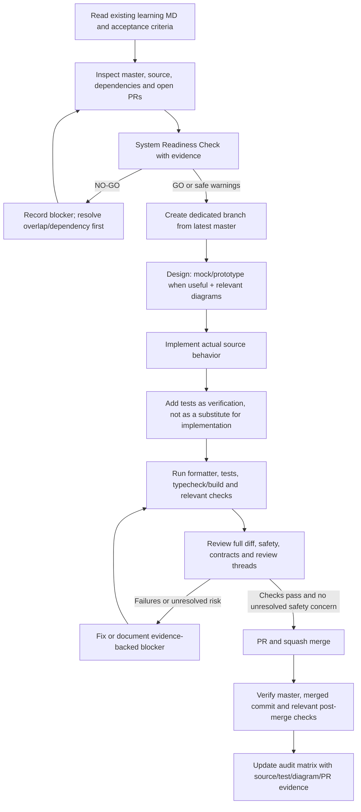
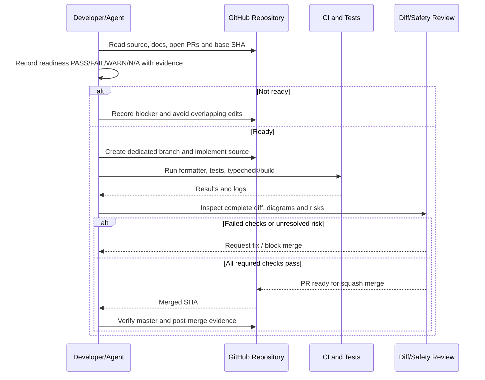

# Senior Frontend Learning — Implementation Audit & Readiness Standard

**Audit date:** 2026-10-30  
**Repository:** `phanthienquoc/TCE-dashboard`  
**Audited base:** `master` at `55ca86251238beaf7cac0348042fa912cbecc5ef`  
**Scope:** Existing `docs/learning/*.md` only. This is an evidence-based initial audit, not a claim that every source path and runtime behavior has already been exhaustively verified.

## 1. System Readiness Check — initial audit

| Check                          | Status                           | Evidence / follow-up                                                                                                                                                                                                                                                                                                                                        |
| ------------------------------ | -------------------------------- | ----------------------------------------------------------------------------------------------------------------------------------------------------------------------------------------------------------------------------------------------------------------------------------------------------------------------------------------------------------- |
| Scope and acceptance criteria  | WARN                             | Five learning Markdown files are present: Days 9–13. Extract each explicit implementation checklist and acceptance criterion before starting its code task.                                                                                                                                                                                                 |
| Base branch and commit         | PASS                             | `master` resolves to `55ca86251238beaf7cac0348042fa912cbecc5ef`.                                                                                                                                                                                                                                                                                            |
| Open PR overlap                | FAIL / BLOCKER for Days 9–12     | PR [#936](https://github.com/phanthienquoc/TCE-dashboard/pull/936) remains open and contains broad source/test/doc changes for Days 9–12. Do not edit overlapping paths or merge blindly.                                                                                                                                                                   |
| Existing source                | WARN                             | The reconnect-backoff fix is on master in `apps/web/lib/microfe-ws.ts`; its PR #943 was squash-merged. Other Day 9–12 changes in PR #936 must not be treated as production/master implementation until verified on master.                                                                                                                                  |
| Build and tests                | WARN                             | PR #936 reports successful frontend build, backend unit tests and mobile viewport contract. Prettier check fails on `apps/web/components/dashboard/DividendPositionsFilter.tsx`, `apps/web/lib/passkey-store.ts`, `apps/web/lib/stock-dividend-pool-store.ts`, and `apps/web/lib/store.ts`. Checks must be rerun after resolving formatting and base drift. |
| Infra, services and deployment | N/A for this documentation audit | Re-check live service/deployment state before any task that changes runtime integration, auth, database, or production behavior. Do not infer health from source code.                                                                                                                                                                                      |
| Secrets and permissions        | N/A for this documentation audit | For a task requiring credentials, verify presence/access without printing secret values.                                                                                                                                                                                                                                                                    |
| Database and migrations        | N/A for this documentation audit | Any task touching persistence must inspect live schema, migration ledger and RLS/account scope before changes.                                                                                                                                                                                                                                              |
| Production risk and rollback   | WARN                             | No production deployment is authorized by this audit. For runtime tasks, define impact, rollout and rollback before implementation.                                                                                                                                                                                                                         |

### Decision

**NO-GO for overlapping Days 9–12 code changes until PR #936 is reconciled.** First inspect the PR's full diff and review threads, resolve its four formatting failures, compare/rebase against current `master`, rerun CI, and verify that its source changes remain correct and safe. Do not merge solely because several checks passed.

**GO for non-overlapping audit/documentation work.** Day 13 optimization is not authorized until a measurable bottleneck and a reproducible baseline are identified.

## 2. Existing learning files — implementation status matrix

| Learning doc                                                     | Master/source evidence found so far                                                                                                                                                                                               | Status                                                                           | Next action                                                                                                                                                                                                                                                               |
| ---------------------------------------------------------------- | --------------------------------------------------------------------------------------------------------------------------------------------------------------------------------------------------------------------------------- | -------------------------------------------------------------------------------- | ------------------------------------------------------------------------------------------------------------------------------------------------------------------------------------------------------------------------------------------------------------------------- |
| `senior-frontend-day-09-nextjs.md`                               | PR #936 includes source and documentation changes related to this learning block, but that PR is still open.                                                                                                                      | **Not verified as merged implementation**                                        | After resolving PR #936, compare every explicit checklist item against current `master`, source paths and tests. Do not mark complete from PR-branch evidence alone.                                                                                                      |
| `senior-frontend-day-10-rest-errors-cancellation.md`             | PR #936 contains cancellation/error-handling changes and tests; master completion is not established by the open PR.                                                                                                              | **Partially evidenced; merge status blocked**                                    | Audit request ownership, cancellation, stale-response guards, safe error logging and tests on current master after PR reconciliation.                                                                                                                                     |
| `senior-frontend-day-11-websocket-sse-reconnect-backpressure.md` | Master has `apps/web/lib/microfe-ws.ts` with bounded reconnect delay and stable-connection backoff reset, merged by PR #943. The current master options include `onGap` but no visible `onResync` callback in the inspected file. | **Reconnect improvement implemented; recovery/backpressure not proven complete** | Verify sequence scope, gap recovery owner, reconnect resynchronization, queue bounds and event-domain-specific coalescing against existing contracts. Do not coalesce execution/risk/audit/reconciliation events.                                                         |
| `senior-frontend-day-12-normalization-cache.md`                  | PR #936 includes source changes around cancellation/cache invalidation and tests, but remains open. The doc itself stresses that no global server watermark should be invented.                                                   | **Partial work in open PR; not verified complete on master**                     | Inspect canonical store ownership, account switching/logout cleanup, normalized identity, snapshot/stream ordering and whether backend contracts provide comparable versions/watermarks.                                                                                  |
| `senior-frontend-day-13-performance-profiling.md`                | Learning material exists on master. No verified implementation task or measured before/after performance result has yet been established in this initial pass.                                                                    | **Audit pending; do not optimize speculatively**                                 | Select one existing screen/component named by an explicit checklist, collect reproducible profiler evidence, create a before/after mock or prototype when it helps validate the interaction, then implement one focused source change and verify correctness/performance. |

**Important:** The current directory listing contains Days 9–13 only. Do not assume Days 1–8 exist in `docs/learning/`; search the existing curriculum/roadmap separately if the task requires them.

## 3. Mandatory task lifecycle

## 4. Design artifacts — senior engineering standard

Create only diagrams that materially clarify the specific task. Keep them aligned with the current source and contract; label unknowns rather than inventing behavior.

| Task type                                               | Expected artifact when relevant                                                                           |
| ------------------------------------------------------- | --------------------------------------------------------------------------------------------------------- |
| Cross-module or service change                          | Architecture/component diagram                                                                            |
| API, auth, WebSocket, async lifecycle                   | Sequence diagram                                                                                          |
| Persistent entities, relations or cache identity        | ERD/data model                                                                                            |
| Multi-owner workflow or deployment                      | Swimlane                                                                                                  |
| State transitions, retry/recovery or UI behavior        | Flow/state machine                                                                                        |
| Complex branching, validation or deterministic behavior | Pseudocode                                                                                                |
| User-visible UI behavior                                | Low-fidelity mock/prototype or component-state table before implementation when it improves reviewability |

Diagrams may be Mermaid in the existing learning doc or PR description. Do not add a decorative diagram with no design value. For UI work, a mock is a review artifact, not proof that the UI is implemented.

### Generic implementation sequence

## 5. Completion evidence required per learning item

A learning item is complete only when its audit row points to:

1. The exact acceptance criterion from the existing MD.
2. The source file(s) and behavior that implement it on `master`.
3. Tests that verify the behavior, including important failure/race paths.
4. Relevant diagram/mock and an explanation of why it matches the implementation.
5. Readiness results and any warnings/blockers.
6. PR URL, squash-merge commit SHA, and relevant CI/post-merge evidence.

Tests-only changes do not count as source implementation unless the explicit task is to add tests. Documentation-only changes do not count as runtime implementation. A green build alone does not prove domain correctness or production deployment.
