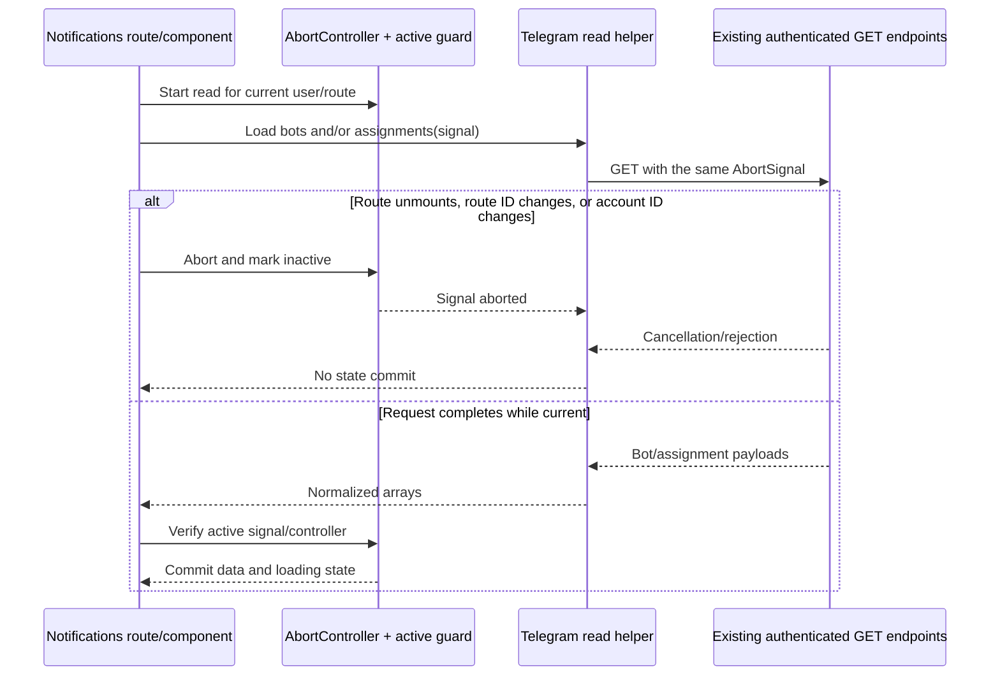
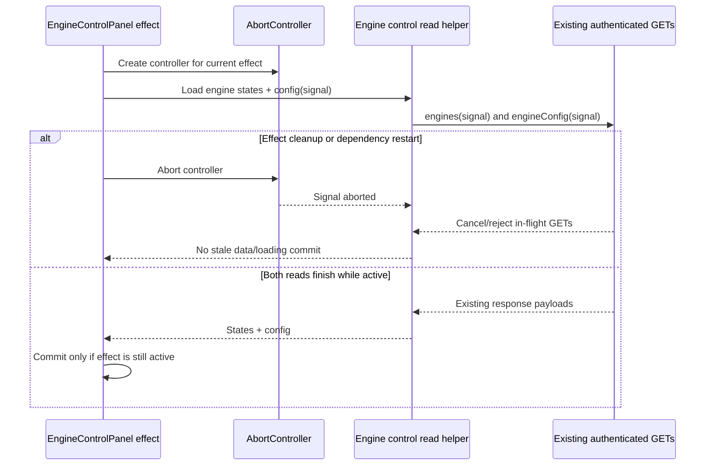

# Senior Frontend Day 10 — REST APIs, Error Handling & Cancellation

> Duration: 60 minutes. This lesson is aligned with the real TCE Dashboard repository and the implementation in `apps/web/lib/api.ts`, `apps/web/lib/api-errors.ts`, `apps/web/lib/store.ts`, `apps/web/lib/stock-dividend-pool-store.ts`, `apps/web/lib/stock-event-store.ts`, `apps/web/lib/app-data-worker.ts`, `apps/web/lib/telegram-notification-data.ts` and its consumers, plus `apps/web/lib/engine-control-data.ts` and `apps/web/app/engines/EngineControlPanel.tsx`.

## Implementation readiness — cross-layer assessment

Before treating this lesson as complete, apply the shared [Learning Implementation Readiness Gate](IMPLEMENTATION_READINESS.md). A code snippet, test-only change, or documentation update is not proof that the product behavior exists end to end.

### TCE-specific inspection scope

- **System design and service contract:** locate the actual caller, centralized API client, endpoint handler/owner, and response/error contract. Confirm whether cancellation is client-side only or has explicit server semantics.
- **Infrastructure:** check timeout/proxy/runtime limits only when they affect the observed request path; do not change infrastructure speculatively.
- **Database and side effects:** determine whether a request is read-only or can mutate durable state. Aborting a browser request does not prove a server operation was rolled back.
- **Integration:** verify auth/refresh behavior, overlapping request ordering, stale-response protection, loading state, and safe user-facing errors against real source—not only a mock.

Record a **READY / PARTIALLY READY / BLOCKED** decision. Implement real runtime behavior only where ownership and contracts are established; otherwise link a concrete item in [the cross-layer curriculum backlog](backlog/curriculum-implementation-backlog.md). Assess system design, infrastructure, service/backend, database, frontend and integration impacts; mark irrelevant layers N/A with a reason. Do not claim deployment or production verification without evidence.

## System Readiness Check — Telegram notification read lifecycle (2026-10-30)

**Task:** `DAY10-TELEGRAM-READ-01` — cancel obsolete Telegram bot/assignment reads and prevent stale notification UI state after route unmount or account switch.

| Area                              | Status | Evidence                                                                                                                                                                                                                                                                                       |
| --------------------------------- | ------ | ---------------------------------------------------------------------------------------------------------------------------------------------------------------------------------------------------------------------------------------------------------------------------------------------- |
| Scope and acceptance              | PASS   | Bounded to authenticated read-only Telegram bot and debug-assignment GETs used by notifications list/detail/config screens. The existing `platformApi` methods already accept optional signals; the implementation reuses them and does not change endpoint, auth, write, or schema contracts. |
| Default/base/current commit       | PASS   | Branch `fix/day10-telegram-read-lifecycle-20261030` was created from current `master` SHA `e093b8521730eaef3b6d1b2e7ce5b6e6b0c095ee` after PR #956 merged.                                                                                                                                     |
| Open PR/branch overlap            | PASS   | At task start, only PR #928 was open and it changes `plan/agentic-task-queue.md`; no overlapping file changes were found.                                                                                                                                                                      |
| Source/dependencies               | PASS   | Inspected `platformApi.telegramBots(signal?)`, `telegramDebugAssignments(signal?)`, `useTCEDataStore`, and the three notifications consumers. Route cleanup and account ID changes define the client cancellation boundary.                                                                    |
| Working-tree/change safety        | WARN   | No local working-tree snapshot is available through the connector; the full branch diff must be reviewed before merge.                                                                                                                                                                         |
| Build/test/CI baseline            | WARN   | The source baseline is unchanged by documentation-only PR #956; relevant earlier frontend build and root tests passed on PR #955. No local commands can be run through this connector; the new branch's frontend build, Prettier and root unit tests are pending CI.                           |
| Service/infrastructure/deployment | N/A    | Client-side read lifecycle only; no service, manifest, workflow, deployment, or market-scan schedule changes.                                                                                                                                                                                  |
| Secrets/permissions               | PASS   | Repository write permission is available; no secret is required or accessed.                                                                                                                                                                                                                   |
| Database/schema/migrations        | N/A    | No persistence or schema change. Live schema/RLS state is not needed for this client-only slice and remains unverified.                                                                                                                                                                        |
| Production risk/rollback          | PASS   | Read-only requests only; no trading/execution behavior. Rollback is reverting the PR; no production deployment is planned or claimed.                                                                                                                                                          |

### Read lifecycle



**Readiness decision:** PR #957 merged at `6b3beb546409358cf9cc1a8f000a4527f02255ab`. Exact PR head `052c301ad522d98802a13e88ed48c6a48c636de7` passed WF-01P #41024683065, WF-02 #41024683023, and WF-05 #41024682994 before merge. The available connector did not surface post-merge workflow status, so post-merge checks and production verification remain unverified.

## System Readiness Check — dividend-pool read lifecycle (2026-10-30)

**Task:** `DAY10-READ-POOL-01` — make month-filtered dividend-pool reads cancellable and stale-response safe.

| Area                                | Status                                  | Evidence                                                                                                                                                                                                                                                                                                                                                                                                                     |
| ----------------------------------- | --------------------------------------- | ---------------------------------------------------------------------------------------------------------------------------------------------------------------------------------------------------------------------------------------------------------------------------------------------------------------------------------------------------------------------------------------------------------------------------- |
| Scope and acceptance                | PASS                                    | Bounded to the existing client-side dividend-pool read path: propagate an optional `AbortSignal`, abort superseded month reads, reject obsolete responses from changing items/loading/error, and normalize user-facing errors. No new API or schema contract.                                                                                                                                                                |
| Default/base and commit             | PASS                                    | Repository default branch is `master`; task branch `fix/day10-dividend-pool-read-lifecycle-20261030` was created from `a6bf2a027b6855627586103404d9f86aaf3e83f1`; PR #953 was squash-merged into `master` at `2434a27510044e08ae1b0ba6ce5501bbc163b5cf`.                                                                                                                                                                     |
| Open PR overlap                     | PASS                                    | At task start, the only other open PR was #928, limited to `plan/agentic-task-queue.md`; no overlap with the store, worker, tests, or Day 10 lesson. PR #953 is now merged. Earlier Day 10 test-only PRs #938/#939 were reviewed; runtime behavior originated in #929, quote validation in #949, and pool-read lifecycle protection in #953.                                                                                 |
| Source of truth and dependencies    | PASS                                    | Inspected `apps/web/lib/stock-dividend-pool-store.ts`, its consumers `apps/web/app/stock-events/pool/page.tsx` and `apps/web/app/stock-dividend-pool/page.tsx`, `apps/web/lib/app-data-worker.ts`, the centralized Axios client, and `apps/service/src/stock-events/stock-dividend-pool.controller.ts` / service. The endpoint is an authenticated GET; an omitted month resolves to the service's current UTC month.        |
| Working tree and change safety      | WARN                                    | A local working-tree snapshot is not available through this connector. The complete PR diff was reviewed; changes were isolated to the dedicated branch and limited to the pool store, worker signal forwarding, tests, and this lesson.                                                                                                                                                                                     |
| Build/test/CI baseline              | PASS for exact PR head; WARN post-merge | PR #953 exact head `39abde70b07fe35ef86f0f8f1d24f3324248c8a6` passed WF-01P run 41012494912, WF-02 run 41012494814, and WF-05 run 41012494856. Post-merge status/workflow endpoints returned no separate records for merge SHA `2434a27510044e08ae1b0ba6ce5501bbc163b5cf`; no separate master push check is claimed. Root `npm test` includes `apps/web/lib` discovery, so the new pool-store and worker specs are included. |
| Service, infrastructure, deployment | N/A                                     | This is client-side read lifecycle only. No controller, service, manifest, workflow, runtime configuration, deployment, or market-scan schedule is changed.                                                                                                                                                                                                                                                                  |
| Secrets and permissions             | PASS                                    | No secret values are read or changed. The existing authenticated Axios instance/interceptors remain the transport; no new permission or credential is introduced.                                                                                                                                                                                                                                                            |
| Database/schema/migrations          | N/A for changes; WARN for live state    | No DB/schema/migration mutation is proposed. The existing service reads its configured market-metrics table; live schema/RLS/ledger state is not queried and is not required for this frontend lifecycle change.                                                                                                                                                                                                             |
| Production risk and rollback        | PASS for bounded client change          | Read-only market-data display path only. No auth protocol, account-scoped cache contract, trading strategy, order execution, or schedule changes. Rollback is reverting the task's squash commit; no deployment rollback is applicable because no deployment is planned.                                                                                                                                                     |

**Readiness decision: READY for this bounded slice.** PR #953 merged the cancellation/generation-guard/error-normalization behavior, and exact-head build/format/unit CI passed. The broader Day 10 API-caller audit remains open. No production deployment or environment verification is claimed.

---

## System Readiness Check — stock-event read lifecycle (2026-10-30)

**Task:** `DAY10-READ-STOCK-EVENT-01` — prevent an in-flight stock-event GET from repopulating cleared state and propagate app-data-worker cancellation.

| Area                                | Status                               | Evidence                                                                                                                                                                                                                                                                                                                         |
| ----------------------------------- | ------------------------------------ | -------------------------------------------------------------------------------------------------------------------------------------------------------------------------------------------------------------------------------------------------------------------------------------------------------------------------------- |
| Scope and acceptance                | PASS                                 | Bounded to the existing stock-event client store and its worker caller: support an optional `AbortSignal`, abort/invalidate on `clear()`, ignore stale completions, and keep cancellation silent with normalized errors. No endpoint/schema contract change.                                                                     |
| Default/base and commit             | PASS                                 | Default branch is `master`; branch `fix/day10-stock-event-read-cancellation-20261030` was created from `4e39d5f5af80b628d7d45b56033b125150e9bace`, the merge of the post-merge audit refresh PR #954.                                                                                                                            |
| Open PR overlap                     | PASS                                 | Only open PR found is #928, limited to `plan/agentic-task-queue.md`; no overlap with the stock-event store, worker, tests, or Day 10 lesson.                                                                                                                                                                                     |
| Source of truth and dependencies    | PASS                                 | Inspected `apps/web/lib/stock-event-store.ts`, the stock-events page, `apps/web/lib/app-data-worker.ts`, and `clearAccountScopedStores()` in `apps/web/lib/store.ts`, which calls the store's `clear()` on logout/account change. The existing `/stock-events` controller is authenticated; its read contract remains unchanged. |
| Working-tree/change safety          | WARN                                 | No local working-tree snapshot is available through this connector. The dedicated branch starts at the current master SHA; the complete PR diff will be reviewed before merge.                                                                                                                                                   |
| Build/test/CI baseline              | WARN                                 | PR #953 exact-head WF-01P/WF-02/WF-05 passed, and PR #954 documentation WF-02/WF-05 passed. Separate master push-check records for merge `4e39d5f` were not exposed by status/workflow endpoints. This task's exact-head CI must pass before merge.                                                                              |
| Service, infrastructure, deployment | N/A                                  | Client-only read lifecycle; no controller, service, deployment, workflow, runtime config, or market-scan schedule changes.                                                                                                                                                                                                       |
| Secrets and permissions             | PASS                                 | No secret values accessed or changed; existing authenticated Axios transport remains in use.                                                                                                                                                                                                                                     |
| Database/schema/migrations          | N/A for changes; WARN for live state | No DB/schema/RLS/migration changes. Live persistence state is not queried because this is a client request-lifecycle fix.                                                                                                                                                                                                        |
| Production risk and rollback        | PASS for bounded change              | Stock-event data is a read-only market-data view. The fix prevents stale state after clear/logout and does not change account ownership, auth, trading, execution, or scheduling. Rollback is reverting the task's squash commit; no deployment is planned.                                                                      |

**Readiness decision: PARTIALLY READY.** A real lifecycle gap is confirmed: `clear()` resets state but does not abort/invalidate the pending request, and the worker does not forward its signal. Implement this client-only slice with regression tests; the broader Day 10 API-caller audit remains open.

---

## Learning objectives

By the end of the session, you should be able to:

- distinguish HTTP errors, network failures, timeouts, and intentional cancellation;
- propagate an `AbortSignal` from a caller through Axios to the request;
- prevent an older dashboard response from overwriting a newer one;
- keep loading state correct when requests overlap;
- avoid exposing arbitrary backend error bodies in user-facing UI;
- explain why cancellation is not the same as rolling back a server-side operation.

## Minute plan

| Time      | Activity                     | Outcome                                             |
| --------- | ---------------------------- | --------------------------------------------------- |
| 0–10 min  | Theory from first principles | Understand request lifecycle and trade-offs         |
| 10–30 min | TypeScript/React code        | Implement typed errors and cancellation             |
| 30–45 min | TCE architecture             | Protect dashboard snapshot and market-price updates |
| 45–55 min | English interview practice   | Explain decisions clearly                           |
| 55–60 min | Review and quiz              | Check understanding                                 |

---

## 1. Theory — from first principles (10 minutes)

### 1.1 What happens during an API request?

A browser sends a request, waits for a response, then the application interprets the result.

```text
UI action
  |
  v
API client
  |
  v
Network -----> Backend
  ^               |
  |               v
  +------ Response / failure
  |
  v
Normalize result -> Update UI state
```

A request can fail in different ways, and those failures should not all produce the same behavior.

| Failure         | Example                                                       | Recommended UI behavior                                      |
| --------------- | ------------------------------------------------------------- | ------------------------------------------------------------ |
| HTTP error      | API returns 403 or 500                                        | Show a safe, useful message; preserve context where possible |
| Network error   | Offline, DNS or connection failure                            | Explain that the service could not be reached                |
| Timeout         | Server does not respond within the configured limit           | Offer an explicit retry when appropriate                     |
| Cancellation    | User changes symbol or a newer request supersedes the old one | Usually silent; it is control flow, not a failure            |
| Invalid payload | HTTP 200 but response data is malformed                       | Validate at runtime and reject the payload                   |

A fulfilled HTTP transport does not guarantee valid business data. A TypeScript assertion such as `response.data as MarketSnapshot` does not validate the JSON at runtime.

### 1.2 Why race conditions happen

Imagine a user quickly selects DPM, SSI, then GAS.

```text
Request A: DPM ----------- response arrives last
Request B: SSI ---- response arrives second
Request C: GAS -- response arrives first
```

If every response updates the same state, the old DPM response can overwrite the newest GAS selection. The issue is not that JavaScript ran two lines at the same instant; the issue is that asynchronous results can complete in a different order from the order in which they were started.

Two complementary protections are useful:

1. **Cancellation:** stop work that is no longer needed.
2. **A request/version guard:** ignore a result if it no longer belongs to the current request.

Cancellation alone is not a complete correctness guarantee. A response may already have completed, or some work may not support cancellation. A version guard protects the state update.

### 1.3 AbortController and complexity

`AbortController` provides an `AbortSignal` that a supported API client can observe.

```ts
const controller = new AbortController();

const request = fetch('/api/markets/DPM', {
  signal: controller.signal,
});

// When superseded or no longer needed:
controller.abort();
```

Axios supports the same standard `signal` option:

```ts
api.get('/dashboard/market-prices', {
  params: { symbols: 'DPM,SSI' },
  signal: controller.signal,
});
```

The controller must reach the actual transport. Creating a controller but not passing its signal to Axios does not cancel the request.

**Complexity:** creating a controller and checking a request version are both O(1) per request. For a list of (n) returned quotes, parsing and merging are generally O(n), assuming constant-time map lookups. Network latency usually dominates the request lifecycle.

**Trade-offs:**

- Cancellation reduces wasted network and response-processing work, but does not guarantee the backend stopped processing.
- A version guard prevents stale state updates, but does not save network resources by itself.
- Automatic retries can improve resilience for idempotent reads, but may amplify load. Never blindly retry order submission or other non-idempotent mutations.
- `no-store`, cancellation, timeout, and retry are different controls; none is a substitute for validating data correctness.

### 1.4 Loading state is part of correctness

If request A starts, request B supersedes it, and A finishes last, A must not set `loading = false` while B is still pending.

Use a request generation/version:

```ts
const version = ++currentVersion;

try {
  const result = await loadData();
  if (version !== currentVersion) return;
  applyResult(result);
} finally {
  if (version === currentVersion) {
    setLoading(false);
  }
}
```

The latest request owns the shared loading state. This pattern is useful in dashboards, autocomplete, filters, search, and symbol/timeframe selectors.

---

## 2. Code practice — TypeScript + React (20 minutes)

### Step 1 — Normalize errors safely

TCE now has `apps/web/lib/api-errors.ts` with two functions:

- `isApiRequestCancelled(error)`: recognizes Axios cancellation.
- `normalizeApiError(error, fallbackMessage)`: maps low-level failures to a predictable `ApiFailure` structure.

The normalized structure contains `kind`, `message`, optional HTTP `status`, and `retryable`.

Example usage:

```ts
try {
  await dashboardApi.all('WATCHING', controller.signal);
} catch (error: unknown) {
  if (isApiRequestCancelled(error)) return;

  const failure = normalizeApiError(error, 'Unable to load dashboard');
  set({ error: failure.message });
}
```

Why not display `error.response.data` directly? Backend payloads can contain internal details or inconsistent messages. Map common HTTP statuses to safe UI messages, and keep detailed diagnostics in appropriately protected server-side logs. Do not log Axios request configuration or headers because they may contain credentials.

### Step 2 — Pass an optional AbortSignal through the API layer

In `apps/web/lib/api.ts`, dashboard read methods now accept an optional signal:

```ts
all: (status?: string, signal?: AbortSignal) =>
  api.get('/dashboard', {
    params: status ? { status } : undefined,
    signal,
  }),

marketPrices: (symbols: string[], signal?: AbortSignal) =>
  api.get('/dashboard/market-prices', {
    params: { symbols: symbols.join(',') },
    signal,
  }),

priceHistory: (symbol: string, days = 365, signal?: AbortSignal) =>
  api.get('/dashboard/price-history', {
    params: { symbol, days },
    signal,
  }),
```

Existing callers remain compatible because `signal` is optional. The centralized Axios instance is preserved, so callers continue to use the same authentication and refresh behavior.

### Step 3 — Cancel stale dashboard requests

The dashboard store creates a controller for the current load and increments a request version.

```ts
dashboardLoadController?.abort();

const controller = new AbortController();
dashboardLoadController = controller;
const requestVersion = ++dashboardLoadVersion;

try {
  const response = await dashboardApi.all('WATCHING', controller.signal);

  if (controller.signal.aborted || requestVersion !== dashboardLoadVersion) {
    return;
  }

  // Only the current request may update the dashboard snapshot.
} finally {
  if (requestVersion === dashboardLoadVersion) {
    set({ loading: false });
  }
}
```

The real implementation also aborts an in-flight market-price synchronization when a newer dashboard load starts. On logout/clear, it aborts both controllers, invalidates the current request version, clears the interval, and resets state. The API error normalizer has focused Node tests, and `apps/web/lib` is included in root `npm test` discovery.

### Step 4 — Do not treat cancellation as a visible error

When a request is intentionally cancelled because a newer one superseded it, the UI should not show “Unable to load dashboard”. The implementation ignores cancellation and only normalizes genuine failures.

Market-price sync logs only normalized kind/status/message fields rather than the raw Axios error object.

### Step 5 — Mini exercise

Add a symbol search field that requests results after the user types. Requirements:

1. Keep one active request controller.
2. Abort the previous request before starting the next.
3. Ignore results from an obsolete request.
4. Do not show an error for cancellation.
5. Keep a loading indicator associated with the latest request only.

Suggested algorithm:

```ts
let controller: AbortController | null = null;
let requestVersion = 0;

async function searchSymbols(query: string) {
  controller?.abort();
  controller = new AbortController();
  const version = ++requestVersion;

  if (!query.trim()) {
    setResults([]);
    setLoading(false);
    return;
  }

  setLoading(true);
  try {
    const result = await searchApi(query, controller.signal);
    if (version !== requestVersion) return;
    setResults(result);
  } catch (error) {
    if (isApiRequestCancelled(error)) return;
    if (version === requestVersion) {
      setError(normalizeApiError(error, 'Search failed').message);
    }
  } finally {
    if (version === requestVersion) setLoading(false);
  }
}
```

In a real React component, keep the controller and version in a `useRef` or in a request-owning service rather than module-level variables. Abort on unmount if the component owns the request. Consider debouncing input separately; debounce reduces how often requests start, while cancellation stops already-started work.

---

## 3. TCE architecture and real-world use case (15 minutes)

### Existing boundary

```text
React / Zustand
     |
     v
apps/web/lib/api.ts
     |
     +--> Central Axios instance
     |      - base URL
     |      - credentials
     |      - auth interceptor / refresh
     |      - timeout
     |
     v
Backend dashboard endpoints
```

Do not bypass this API layer with ad-hoc Axios instances in feature components. That would duplicate authentication and error behavior.

### Updated request lifecycle

```text
Dashboard load requested
       |
       v
Abort previous dashboard + price-sync requests
       |
       v
Create AbortController + increment request version
       |
       v
Axios request receives signal
       |
       v
Response arrives
       |
       +---- aborted / obsolete? ----> Ignore
       |
       v
Normalize and update dashboard snapshot
       |
       v
Fetch market prices with its own signal
       |
       v
Apply only if this price-sync request is still current
```

### Why TCE needs both cancellation and a version guard

- The overview store is shared across dashboard views; overlapping loads can happen.
- Market-price sync runs independently on a timer, so an old price response should not overwrite a newer synchronization.
- Logout clears user-scoped state. In-flight reads should be cancelled and invalidated so they cannot repopulate state after the user signs out.
- The request version protects against stale completions even if cancellation arrives too late.

### Error policy

| Situation                              | Expected handling                                                               |
| -------------------------------------- | ------------------------------------------------------------------------------- |
| Intentional cancellation               | Silent; no error banner                                                         |
| Network failure                        | Show a safe message; keep last known data only if the UI clearly marks it stale |
| Timeout                                | Explain the timeout; allow a deliberate retry where appropriate                 |
| 401 after centralized refresh behavior | Follow the existing authentication/session flow                                 |
| 403                                    | Show an authorization message; do not retry blindly                             |
| 429 / 5xx                              | Treat as potentially transient, but do not create an uncontrolled retry loop    |
| Invalid quote payload                  | Reject or quarantine invalid data; do not calculate P/L from malformed values   |

**Trading safety note:** cancelling a client request does not roll back an operation already received by the backend. For order placement, use server-authoritative status, idempotency keys where supported, and reconciliation. Never interpret a browser timeout as proof that an order failed; the server may have accepted it before the connection timed out.

### Verification checklist

- [x] The optional signal reaches the actual Axios request.
- [x] A newer dashboard load aborts the previous load.
- [x] An obsolete response cannot update the store.
- [x] An old request cannot clear the newest request's loading state.
- [x] Market-price sync cancels its previous in-flight request.
- [x] Logout/clear aborts and invalidates in-flight reads.
- [x] Cancellation is not surfaced as a user-facing error.
- [x] Logs do not include raw Axios request config or credential headers.
- [x] Invalid market-price rows cannot overwrite state; unrequested symbols are rejected and diagnostics contain aggregate counts only.
- [x] If a payload contains no valid quote rows, existing market-price state is preserved.
- [x] Existing callers that omit `signal` still compile.
- [x] A newer dividend-pool month request aborts the previous read and an obsolete response cannot replace the selected-month data or loading state.
- [x] App-data-worker cancellation reaches the dividend-pool transport; intentional cancellation stays silent.
- [x] Dividend-pool failures use normalized safe messages rather than arbitrary backend response bodies.

---

### Implementation evidence — market-price payload validation

- `apps/web/lib/market-price-validation.ts` validates the untrusted response before it enters the Zustand store.
- Only finite positive numeric prices for symbols requested by the current sync are accepted. Malformed rows, non-positive/non-finite prices, invalid optional field types, and unrequested symbols are rejected.
- `apps/web/lib/store.ts` applies only accepted rows and logs aggregate counts for rejected rows; it does not log the raw payload or credential-bearing request config.
- Unit and store-level regression coverage lives in `apps/web/lib/market-price-validation.spec.ts` and `apps/web/lib/dashboard-cancellation.spec.ts`.
- This validates the client boundary; the backend SSI adapter also filters non-positive market prices. It does not replace server-side validation or prove production behavior before deployment.
- Merge/CI evidence: PR #949 merged as `4808382`; master WF-01 Build + Verify, WF-02 Prettier, and WF-05 backend/unit checks passed. No production deployment was performed.
- Safety boundary: this validator protects display state only; it is not an order, risk, or execution gate, and server-side validation/reconciliation remain authoritative.

```mermaid
sequenceDiagram
  participant Store as Dashboard Zustand store
  participant API as Central Axios client
  participant Validator as Market-price validator
  Store->>API: Request prices for current symbols with AbortSignal
  API-->>Store: Untrusted response payload
  Store->>Validator: Payload + allowed symbol set
  Validator-->>Store: Accepted prices + rejected row counts
  alt At least one valid quote
    Store->>Store: Merge only accepted quotes
  else No valid quotes
    Store->>Store: Preserve existing market-price state
  end
  Note over Store,Validator: Diagnostics contain counts only; raw payload values are not logged.
```

### Implementation follow-up — dividend-pool read lifecycle

**Task:** `DAY10-READ-POOL-01`  
**Status:** Runtime change and regression tests are merged in PR #953 at `2434a27510044e08ae1b0ba6ce5501bbc163b5cf`. Final PR head `39abde70b07fe35ef86f0f8f1d24f3324248c8a6` passed WF-01P, WF-02, and WF-05; separate post-merge workflow status was not surfaced. No production deployment is claimed.

The first WF-02 run failed only on `apps/web/lib/stock-dividend-pool-store.spec.ts`. The repository's push formatter applied formatting-only commit `6e8b93bc9b863be5e8608011a3913166b67554de`; the final exact-head rerun passed WF-01P run 41012494912, WF-02 run 41012494814, and WF-05 run 41012494856. Results from the earlier head were not reused.

The source-backed gap was in `apps/web/lib/stock-dividend-pool-store.ts`: changing the month starts another GET while the previous response can still replace `items` and clear `loading`; the app-data worker's cancellation signal also did not reach this store's Axios request. The bounded implementation adds an internal controller and monotonically increasing request generation, accepts an optional caller signal, ignores obsolete/aborted completions, and uses `normalizeApiError` for user-visible failures. `apps/web/lib/app-data-worker.ts` now forwards its existing worker signal to this read.

Regression coverage is in `apps/web/lib/stock-dividend-pool-store.spec.ts` and `apps/web/lib/app-data-worker.spec.ts`. The tests cover month-switch races, late responses after cancellation, worker cancellation propagation, and safe 503 messaging. The controller/service, authentication interceptor, schema, and all trading/execution paths are unchanged. No deployment or production verification is claimed.

```mermaid
sequenceDiagram
  participant Page as Dividend-pool page
  participant Worker as App-data worker
  participant Store as Pool Zustand store
  participant API as Central Axios client

  Page->>Store: load(selectedMonth)
  Store->>Store: Abort prior read; increment generation
  Store->>API: GET pool?month=selectedMonth + signal
  Page->>Store: load(nextMonth)
  Store->>Store: Abort prior read; increment generation
  Store->>API: GET pool?month=nextMonth + signal
  API-->>Store: Late response for selectedMonth
  Store->>Store: Ignore obsolete generation
  API-->>Store: Response for nextMonth
  Store->>Store: Apply items; clear loading/error

  Worker->>Store: load(undefined, workerSignal)
  Worker->>Worker: clear() aborts workerSignal
  Store->>API: Abort current pool GET
  Store->>Store: Ignore cancelled completion; do not surface an error
```

### Implementation follow-up — stock-event read lifecycle

**Task:** `DAY10-READ-STOCK-EVENT-01`  
**Status:** PR #955 merged at master commit `d79404ec62250ddf2762620f6819318daf029412`. Final head `ad1664f06ed48972dd3915ef105551b08f91cc14` passed frontend build run 41013983958, Prettier run 41013984089 and backend/root tests run 41013983940. Master backend tests, image/config verification and auto-format also passed in runs 41014092643, 41014092714 and 41014092678; duplicate runs were cancelled/skipped. This is CI evidence only; no production deployment or environment verification is claimed.

The store's `clear()` previously reset visible state without aborting or invalidating its pending `/stock-events` request. Since logout/account change calls `clearAccountScopedStores()`, a late response could repopulate the store after it had been cleared. The app-data worker also did not forward its cancellation signal to this read. The bounded implementation adds an internal `AbortController`, a request generation guard, an optional caller signal, and normalized error messages without changing the authenticated endpoint contract.

- [x] `clear()` aborts the active request, invalidates its generation, and prevents late responses from repopulating state.
- [x] App-data-worker cancellation reaches the stock-event transport and intentional cancellation remains silent.
- [x] Stock-event read failures use normalized safe messages rather than arbitrary backend response bodies.
- [x] Regression tests cover clear/late-response behavior, worker cancellation, and normalized errors.

```mermaid
sequenceDiagram
  participant Auth as Auth/account lifecycle
  participant Worker as App-data worker
  participant Store as Stock-event Zustand store
  participant API as Central Axios client

  Worker->>Store: load(200, false, null, workerSignal)
  Store->>Store: Create controller and generation
  Store->>API: GET /stock-events with internal signal
  Auth->>Store: clear() on logout/account change
  Store->>Store: Increment generation; abort controller; reset state
  API-->>Store: Cancelled or late response
  Store->>Store: Ignore stale/aborted completion
  Note over Store: Cleared state remains empty; no cancellation error is surfaced
```

## 4. English interview practice (10 minutes)

### Question 1: How do you prevent race conditions in frontend data fetching?

**Sample answer:**

> I use cancellation and a request identity guard. When a new request supersedes an old one, I abort the old request through an AbortSignal. I also compare a request version before applying the response, because cancellation alone is not a complete correctness guarantee. Only the current request is allowed to update the data and loading state.

### Question 2: How do you distinguish network errors from HTTP errors?

**Sample answer:**

> An HTTP error means the server returned a response with an unsuccessful status, such as 403 or 500. A network error means the client did not receive a usable HTTP response. A timeout is a separate transport failure, and cancellation is usually intentional control flow. I normalize these cases into a small typed error model so the UI can respond consistently without exposing internal backend details.

### Question 3: Is it safe to retry a failed API request automatically?

**Sample answer:**

> It depends on the operation and the failure. A retry may be reasonable for an idempotent read after a transient network error or a 503 response, preferably with a bounded policy and backoff. I would not blindly retry a trading order because the server might have accepted the first request even if the client timed out. For mutations, I would rely on server-side idempotency support and reconcile the authoritative operation status.

### Speaking drill

- Minutes 1–3: explain cancellation versus a request version guard.
- Minutes 4–6: explain HTTP error versus network error versus timeout.
- Minutes 7–10: explain why a timeout must not be interpreted as proof that an order failed.

Use this structure: **problem → mechanism → trade-off → failure case**.

---

## 5. Review and quick quiz (5 minutes)

### Question 1

Does calling `controller.abort()` cancel an Axios request if the signal was never passed to Axios?

**Answer:** No. The transport must receive the signal.

### Question 2

Request A starts first, request B starts second, and A finishes last. What prevents A from overwriting B?

**Answer:** Abort A when possible, and check a request version/identity before applying any response. The version guard is the correctness backstop.

### Question 3

The browser times out while submitting an order. Can the UI safely report “the order failed”?

**Answer:** No. The backend may have accepted the order before the timeout. The UI should show an unknown/pending outcome and reconcile against authoritative server status rather than blindly retrying.

## End-of-session takeaway

A Senior Frontend Engineer does not merely call an endpoint. They define the request lifecycle, error semantics, cancellation ownership, stale-response policy, and the boundary between client uncertainty and authoritative server state.

## System Readiness Check — Engine Control read lifecycle (2026-10-30)

**Task:** `DAY10-READ-ENGINE-CONTROL-01` — cancel obsolete read-only engine status/configuration requests when the Engine Control panel effect is cleaned up or restarted. Keep existing API endpoints, auth/session behavior, engine-toggle writes, trading/execution settings, and persistence unchanged.

| Area                              | Status     | Evidence                                                                                                                                                                                                                           |
| --------------------------------- | ---------- | ---------------------------------------------------------------------------------------------------------------------------------------------------------------------------------------------------------------------------------- |
| Scope and acceptance              | PASS       | Existing effect suppresses late commits but omits signals supported by both GETs. Acceptance: one effect-owned controller, shared signal, abort on cleanup/restart, no post-abort state commit; writes remain unchanged.           |
| Default/base/current commit       | PASS       | Repository default/base is `master`; current base is `43a52e39439274ac9b08370cf8b23495e4b7bbe5`, after merged PR #960. The task branch is `fix/day10-engine-control-read-cancellation-20261030`, created from that exact commit.   |
| Open PR/branch overlap            | PASS       | Only open PR found is #928, limited to `plan/agentic-task-queue.md`. No existing branch matching the Engine Control read task was found. PRs #959/#960 are merged; their review-thread lists are empty.                            |
| Source of truth and dependencies  | PASS       | Inspected `apps/web/app/engines/EngineControlPanel.tsx`, `apps/web/lib/api.ts`, and `apps/web/lib/dashboard-cancellation.spec.ts`. The two GET methods already accept `AbortSignal`; no backend/API change is needed.              |
| Working-tree/change safety        | WARN       | GitHub connector did not expose a local working-tree snapshot. The complete PR diff and review threads were reviewed before merge.                                                                                                 |
| Build/test/CI baseline            | WARN       | PR #961 exact head `ec240d8662597b3982263fe74b7071a76a26e735` passed WF-01P #41030892797, WF-02 #41030892857 and WF-05 #41030892904 (253 passed, 0 failed). Post-merge status for `53b70f9` was not surfaced; no deployment claim. |
| Service/infrastructure/deployment | N/A        | Read-only client request lifecycle only. No service, workflow, manifest, deployment, runtime configuration, or market-scan schedule changes.                                                                                       |
| Secrets/permissions               | PASS / N/A | Repository branch/write permission is available. No secret is required, read, or changed.                                                                                                                                          |
| Database/schema/migrations        | N/A        | No persistence, schema, RLS, or migration changes; live DB state is not needed for this bounded client-only task.                                                                                                                  |
| Production risk and rollback      | PASS       | Only existing authenticated GET reads are cancelled. No engine toggle/config write, order, strategy, execution, or production action is changed. Rollback is reverting this PR; no deployment is planned.                          |

**Readiness decision:** PR #961 merged at `53b70f907eb24462db207269ddc2092e9c6563c3` after exact-head build/format/tests passed. Post-merge workflow status remains WARN; no deployment is claimed.

### Design — Engine Control read lifecycle



### Post-merge verification — PR #961 (2026-10-30)

- **Merge state — PASS:** PR #961 is merged at `53b70f907eb24462db207269ddc2092e9c6563c3`; the three runtime/test files are present on `master`.
- **Exact-head CI — PASS:** WF-01P #41030892797, WF-02 #41030892857 and WF-05 #41030892904 passed on head `ec240d8662597b3982263fe74b7071a76a26e735`. WF-05 reported 253 tests passed and 0 failed, including the three Engine Control helper tests.
- **Post-merge checks — WARN:** Combined status and the available workflow-run query returned no post-merge records for merge SHA `53b70f9`. This is unverified, not PASS.
- **Production — N/A:** No production deployment or live engine/config mutation was performed.

## Runtime update — Binance chart-history cancellation (PR #963)

- `BinanceRealtimeChart` now owns an `AbortController` for public Binance kline history; effect cleanup aborts the GET, and the existing disposed guard suppresses stale chart/error updates.
- `binance-kline-history.ts` forwards the caller signal while preserving the public endpoint, query limits, cache policy and HTTP error contract. `binance-kline-history.spec.ts` covers signal forwarding, abort behavior, limit bounds and HTTP 429.
- Exact PR head `d18f18464a4b8ed151fbc2a6b304f56e126821b2` passed WF-01P `41037561091`, WF-02 `41037561173` and WF-05 `41037561127`. The three new Node tests passed; Vitest reported 23 files and 101 tests passed.
- **Readiness:** GO for this bounded client read-lifecycle change only. Post-merge checks for `086d537` remain unverified; `CURR-SVC-03` remains open. No production, database, auth, WebSocket, trading or execution behavior changed.

Next: **Day 11 — WebSocket/SSE, reconnection and backpressure**, using the TCE realtime contract and keeping correctness separate from rendering optimizations.


## System Readiness Check — Binance XAU panel read lifecycle (2026-10-30)

**Task:** `DAY10-XAU-READ-01` — cancel obsolete account/environment-scoped Binance XAU panel reads and prevent stale position/configuration/bot metadata from committing after cleanup or account change.

| Area | Status | Evidence |
|---|---|---|
| Scope and acceptance | PASS | Bounded to the panel's read-only `GET /tce/engine/binance/config`, `GET /platform/telegram/bots`, and `GET /tce/engine/binance/positions` requests. Abort reads on unmount/account/environment change; prevent obsolete state/loading commits; avoid overlapping position polls. No order, save, TP/SL, close, engine-scan, or execution behavior changes. |
| Default/base/current commit | PASS | Repository default branch is `master`; latest master at task start is `659e1ec1f1df143cfaca88d0475194459d2da4e6`. Dedicated branch `fix/day10-binance-xau-read-lifecycle-20261030` was created directly from that SHA. |
| Open PR/branch overlap | PASS | Only open PR is draft #928, and its changed-file list contains only `plan/agentic-task-queue.md`. No overlapping source, test, or learning-document changes; the new task branch did not exist before creation. |
| Source of truth and dependencies | PASS | Inspected `apps/web/app/xau/page.tsx`, `apps/web/app/engines/BinanceXauTradingPanel.tsx`, `apps/web/lib/api.ts`, `apps/web/lib/store.ts` (`useAuthStore` identity/status), `apps/service/src/monitor/tce-engine.controller.ts`, `apps/service/src/monitor/binance-engine.service.ts`, and `apps/service/src/platform/binance-futures.service.ts`. The controller derives user identity from the existing Bearer JWT, validates the `x-environment` header, and calls the position service with that user ID and environment. Binance credentials are resolved per user by the existing provider. |
| Working-tree/change safety | WARN | The GitHub connector does not expose a local working-tree snapshot or permit local commands. Review the complete PR diff and rely on PR CI for formatter/tests/build; no claim of a clean local tree is possible. |
| Build/test/CI baseline | WARN | Current-master combined status and workflow-run queries returned no entries for `659e1ec`; this is unverified, not PASS. Prior PR #963 passed its exact-head frontend build, Prettier and unit-test workflows, but that is not a current-master baseline. This task must pass its own required PR workflows. |
| Service/infrastructure/deployment | N/A for change; WARN for runtime | The service contract and deployment files are not changed. Client cancellation does not guarantee cancellation of the server's downstream Binance read. No live service health, deployment, proxy or Binance connectivity check is available or required for this UI-only change. |
| Secrets and permissions | PASS / N/A | Repository write access is available and no CI secret is required by the intended source/test changes. No secret values are read or exposed. Per-user Binance credentials are runtime-owned and are not inspected or changed. |
| Database/schema/migrations | N/A for change; WARN for live state | No database, migration, RLS or persistence changes. Live schema/ledger state is not queried because this read-lifecycle change does not depend on a schema modification. |
| Production risk and rollback | PASS for bounded client change | Position/config/bot reads only. No production order, config write, TP/SL, close, trading strategy, authentication protocol, or market-scan schedule changes. Rollback is reverting the task's squash commit; no production deployment is planned. |

**Readiness decision: PARTIALLY READY — proceed only with the client read-lifecycle slice.** The authenticated service contract is source-backed, while CI baseline and local working-tree state are unverified. Keep all write/execution paths unchanged.

### Read-lifecycle sequence

```mermaid
sequenceDiagram
  participant Auth as Auth store
  participant UI as Binance XAU panel
  participant Scope as Effect-owned AbortController
  participant API as Existing authenticated GETs
  participant Service as TCE engine controller
  participant Binance as User-scoped Binance state adapter

  Auth-->>UI: authenticated user ID + status
  UI->>Scope: Start config/bot reads and position poll
  Scope->>API: GET config + Telegram bots + positions(environment, signal)
  API->>Service: Existing Bearer JWT + environment header
  Service->>Service: Resolve user ID from JWT; validate environment
  Service->>Binance: Read positions for that user/environment
  Binance-->>Service: Position rows
  Service-->>API: Existing response contract
  API-->>UI: Read result
  UI->>UI: Commit only if effect is active and signal is not aborted
  alt Logout, account switch, environment change, or unmount
    UI->>Scope: Cleanup
    Scope-->>API: Abort client request
    UI->>UI: Clear prior account's local position/config/bot view
  else Poll completed
    UI->>Scope: Schedule next poll after completion
  end
```

**Explicit limitation:** aborting the browser request prevents obsolete client state commits; it does not prove that the service or Binance has stopped processing an already received read request.

**Implementation evidence (PR #965, pending CI/review):** the branch adds optional signals to the existing config/position GET methods in `apps/web/lib/api.ts`, centralizes position selection in `apps/web/lib/binance-xau-position-data.ts`, and scopes the panel's config/bot reads to authenticated account lifecycle and its position poll to account/environment lifecycle in `apps/web/app/engines/BinanceXauTradingPanel.tsx`. Regression coverage is proposed in `apps/web/lib/binance-xau-position-data.spec.ts` and `apps/web/lib/dashboard-cancellation.spec.ts`. These changes are not yet merged or production-verified.
